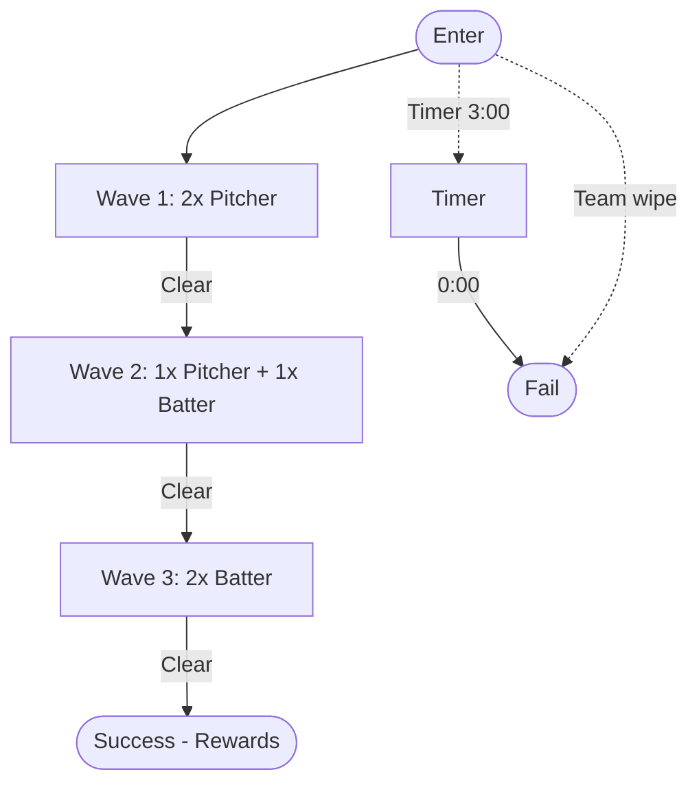
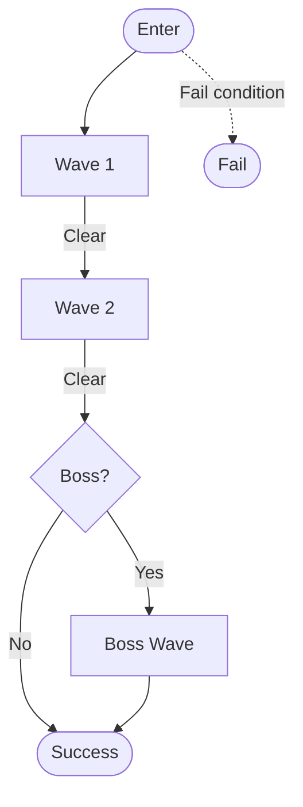

# Field Of Horrors — Documentation Bundle

---
## README.md

# Field Of Horrors — Docs Index

_Auto-generated by tools/gen_docs_index.sh — do not edit by hand._

## Bundle

- [All Docs](docs/_bundle/ALL_DOCS.md)

## Design

- [Readme](docs/design/_catalog/README.md)
- [Readme](docs/design/arena_cards/README.md)
- [Stadium T1 Rookie Warmup](docs/design/arena_cards/stadium_t1_rookie_warmup.md)
- [Stadium T1 Rookie Warmup](docs/design/arena_cards/stadium_t1_rookie_warmup.mmd)
- [Template](docs/design/arena_cards/template.md)
- [Readme](docs/design/classes/README.md)
- [Batter](docs/design/classes/_archive_v1/batter.md)
- [Center](docs/design/classes/_archive_v1/center.md)
- [Linebacker](docs/design/classes/_archive_v1/linebacker.md)
- [Pitcher](docs/design/classes/_archive_v1/pitcher.md)
- [Point Guard](docs/design/classes/_archive_v1/point_guard.md)
- [Qb](docs/design/classes/_archive_v1/qb.md)
- [Batter](docs/design/classes/batter.md)
- [Center](docs/design/classes/center.md)
- [Batter](docs/design/classes/detail/batter.md)
- [Center](docs/design/classes/detail/center.md)
- [Linebacker](docs/design/classes/detail/linebacker.md)
- [Pitcher](docs/design/classes/detail/pitcher.md)
- [Point Guard](docs/design/classes/detail/point_guard.md)
- [Quarterback](docs/design/classes/detail/quarterback.md)
- [Linebacker](docs/design/classes/linebacker.md)
- [Overview](docs/design/classes/overview.mmd)
- [Pitcher](docs/design/classes/pitcher.md)
- [Point Guard](docs/design/classes/point_guard.md)
- [Qb](docs/design/classes/qb.md)
- [Open Threads](docs/design/open_threads.md)
- [Overview](docs/design/overview.mmd)
- [Qb Summons](docs/design/skills/qb_summons.md)
- [Combat Overview](docs/design/systems/combat_overview.md)
- [Readme](docs/design/telegraphs/README.md)
- [Batter](docs/design/telegraphs/batter.md)
- [Linebacker](docs/design/telegraphs/linebacker.md)
- [Pitcher](docs/design/telegraphs/pitcher.md)
- [Qb](docs/design/telegraphs/qb.md)
- [Foam Finger Pike](docs/design/weapons/foam_finger_pike.md)
- [Foam Finger Pike](docs/design/weapons/foam_finger_pike.mmd)
- [Shoulder Ram](docs/design/weapons/shoulder_ram.md)
- [Spiral Disc](docs/design/weapons/spiral_disc.md)
- [Whistle Bomb](docs/design/weapons/whistle_bomb.md)
- [Whistle Bomb](docs/design/weapons/whistle_bomb.mmd)

## Diagrams

## Narrative

- [Lore Bible](docs/narrative/lore_bible.md)
- [Vo Calls](docs/narrative/vo_calls.md)

## Telemetry

- [Events](docs/telemetry/events.md)

## Ux

- [Briefing Wire](docs/ux/briefing_wire.md)

## Root

- [Weekly Report Template](docs/weekly_report_template.md)

---
## design/_catalog/README.md

# FOH Design Catalog

This folder auto-lists and bundles all `.md`/`.mmd` into a single `ALL_DOCS.md`.
Upload just that one file to ChatGPT to bypass per-file limits.

---
## design/arena_cards/README.md

# Arena Cards Index

- T1: Rookie Warmup (baseline loadouts and movement lanes)

---
## design/arena_cards/stadium_t1_rookie_warmup.md

# Arena Challenge – Stadium T1: Rookie Warm-Up

**Metadata**

- Name: Stadium T1 – Rookie Warm-Up
- Tier: 1
- Biome: stadium
- Recommended Power: 1
- Rewards: 100 ⚾ Scrip, 1x Common Mod

**Objective**

- Primary: Clear all waves within **3:00**.
- Secondary (optional): Take **≤1** hit(s).
- Fail: Timer expires or team wipe.

**Modifiers**

- Global: Crowd Noise (minor telegraph audio dampening).
- Enemy: None (training match).
- Player: +10% stamina regen between waves.

**Wave Plan (summary)**

- Wave 1 (0:00): 2x Pitcher (fastball/curveball basics)
- Wave 2 (0:45): 1x Pitcher, 1x Batter (introduces melee spacing)
- Wave 3 (1:30): 2x Batter (power swing spacing test)

**Enemy Telegraph References**

- Pitcher: [../telegraphs/pitcher.md](../telegraphs/pitcher.md)
- Batter:  [../telegraphs/batter.md](../telegraphs/batter.md)

---

## Flow (Mermaid preview)

## Player Loadouts (Baseline Weapons)

- Pitcher: [Whistle Bomb](../weapons/whistle_bomb.md)
- Batter:  [Foam-Finger Pike](../weapons/foam_finger_pike.md)
- Linebacker: [Shoulder Ram](../weapons/shoulder_ram.md)
- Quarterback: [Spiral Disc](../weapons/spiral_disc.md)

---
## design/arena_cards/stadium_t1_rookie_warmup.mmd

%% Stadium T1 – Rookie Warm-Up (Flow)
flowchart TD
  Start([Enter Arena]) --> W1[Wave 1: 2× Pitcher]
  W1 -->|Clear| W2[Wave 2: 1× Pitcher + 1× Batter]
  W2 -->|Clear| W3[Wave 3: 2× Batter]
  W3 -->|Clear| Success([Success • Rewards])

  Start -. "Timer 3:00" .-> T[Timer]
  T -->|0:00| Fail([Fail])
  Start -. "Team wipe" .-> Fail

---
## design/arena_cards/template.md

# Arena Challenge – Template

**Metadata**

- Name: <challenge name>
- Tier: 1–5
- Biome: stadium | ice | court | street
- Recommended Power: <value>
- Rewards: <currency/items/perks>

**Objective**

- Primary: …
- Secondary (optional): …
- Fail: <timeout | wipe | objective break>

**Modifiers**

- Global: …
- Enemy: …
- Player: …

**Wave Plan (summary)**

- Wave 1: <composition, cadence>
- Wave 2: …
- Boss/Miniboss (if any): …

---

## Mermaid – Flow (authoring example)

---
## design/classes/README.md

# Class System

Six launch classes, two per sport:

- **Baseball:** [Pitcher](pitcher.md), [Batter](batter.md)
- **Football:** [Linebacker](linebacker.md), [Quarterback (QB)](qb.md)
- **Basketball:** [Point Guard](point_guard.md), [Center](center.md)

Each class page holds stats, weapons, skills, and the capstone. Passive nodes are in `detail/`.
There are no ultimates: capstones are the big mid-run moment (about 6–7 minutes in).

Data: `FieldOfHorrors/data/classes/classes.json` (validated stats) and `FieldOfHorrors/game/classes.yaml` (stats plus kit).
`_archive_v1/` keeps the earlier v1 drafts. This index is consumed by `tools/make_chat_bundle.py`.

---
## design/classes/_archive_v1/batter.md

# <CLASS_TITLE>
## Fantasy/Theme
## Base Stats
- HP: 100
- ARM: <per class>
- SPD: 6.0
- STA: 100
- CRIT: 10% (1.5x)
## Default Weapons
## Skills
## Passive
## Playstyle
## Tuning Targets
## Synergies
## Counters
## Unlocks/Progression
## Concept Art Prompts

---
## design/classes/_archive_v1/center.md

# <CLASS_TITLE>
## Fantasy/Theme
## Base Stats
- HP: 100
- ARM: <per class>
- SPD: 6.0
- STA: 100
- CRIT: 10% (1.5x)
## Default Weapons
## Skills
## Passive
## Playstyle
## Tuning Targets
## Synergies
## Counters
## Unlocks/Progression
## Concept Art Prompts

---
## design/classes/_archive_v1/linebacker.md

# <CLASS_TITLE>
## Fantasy/Theme
## Base Stats
- HP: 100
- ARM: <per class>
- SPD: 6.0
- STA: 100
- CRIT: 10% (1.5x)
## Default Weapons
## Skills
## Passive
## Playstyle
## Tuning Targets
## Synergies
## Counters
## Unlocks/Progression
## Concept Art Prompts

---
## design/classes/_archive_v1/pitcher.md

# Pitcher
## Fantasy/Theme
Grenadier/control using curved and impact throws.
## Base Stats
- HP: 100
- ARM: 10%
- SPD: 6.0
- STA: 100
- CRIT: 10% (1.5x)
## Default Weapons
- Whistle Bomb (arc throw; 3s fuse; cookable)
## Skills
- Curveball (guided arc), Fastball (impact), Resin Fuse (fuse -1s, risky), Smoke Screen (soft CC)
## Passive
Perfect Release (+20% blast radius on perfect timing)
## Playstyle
Zone denial, chokepoints, soft CC.
## Tuning Targets
Keep common mob TTK ~1.2–1.6s at Tier 1 via blast tuning.
## Synergies
QB marks, Linebacker stuns, PG mobility pads for vertical angles.
## Counters
Armor-stacked elites; bring Resin Fuse or team marks.
## Unlocks/Progression
Fuse mods, larger satchel, arc-assist HUD tiers.
## Concept Art Prompts
athletic sci-fi grenadier, visor HUD arc, bomb satchel, arena lighting.

---
## design/classes/_archive_v1/point_guard.md

# <CLASS_TITLE>
## Fantasy/Theme
## Base Stats
- HP: 100
- ARM: <per class>
- SPD: 6.0
- STA: 100
- CRIT: 10% (1.5x)
## Default Weapons
## Skills
## Passive
## Playstyle
## Tuning Targets
## Synergies
## Counters
## Unlocks/Progression
## Concept Art Prompts

---
## design/classes/_archive_v1/qb.md

# QB — Summoner / Field General
SPD 6.0 | ARM 1 | Role: Field control via summons.
Primary: Playbook Launcher
Secondary: Sidearm
Skill: Audible — retarget summoned units
Utility: Pep Talk — AoE team buff
Ultimate: Hail Mary — elite Receiver dash
Summons: Receiver (burst), Lineman (taunt), Kicker (knockback)

---
## design/classes/batter.md

# Batter

**Sport:** Baseball • **Role:** Melee crit / knockback bruiser
**Movement:** SPD 5.8 • **HP:** 125 • **Grit Cap:** 35 • **Armor:** Medium

## Default Weapons

- **Primary: Wooden Bat** – 22 dmg, 1.6/s, ~35 DPS, wide arc, small knockback. Upgrades into the Batblade line (`design/weapon_balance.md`, `design/weapon_trees/batblade_tree.mmd`).
- **Secondary: Foam Finger Pike** – see [weapons/foam_finger_pike.md](../weapons/foam_finger_pike.md) (stats still TBD there).

## Signature

- **Power Swing** – full-windup arc that deals high damage and stagger, breaks guard, and knocks down armored or marked targets. A charged variant widens the arc.

## Skills (Early → Mid)

1. **Home Run Timing I → II** – a perfectly timed hit gains +50% crit, then also creates a shockwave.
2. **Line Drive I → II** – 3-hit combo whose last hit adds knockback, then finishers cleave nearby foes.
3. **Pit Grip I → II** – -10% stamina cost on swings, then -20% stamina cost and +5% attack speed.

## Capstone (≈6–7 min)

- **Blood Diamond Bat** – finishers auto-crit and apply Bleed on crit.

## Perks (passive nodes)

Full list in [detail/batter.md](detail/batter.md). Two branches:

- **Combo Engine:** Three Count (+20% combo build rate), Finish Him (+25% finisher damage), keystone On the Sweet Spot (+50% timed crit bonus).
- **Bleed:** Razor Tape (+12% bleed chance), Open Wound (+20% bleed DPS), keystone Home Crowd (+20% knockback).

## Debuff Crystals

- **Heavy Bat** – -8% move speed, +12% bat damage.
- **Glass Hands** – -10% block/parry, +15% crit damage.

## Tips

- Melee carries a risk premium: Batter DPS should sit above ranged classes at the same tier.
- Build the combo on trash, then spend the finisher on elites.
- Timing reference: [telegraphs/batter.md](../telegraphs/batter.md) (Bunt Jab, Power Swing, Pop-Fly Uppercut).

## Open Questions

- The skill tree lists **Slugger's Rage** (10s enrage on killstreak) as a second capstone.
- The v0.1 loadout in `game/classes.yaml` gave Batter an SMG, Bunt (parry), Pine Tar, and a Grand Slam ultimate. None of that is in the GDD.

---
## design/classes/center.md

# Center

**Sport:** Basketball • **Role:** Zone control / AOE slams
**Movement:** SPD 5.9 • **HP:** 120 • **Grit Cap:** 30 • **Armor:** Medium

## Default Weapons

- **Primary: Dunk attacks** – slams and the Hook Shot short cone (stats TBD; no baseline in `design/weapon_balance.md` yet).
- **Secondary: Grapples** – grab-and-throw moves in place of a second weapon.

## Signature

- **Box Out** – knockback aura around the player (4.0s aura, 10s cooldown, about 120 units/s knockback tick).

## Skills (Early → Mid)

1. **Box Out I → II** – small knockback aura, then a larger radius with stronger knockback.
2. **Hook Shot I → Alley-Oop Grab** – short cone hit with minor stagger (4.5s cooldown), then pull enemies in and slam them (12s cooldown).
3. **Rebounder I → Paint Dominance** – chance to auto-pull nearby pickups, then damage reduction while stationary (8s, 18s cooldown).

## Capstone (≈6–7 min)

- **Slam of the Damned** – massive dunk AOE with a gore shockwave; elite-shatter tuned around a ~20% threshold (0.8s telegraph, 28s cooldown).

## Perks (passive nodes)

Full list in [detail/center.md](detail/center.md). Two branches:

- **Paint Control:** Paint Dominance (+12% DR while stationary), Hard Screen (+12% reflect chance), keystone Box Out (knockback aura +20% strength).
- **Slam:** Alley-Oop (pull on slam), Who's In The Paint? (+18% AOE damage), keystone Rebounder (+25% pickup magnet radius).

## Debuff Crystals

- **Heavy Shoes** – -8% move speed, +AOE damage.
- **Glass Knees** – -dodge i-frames, +block strength.

## Tips

- Pick a spot and own it: most of the kit rewards standing still.
- Keep slam wind-ups at 0.7s or longer so they stay readable.
- Timing reference: `design/classes/telegraphs/center.md`.

## Open Questions

- This class was briefly named **Power Forward**. Stats (SPD 5.9, HP 120, Grit 30, Medium armor) carry over from that page; the kit comes from the GDD's Center.
- The skill tree lists **Hard Screen** (reflect while standing still) as a second capstone.
- The v0.1 loadout in `game/classes.yaml` used a Board Crusher, DMR, Second Chance, and Putback. None of that is in the GDD.

---
## design/classes/detail/batter.md

# Batter – Detail (PoE2-lean)

**Role:** Melee crit/knockback; risk premium DPS > ranged.  
**Signature:** Bats/Batblades; bleed scaling.  
Refs: melee > ranged baseline DPS; TTK targets.  

## Branches

- **Combo Engine:** faster combo build, finisher spike.  
- **Bleed:** chance, DPS, duration scaling.

## Early Nodes

- *Three Count:* +20% Combo Build Rate  
- *Razor Tape:* +12% Bleed Chance

## Mid Nodes

- *Finish Him:* +25% Finisher Damage  
- *Open Wound:* +20% Bleed DPS

## Keystones

- *On the Sweet Spot:* +50% Timed Crit Bonus  
- *Home Crowd:* +20% Knockback

## Capstone (≈6–7 min)

**Blood Diamond Bat:** Finishers auto-crit; Bleed on Crit.  

---
## design/classes/detail/center.md

# Center – Detail (PoE2-lean)

**Role:** Zone control/AOE slams; knockback aura; grapples.  
**Telegraphs:** Keep slam ≥0.7s; use shadow decals & rings.  

## Branches

- **Paint Control:** DR while stationary; reflect chance.  
- **Slam:** pull-in + AOE scaling.

## Early Nodes

- *Paint Dominance:* +12% DR while stationary  
- *Alley-Oop:* Pull on Slam

## Mid Nodes

- *Hard Screen:* +12% Reflect Chance  
- *Who's In The Paint?:* +18% AOE Damage

## Keystones

- *Box Out:* Knockback Aura +20% strength  
- *Rebounder:* +25% Pickup Magnet Radius

## Capstone (≈6–7 min)

**Slam of the Damned:** Massive AOE; elite-shatter tuning ~20% threshold.

---
## design/classes/detail/linebacker.md

# Linebacker – Detail (PoE2-lean)

**Role:** Tank/disruptor; bash/DR; hazard soak.  
Refs: boss counters (interrupt Replay Review; soak shockwaves); telegraph floors.  

## Branches

- **Control:** stun duration, bash damage.  
- **Hazard Soak:** -knockback taken, -hazard damage taken.

## Early Nodes

- *Stun Lock:* +12% Stun Duration  
- *Grounded:* -20% Knockback Taken

## Mid Nodes

- *Shoulder Check:* +18% Bash Damage  
- *Shock Absorbers:* -15% Hazard Damage Taken

## Keystones

- *Iron Wall:* +12% DR  
- *Taunting Roar:* +20% Taunt Radius

## Capstone (≈6–7 min)

**Blitzkrieg:** Unstoppable Dash + AOE impact tuned to elite-health breakpoints.  

---
## design/classes/detail/pitcher.md

# Pitcher – Detail (PoE2-lean)

**Role:** Ranged precision/control.  
**Signature:** Fastball (pierce, crit line), Curveball (slow/confuse).  
**Balance anchors:** Fastball/Curveball DPS baselines; mid-run TTK 0.8–1.2s; elites 3–5× HP; bosses 30–50×.  
Refs: weapons table, combat stats.  

## Branches

- **Long Range:** projectile speed, crit windows, headshot multipliers.  
- **Control:** slow/ confuse uptime, safe-pocket creation during spikes.

## Early Nodes

- *Grip Strength:* +12% Projectile Speed  
- *Spot Hitter:* +20% Headshot Damage

## Mid Nodes

- *Changeup:* +12% Enemy Slow on Curveball  
- *Paint the Corners:* +6% Confuse Chance

## Keystones

- *Ace Pitch:* +1 Fastball Pierce, +4% Crit Chance  
- *Curve Control:* +20% Curveball Slow, +10% Confuse Chance

## Capstone (≈6–7 min)

**Grand Slam Pitch:** Cast 5 flaming fastballs; fire DoT tuned vs mid-run elite HP.  
Refs: weapon baselines + TTK bands.  

---
## design/classes/detail/point_guard.md

# Point Guard – Detail (PoE2-lean)

**Role:** Mobility/support; dashes, team haste, global slow.  
**Telegraphs:** See dedicated timing table for readability.  

## Branches

- **Speed Game:** move speed, dash cooldown.  
- **Court Control:** stun on dash, team haste auras.

## Early Nodes

- *Ankles:* +10% Move Speed  
- *Pick-and-Roll:* +300ms Stun on Dash

## Mid Nodes

- *Breakaway:* -12% Dash Cooldown  
- *Floor General:* +6% Team Haste

## Keystones

- *No-Look Pass:* +10% Ally Attack Speed  
- *Cross-Over:* +1 Dash Charge

## Capstone (≈6–7 min)

**Full Court Press:** Global -20% Enemy Speed, +10% Team Haste, 10s duration.  

---
## design/classes/detail/quarterback.md

# Quarterback – Detail (PoE2-lean)

**Role:** Summoner/commander; receivers/linemen; pass-based AOE.  
**Co-op note:** Summon Power scales with player count; avoid solo overpower.  

## Branches

- **Summons:** HP/Damage; body-block lines.  
- **Passing Game:** AOE radius; on-pass explosion.

## Early Nodes

- *Anchor Block:* +20% Summon HP  
- *Precision Pass:* +15% Pass AOE Radius

## Mid Nodes

- *Route Tree:* +15% Summon Damage  
- *Handoff:* On-pass explosion (small AOE)

## Keystones

- *Offensive Line:* +2 Linemen  
- *Two-Minute Playbook:* +8% Team Haste

## Capstone (≈6–7 min)

**Hail Mary:** +5 Receivers, +2 Linemen, 12s duration push.  

---
## design/classes/linebacker.md

# Linebacker

**Sport:** Football • **Role:** Tank / disruptor
**Movement:** SPD 5.7 • **HP:** 140 • **Grit Cap:** 45 • **Armor:** Heavy

## Default Weapons

- **Primary: Shoulder Ram** – see [weapons/shoulder_ram.md](../weapons/shoulder_ram.md) (stats still TBD there).
- **Secondary: Shield** – block and bash; enables Guard Breaker follow-ups.

## Signature

- **Shoulder Charge** – short dash that knocks enemies back.

## Skills (Early → Mid)

1. **Shoulder Charge I → II** – short knockback dash, then the dash leaves a shockwave trail.
2. **Shield Up I → Shield Bash** – flat damage reduction, then a cone stun on bash.
3. **Huddle I → Taunting Call** – minor DR aura for allies and summons, then a brief taunt pulse on hit.

## Capstone (≈6–7 min)

- **Blitzkrieg** – unstoppable long dash through a horde with an AOE impact tuned to elite-health breakpoints.

## Perks (passive nodes)

Full list in [detail/linebacker.md](detail/linebacker.md). Two branches:

- **Control:** Stun Lock (+12% stun duration), Shoulder Check (+18% bash damage), keystone Iron Wall (+12% DR).
- **Hazard Soak:** Grounded (-20% knockback taken), Shock Absorbers (-15% hazard damage taken), keystone Taunting Roar (+20% taunt radius).

## Debuff Crystals

- **Heavy Pads** – -8% move speed, +armor.
- **Glass Visor** – -vision radius, +crit resist.

## Tips

- Stand in hazards so the rest of the team does not have to.
- Against the Referee King, interrupt Replay Review and soak shockwaves.
- Timing reference: [telegraphs/linebacker.md](../telegraphs/linebacker.md) (Bull Rush, Tackle, Guard Breaker).

## Open Questions

- The skill tree lists **Goal-Line Stand** (temporary fortify, massive DR) as a second capstone. An earlier page used Goal Line Stand as the signature instead (team Grit regen aura, -10% damage taken).
- The v0.1 loadout in `game/classes.yaml` gave Linebacker a Shotgun, Blitz, and a Pile-Up ultimate. None of that is in the GDD.

---
## design/classes/overview.mmd

# FOH Classes System v1 (Overview)
- TTK target: 0.8–1.2s on trash mid-run; 1.5–2.0s at higher difficulty
- SPD baseline: 6.0 (±0.5 by class)
- Classes: Pitcher, Batter, Linebacker, Quarterback (Summoner), Point Guard, Center
- No ultimates; capstones at ~6–7 minutes
- See per-class files for stats, skills, and tuning notes.

---
## design/classes/pitcher.md

# Pitcher

**Sport:** Baseball • **Role:** Ranged precision / control
**Movement:** SPD 6.1 • **HP:** 100 • **Grit Cap:** 25 • **Armor:** Light

## Default Weapons

- **Primary: Baseballs** – Fastball (18 dmg, 3.0/s, ~54 DPS, pierce 1, long-range crit) and Curveball (14 dmg, 2.6/s, ~36 DPS, slow/confuse chance). Baselines from `design/weapon_balance.md`.
- **Secondary: Whistle Bomb** – arc throw, 3s fuse, cookable. See [weapons/whistle_bomb.md](../weapons/whistle_bomb.md) (stats still TBD there).

## Signature

- **Curveball** – arcing projectile that slows and can confuse on hit.

## Skills (Early → Mid)

1. **Fastball I → II** – +projectile speed and +1 pierce, then +crit chance at long range.
2. **Curveball I → II** – arcing path with low confuse chance, then a wider arc with slow on near miss.
3. **Rosin Bag I → Change-Up** – -10% stamina on throws, then random speed variance with a bonus damage window.

## Capstone (≈6–7 min)

- **Grand Slam Pitch** – casts 5 flaming fastballs in a spread; fire DoT tuned against mid-run elite HP.

## Perks (passive nodes)

Full list in [detail/pitcher.md](detail/pitcher.md). Two branches:

- **Long Range:** Grip Strength (+12% projectile speed), Spot Hitter (+20% headshot damage), keystone Ace Pitch (+1 Fastball pierce, +4% crit chance).
- **Control:** Changeup (+12% enemy slow on Curveball), Paint the Corners (+6% confuse chance), keystone Curve Control (+20% Curveball slow, +10% confuse chance).

## Debuff Crystals

- **Sore Shoulder** – -10% attack speed, +15% damage.
- **Wild Pitch** – +spread, +AOE on impact.

## Tips

- Plays as zone denial: hold chokepoints and keep enemies slowed before they reach you.
- Weak against armor-stacked elites; lean on pierce and team marks.
- Pairs well with Linebacker stuns and Quarterback summons that hold a line.
- Timing reference: [telegraphs/pitcher.md](../telegraphs/pitcher.md).

## Open Questions

- The skill tree (`design/skilltrees/pitcher_skilltree.mmd`) lists **Perfect Game** and **Knuckleball Mayhem** as capstones instead of Grand Slam Pitch. Grand Slam Pitch is used here because the GDD and the detail page agree on it.
- An earlier page had Curveball applying **Marked** (+15% team damage, 4s) instead of slow/confuse.
- The v1 draft also listed Resin Fuse, Smoke Screen, and a Perfect Release passive (+20% blast radius). See [_archive_v1/pitcher.md](_archive_v1/pitcher.md).

---
## design/classes/point_guard.md

# Point Guard

**Sport:** Basketball • **Role:** Mobility / support
**Movement:** SPD 6.2 • **HP:** 95 • **Grit Cap:** 20 • **Armor:** Light

## Default Weapons

- **Primary: Energy Pass** – ranged pass attack (stats TBD; no baseline in `design/weapon_balance.md` yet).
- **Secondary: Dashes** – mobility in place of a second weapon.

## Signature

- **Cross-Over Dash** – extra dash with short i-frames (0.15s i-frames, 3.5s cooldown at rank I).

## Skills (Early → Mid)

1. **Cross-Over Dash I → II** – +1 dash with short i-frames, then the dash leaves a 2.0s slow field.
2. **No-Look Pass I → II** – +10% attack speed buff on an ally or summon (6s cooldown), then adds a small heal on the pass target.
3. **Floor General I → Pick-and-Roll** – +5% team move speed aura, then a dash-through that causes a brief stun (0.5s stun, 10s cooldown).

## Capstone (≈6–7 min)

- **Full Court Press** – global -20% enemy speed and +10% team haste for 10s (30s cooldown).

## Perks (passive nodes)

Full list in [detail/point_guard.md](detail/point_guard.md). Two branches:

- **Speed Game:** Ankles (+10% move speed), Breakaway (-12% dash cooldown), keystone Cross-Over (+1 dash charge).
- **Court Control:** Pick-and-Roll (+300ms stun on dash), Floor General (+6% team haste), keystone No-Look Pass (+10% ally attack speed).

## Debuff Crystals

- **Light Frame** – -10% max HP, +10% move speed.
- **Fatigue** – -stamina regen, +crit chance.

## Tips

- Lowest HP in the roster: survive by dashing, not by trading hits.
- Most of the kit buffs allies and summons, so the class is strongest in co-op.
- Timing reference: `design/classes/telegraphs/point_guard.md`.

## Open Questions

- `design/skilltrees/point_guard_skilltree.mmd` is cut off before its capstone section, and the timing doc is cut off after "Readability".
- The timing doc lists **Fast Break** (haste on elite kill, 6s) with no matching tree node; it may be the second capstone.
- An earlier page described Pick & Roll as an ally tether (+move/reload/throw speed) instead of a dash-through stun.
- The v0.1 loadout in `game/classes.yaml` used an Assist Pistol and Carbine. Neither is in the GDD.

---
## design/classes/qb.md

# Quarterback (QB)

**Sport:** Football • **Role:** Summoner / field general
**Movement:** SPD 6.0 • **HP:** 100 • **Grit Cap:** 20 • **Armor:** Light

## Default Weapons

- **Primary: Precision Pass** – thrown ball, 16 dmg, 2.2/s, ~35 DPS, small AOE on final pierce (`design/weapon_balance.md`). Move timings in [weapons/spiral_disc.md](../weapons/spiral_disc.md).
- **Secondary: Command calls** – summons and tactical calls in place of a second weapon.

## Signature

- **Summons** – AI-controlled Linemen (shield, slow push, taunt) and Receivers (ranged support). See [skills/qb_summons.md](../skills/qb_summons.md).

## Skills (Early → Mid)

1. **Offensive Line I → II** – summon 1 Lineman, then +1 Lineman with a taunt pulse on spawn.
2. **Precision Pass I → II** – thrown ball pierces 1 target, then explodes on the last pierce (small AOE).
3. **Playbook I → Audible Call** – +10% summon HP and +5% player move speed, then swap Linemen to Receivers mid-fight (15s cooldown).

## Capstone (≈6–7 min)

- **Hail Mary** – timed push: +5 Receivers and +2 Linemen for 12s.

## Perks (passive nodes)

Full list in [detail/quarterback.md](detail/quarterback.md). Two branches:

- **Summons:** Anchor Block (+20% summon HP), Route Tree (+15% summon damage), keystone Offensive Line (+2 Linemen).
- **Passing Game:** Precision Pass (+15% pass AOE radius), Handoff (on-pass explosion), keystone Two-Minute Playbook (+8% team haste).

## Debuff Crystals

- **Selfish Captain** – -15% player damage, +20% summon damage.
- **Fatigue** – -10% stamina regen, +10% crit chance (summons and throws).

## Tips

- Use Linemen to body-block a lane, then throw over them.
- Summon Power scales with player count, so the class is not overpowered solo.
- Timing reference: [telegraphs/qb.md](../telegraphs/qb.md) (Spiral Pass, Hail Mary, Pump Fake).

## Open Questions

- Summon roster differs between docs: Linemen and Receivers (GDD, skill tree), Receiver/Fullback/Kicker (`skills/qb_summons.md`), Receiver/Lineman/Kicker (v1 draft). Linemen and Receivers are treated as the MVP set here.
- Hail Mary size differs: +3 Receivers in the skill tree, +5 in the GDD and detail page. +5 is used here.
- The skill tree lists **Two-Minute Drill** (+30% team attack/move speed burst) as a second capstone.
- The v0.1 loadout in `game/classes.yaml` used a Playbook Launcher, Sidearm, and Pep Talk. See [_archive_v1/qb.md](_archive_v1/qb.md).

---
## design/open_threads.md

# Open Threads

- Telegraph tables
- Arena Challenge templates
- Expanded weapon trees
- Wave presets
- Co-op synergy

---
## design/overview.mmd

%% Field of Horrors – Design Overview (auto-generated)
flowchart TD
A["docs/design"]
DG["telegraphs"]
AC["arena_cards"]
W["weapons"]
CA["chat_archive.md TODO"]
OT["open_threads.md ✅"]
DGM["diagrams (CI artifacts)"]
A --> DG
A --> AC
A --> W
A --> CA
A --> OT
A -. rendered by CI .-> DGM
subgraph CLASSES["Classes"]
  C_P["Pitcher"]
  C_B["Batter"]
  C_L["Linebacker"]
  C_Q["Quarterback"]
end
subgraph TSG["telegraphs"]
  T_pitcher_md["pitcher.md ✅"]
  T_batter_md["batter.md ✅"]
  T_linebacker_md["linebacker.md ✅"]
  T_qb_md["qb.md ✅"]
  T_README_md["README.md ✅"]
end
subgraph ACG["arena_cards"]
  A_template_md["template.md ✅"]
  A_stadium_t1_rookie_warmup_md["stadium_t1_rookie_warmup.md ✅"]
  A_stadium_t1_rookie_warmup_mmd["stadium_t1_rookie_warmup.mmd ✅"]
end
subgraph WG["weapons"]
  W_whistle_bomb_mmd["whistle_bomb.mmd ✅"]
  W_foam_finger_pike_mmd["foam_finger_pike.mmd ✅"]
  W_shoulder_ram_mmd["shoulder_ram.mmd TODO"]
  W_spiral_disc_mmd["spiral_disc.mmd TODO"]
  WS_whistle_bomb_md["whistle_bomb.md ✅"]
  WS_foam_finger_pike_md["foam_finger_pike.md ✅"]
  WS_shoulder_ram_md["shoulder_ram.md ✅"]
  WS_spiral_disc_md["spiral_disc.md ✅"]
end
C_P --> W_whistle_bomb_mmd
C_B --> W_foam_finger_pike_mmd
C_L --> W_shoulder_ram_mmd
C_Q --> W_spiral_disc_mmd
W_whistle_bomb_mmd --> A_stadium_t1_rookie_warmup_md
W_foam_finger_pike_mmd --> A_stadium_t1_rookie_warmup_md
W_shoulder_ram_mmd --> A_stadium_t1_rookie_warmup_md
W_spiral_disc_mmd --> A_stadium_t1_rookie_warmup_md
ST1SVG["stadium_t1_rookie_warmup.svg"]
WBSVG["whistle_bomb.svg"]
FPSVG["foam_finger_pike.svg"]
DGM --> ST1SVG
DGM --> WBSVG
DGM --> FPSVG

---
## design/skills/qb_summons.md

# QB Summons

- Receiver: Ranged support
- Fullback: Taunt melee
- Kicker: Slow mines (area denial)

---
## design/systems/combat_overview.md

# Combat Overview

- TTK target: quick on-ramp → avg 1.5–2.0s at higher difficulty
- Resources: Stamina (move), Focus (skills), Grit (temp soak)
- Armor: Light/Medium/Heavy; Damage: Kinetic/Explosive/Utility
- Status: Stagger/Daze/Knockdown/Bleed/Slow/Marked
- Headshot 1.75x, weak-point 1.5x (ranged); thrown 1.25x
- Movement baseline SPD 6.0; role deltas ±0.5

---
## design/telegraphs/README.md

# Telegraph Tables – Schema

**Columns (required):**

| move | startup | active | recovery | cooldown | range | tells | damage | stagger | counterplay | variations | notes |
|------|---------|--------|----------|----------|-------|-------|--------|---------|-------------|------------|-------|

**Timing units:** frames (f) or seconds (s). Pick one per table and stick to it.  
**Ranges:** tiles or meters; be consistent within a table.  
**Tells:** animations, SFX, VFX, windups.  
**Counterplay:** dodge windows, parry timings, interrupts, terrain use.  
**Variations:** elite/boss modifiers, status, elemental, “on enraged,” etc.

---
## design/telegraphs/batter.md

# BATTER – Telegraphs (frames)

| move | startup | active | recovery | cooldown | range | tells | damage | stagger | counterplay | variations | notes |
|------|---------|--------|----------|----------|-------|-------|--------|---------|-------------|------------|-------|
| Bunt Jab | 12f | 2f | 16f | 20f | 1 tile | Bat lift to chest | Low | Low | Micro-sidestep; free punish 14–20f | Double jab chain | Used to check space |
| Power Swing | 30f | 6f | 28f | 36f | 2 tiles arc | Full windup; grunt | High | High | Roll through hips at 28–32f | Charged variant (wider arc) | Breaks guard |
| Pop-Fly Uppercut | 22f | 4f | 24f | 28f | 1 tile vertical | Knees bend; elbow flare | Med | Med | Jump cancel; parry early | Launcher (juggles) | Anti-air punish tool |

---
## design/telegraphs/linebacker.md

# LINEBACKER – Telegraphs (frames)

| move | startup | active | recovery | cooldown | range | tells | damage | stagger | counterplay | variations | notes |
|------|---------|--------|----------|----------|-------|-------|--------|---------|-------------|------------|-------|
| Bull Rush | 20f | 14f | 26f | 34f | 6 tiles line | Snort; shoulder dip | Med | High | Side-dodge on windup; trip hazard counters | Frenzy (longer active) | Collides with walls |
| Tackle | 24f | 8f | 22f | 30f | 2 tiles | Hip rotate; stomp | High | High | Jump back; bait into trap | Stun on hit | Armor during startup |
| Guard Breaker | 18f | 3f | 18f | 26f | 1 tile | Hand open, then fist | Low | High | Parry 2f pre-active; counterthrow | Shield-only bonus | Opens ripostes |

---
## design/telegraphs/pitcher.md

# PITCHER – Telegraphs (frames)

| move | startup | active | recovery | cooldown | range | tells | damage | stagger | counterplay | variations | notes |
|------|---------|--------|----------|----------|-------|-------|--------|---------|-------------|------------|-------|
| Fastball | 18f | 4f | 22f | 30f | 10 tiles line | Shoulder cocks back; glove tap | Med | Low | Sidestep at 18–22f; shield blocks | Curveball (homes lightly) | Rolls if hits wall |
| Curveball | 22f | 6f | 24f | 32f | 8 tiles arc | Wrist twist; ball glow pulse | Med | Med | Move inward on apex; jump over inner arc | Slippery turf: +2 tiles | Punishes greedy melee |
| Change-up | 26f | 4f | 18f | 28f | 10 tiles line (slow) | Long exhale; slower arm | Low | Low | Walk dodge; counterthrow window 24–30f | Fake windup (rare) | Baits early dodge |

---
## design/telegraphs/qb.md

# QB – Telegraphs (frames)

| move | startup | active | recovery | cooldown | range | tells | damage | stagger | counterplay | variations | notes |
|------|---------|--------|----------|----------|-------|-------|--------|---------|-------------|------------|-------|
| Spiral Pass | 16f | 3f | 18f | 26f | 12 tiles line | Finger lace spin; wrist snap | Med | Low | Step off-line 14–18f | Homing (light) | Can tag allies |
| Hail Mary | 36f | 8f | 30f | 40f | 16 tiles arc | Deep lean back | High | Med | Close distance during windup; interrupt | Multi-ball spread | Arena hazard synergy |
| Pump Fake | 10f | 0f | 8f | 12f | — | Quick shoulder twitch | — | — | Hold dodge; punish recovery | Into Spiral Pass | Baits parry windows |

---
## design/weapons/foam_finger_pike.md

# foam finger pike

**Status:** draft  
**Owner:** design  
**Last-updated:** 2025-09-14

## Role

(one line)

## Stats (v0.2 target)

- Damage:
- Range:
- Stagger:
- TtK vs trash:

## Counterplay

(what beats this, how to read the tell)

## Unlock Path

(when/how)

---
## design/weapons/foam_finger_pike.mmd

%% Foam-Finger Pike – Upgrade Tree
flowchart TD
  FP0["Foam-Finger Pike (Base)"] --> FP1A["Tier1: Lunge Booster (+range)"]
  FP0 --> FP1B["Tier1: Guard Point (startup armor)"]

  FP1A --> FP2A["Tier2: Spear Wall (multi-hit line)"]
  FP1A --> FP2B["Tier2: Pivot Stab (instant turn)"]

  FP1B --> FP2C["Tier2: Riposte Window (parry → bonus)"]
  FP1B --> FP2D["Tier2: Brace (reduced knockback)"]

  %% Tier 3 caps
  FP2A --> FP3A["Tier3: Phalanx (ally aura)"]
  FP2B --> FP3B["Tier3: Whirl (short arc sweep)"]
  FP2C --> FP3C["Tier3: Perfect Counter (auto-crit)"]
  FP2D --> FP3D["Tier3: Iron Line (party guard)"]

---
## design/weapons/shoulder_ram.md

# shoulder ram

**Status:** draft  
**Owner:** design  
**Last-updated:** 2025-09-14

## Role

(one line)

## Stats (v0.2 target)

- Damage:
- Range:
- Stagger:
- TtK vs trash:

## Counterplay

(what beats this, how to read the tell)

## Unlock Path

(when/how)

---
## design/weapons/spiral_disc.md

# SPIRAL DISC — Base Stats (frames, tiles)

| move | startup | active | recovery | cooldown | range | tells | damage | stagger | counterplay | variations | notes |
|------|---------|--------|----------|----------|-------|-------|--------|---------|-------------|------------|-------|
| Straight Pass | 12f | 3f (on contact) | 14f | 22f | 8 tiles line | Wrist snap; finger lace spin | Med | Low | Step off-line 10–14f; shield blocks | N/A | Slight aim magnet to center-mass |
| Pump → Pass | 10f (fake) + 12f | 3f | 16f | 24f | 8 tiles line | Shoulder twitch (fake) then full release | Med | Low | Hold dodge on fake; punish recovery | N/A | Fake does not fire; teaches patience |

---
## design/weapons/whistle_bomb.md

# whistle bomb

**Status:** draft  
**Owner:** design  
**Last-updated:** 2025-09-14

## Role

(one line)

## Stats (v0.2 target)

- Damage:
- Range:
- Stagger:
- TtK vs trash:

## Counterplay

(what beats this, how to read the tell)

## Unlock Path

(when/how)

---
## design/weapons/whistle_bomb.mmd

%% Whistle Bomb – Upgrade Tree
flowchart TD
  WB0["Whistle Bomb (Base)"] --> WB1A["Tier1: Sticky Fuse (+DoT)"]
  WB0 --> WB1B["Tier1: Quick Whistle (-startup)"]

  WB1A --> WB2A["Tier2: Cluster Pop (split on hit)"]
  WB1A --> WB2B["Tier2: Siren Pitch (fear on near-miss)"]

  WB1B --> WB2C["Tier2: Curve Throw (manual curve)"]
  WB1B --> WB2D["Tier2: Silent Fuse (no tell)"]

  %% Tier 3 caps (choose one)
  WB2A --> WB3A["Tier3: Grand Slam (large AoE, longer cooldown)"]
  WB2B --> WB3B["Tier3: Panic Chain (fear spreads)"]
  WB2C --> WB3C["Tier3: Perfect Spiral (pierce)"]
  WB2D --> WB3D["Tier3: Ghost Fuse (invisible arc, lower damage)"]

---
## narrative/lore_bible.md

# Lore Bible (1-pager)

Tone pillars, factions, forbidden words, voice examples.

---
## narrative/vo_calls.md

# VO Callouts

- Low HP:
- Hazard warn:
- Mini-boss intro:

---
## telemetry/events.md

# Telemetry Events (v0.1)

**Status:** draft | **Owner:** design/analytics | **Last-updated:** 2025-09-14

- `death_event`: {player_id, cause, arena, timestamp}
- `hazard_fail`: {player_id, hazard_id, count, timestamp}
- `boss_clear_time`: {arena, seconds_to_clear, timestamp}

---
## ux/briefing_wire.md

# Briefing Wire (low-fi)

Screen 1: Threats
Screen 2: Rewards
Screen 3: Recommended Loadout

---
## weekly_report_template.md

# Field of Horrors – Weekly Report

**Week of:** {{DATE}}

## Highlights

- Combat: ...
- Classes: ...
- Art/Music: ...

## Diagrams Updated

- flow.png
- systems.png

## Next Week Goals

- ...

## Risks / Needs

- ...

