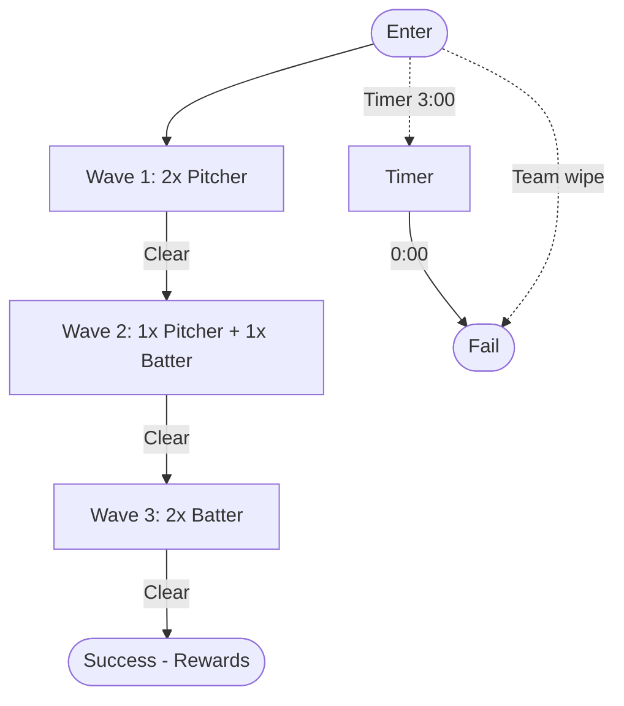
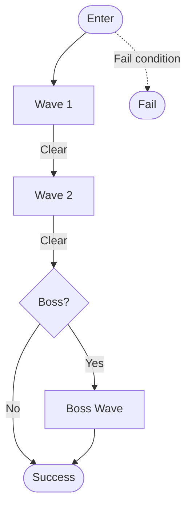

# Field Of Horrors — All Text Snapshot

> Auto-generated view of repo text files (safely filtered).
> Per-file cap: 200 KB • Total cap: 6 MB

---
## .editorconfig

```
root = true
[*]
end_of_line = lf
charset = utf-8
insert_final_newline = true
trim_trailing_whitespace = true
indent_style = space
indent_size = 2

```

---
## .gitattributes

```
* text=auto eol=lf
*.md diff=markdown
*.mmd diff=markdown
*.svg text linguist-generated

```

---
## .gitignore

```
# FOH logs
# (kept in repo; remove these lines if you want to exclude later)
# !history/raw_logs/*.log

```

---
## .markdownlint-cli2.jsonc

```
{
  // Lint hand-written docs only. Generated bundles, verbatim chat logs, and
  // archived drafts are skipped.
  "ignores": [
    "**/_bundle/**",
    "FieldOfHorrors/chat_bundle/**",
    "FieldOfHorrors/history/raw_logs/**",
    "FieldOfHorrors/history/chat_archive.md",
    "FieldOfHorrors/history/auto_reports/**",
    "history/**",
    "FieldOfHorrors/docs/design/classes/_archive_v1/**",
    "FieldOfHorrors/docs/README.md",
    "FieldOfHorrors/design/classes.md",
    ".github/**",
    "HEALTHCHECK.md"
  ],
  "config": {
    "default": true,
    "MD013": false, // line length: design docs use long table rows
    "MD024": { "siblings_only": true },
    "MD029": false, // numbered lists continue across section headings
    "MD033": false, // inline HTML (<br/> in tables)
    "MD036": false, // bold lines used as section labels
    "MD060": false  // table column alignment
  }
}

```

---
## CHATGPT_INDEX.md

```markdown
# Field Of Horrors — ChatGPT Discovery Index

**Start here.** Upload either of these single files to ChatGPT for a full-context read.

- **Design bundle (all docs):** `FieldOfHorrors/docs/_bundle/ALL_DOCS.md`
- **Logs bundle (all sessions):** `history/_bundle/ALL_LOGS.md`

Shortcuts:

- Classes: `FieldOfHorrors/docs/design/classes/`
- Systems: `FieldOfHorrors/docs/design/systems/`
- Weapons/Skills: `FieldOfHorrors/docs/design/{weapons,skills}/`
- Arena cards: `FieldOfHorrors/docs/design/arena_cards/`
- Data stubs: `FieldOfHorrors/data/`

## Full Repo (text) Snapshot

- `_bundle/ALL_TEXT_SNAPSHOT.md` — aggregated view of most text files (auto-built)

```

---
## CODE_OF_CONDUCT.md

```markdown
# Contributor Covenant Code of Conduct

This project adheres to the Contributor Covenant. See <https://www.contributor-covenant.org/version/2/1/code_of_conduct/>

```

---
## CONTRIBUTING.md

```markdown
# Contributing

- Branch names: `type/area-short` (e.g., `design/arena-stadium-t1`, `chore/devops-bootstrap`).
- Commits: Conventional Commits (`feat:`, `fix:`, `docs:`, `chore:`, etc.).
- PRs: must include **type:** and **area:** labels; auto-labeled by paths.
- Changelog: daily file under `FieldOfHorrors/history/changelog/YYYY-MM-DD.md`.
- No secrets in repo. Use `.env.example` patterns; see SECURITY.md.

```

---
## FieldOfHorrors/.editorconfig

```
root = true

[*]
end_of_line = lf
insert_final_newline = true
charset = utf-8
indent_style = space
indent_size = 2
trim_trailing_whitespace = true

[*.md]
max_line_length = off

```

---
## FieldOfHorrors/.gitattributes

```
* text=auto eol=lf
*.mmd text
*.md  text
*.svg text
*.png binary
*.zip binary

```

---
## FieldOfHorrors/.gitignore

```
# Node / Python / build junk
node_modules/
dist/
build/
.cache/
.venv/
__pycache__/
.DS_Store
*.log
# VSCode
.vscode/*.code-workspace
# Mermaid renders (CI will upload as artifacts)
docs/diagrams/*.png
docs/diagrams/*.svg
!docs/diagrams/overview.svg

!docs/diagrams/overview.svg
!docs/diagrams/overview.svg

```

---
## FieldOfHorrors/CHATGPT_INDEX.md

```markdown
# Field Of Horrors — ChatGPT Discovery Index

- Design bundle: `FieldOfHorrors/docs/_bundle/ALL_DOCS.md`
- Logs bundle: `history/_bundle/ALL_LOGS.md`
- Full text snapshot: `_bundle/ALL_TEXT_SNAPSHOT.md`
- Classes: `FieldOfHorrors/docs/design/classes/`
- Systems: `FieldOfHorrors/docs/design/systems/`
- Weapons/Skills: `FieldOfHorrors/docs/design/{weapons,skills}/`
- Arena cards: `FieldOfHorrors/docs/design/arena_cards/`
- Data: `FieldOfHorrors/data/`

```

---
## FieldOfHorrors/CONTRIBUTING.md

```markdown
# Contributing – Field of Horrors

## Branches

- `main`: protected.
- `design/*`: docs/diagrams.
- `feat/*`: gameplay/features.
- `balance/*`: data tuning.

## Commits

Use Conventional Commits: feat:, fix:, docs:, chore:, refactor:, ci:, test:.

## PR checklist

- [ ] Palette rules honored
- [ ] Telegraph timing keys valid
- [ ] Mermaid renders locally or via CI
- [ ] Updated docs (chat_archive links if relevant)
- [ ] CI green

## Running validators

- Python: `python tools/validate_design_rules.py`
- Mermaid (optional local): `npx @mermaid-js/mermaid-cli -i input.mmd -o out.svg`

```

---
## FieldOfHorrors/LICENSE

```
MIT License

Copyright (c) 2025

Permission is hereby granted, free of charge, to any person obtaining a copy
of this software and associated documentation files (the "Software"), to deal
in the Software without restriction, including without limitation the rights
to use, copy, modify, merge, publish, distribute, sublicense, and/or sell
copies of the Software, and to permit persons to do so, subject to the following conditions:

The above copyright notice and this permission notice shall be included in all
copies or substantial portions of the Software.

THE SOFTWARE IS PROVIDED "AS IS", WITHOUT WARRANTY OF ANY KIND, EXPRESS OR
IMPLIED, INCLUDING BUT NOT LIMITED TO THE WARRANTIES OF MERCHANTABILITY,
FITNESS FOR A PARTICULAR PURPOSE AND NONINFRINGEMENT. IN NO EVENT SHALL THE
AUTHORS OR COPYRIGHT HOLDERS BE LIABLE FOR ANY CLAIM, DAMAGES OR OTHER
LIABILITY, WHETHER IN AN ACTION OF CONTRACT, TORT OR OTHERWISE, ARISING FROM,
OUT OF OR IN CONNECTION WITH THE SOFTWARE OR THE USE OR OTHER DEALINGS IN THE
SOFTWARE.

```

---
## FieldOfHorrors/README.md

```markdown
# Field of Horrors

Fast-TTK co-op arena with sports-themed classes.

- Docs entry: [docs/chat_bundle/bundle.md](docs/chat_bundle/bundle.md)
- Class index: [docs/design/classes/](docs/design/classes/)

```

---
## FieldOfHorrors/art/autogen/README.md

```markdown
# Field of Horrors

Template repo for design/code/art/music.

```

---
## FieldOfHorrors/chat_bundle/bundle_2025-09-14.md

```markdown
# Field of Horrors — Chat Bundle

## Table of Contents

1. [Arena Cards Index](#arena-cards-index) — `docs\design\arena_cards\README.md`
2. [Arena Challenge – Stadium T1: Rookie Warm-Up](#arena-challenge-stadium-t1-rookie-warm-up) — `docs\design\arena_cards\stadium_t1_rookie_warmup.md`
3. [stadium_t1_rookie_warmup.mmd](#stadium-t1-rookie-warmup-mmd) — `docs\design\arena_cards\stadium_t1_rookie_warmup.mmd`
4. [Arena Challenge – Template](#arena-challenge-template) — `docs\design\arena_cards\template.md`
5. [<CLASS_TITLE>](#class-title) — `docs\design\classes\batter.md`
6. [<CLASS_TITLE>](#class-title) — `docs\design\classes\linebacker.md`
7. [FOH Classes System v1 (Overview)](#foh-classes-system-v1-overview) — `docs\design\classes\overview.mmd`
8. [Pitcher](#pitcher) — `docs\design\classes\pitcher.md`
9. [<CLASS_TITLE>](#class-title) — `docs\design\classes\point_guard.md`
10. [<CLASS_TITLE>](#class-title) — `docs\design\classes\power_forward.md`
11. [QB — Summoner / Field General](#qb-summoner-field-general) — `docs\design\classes\qb.md`
12. [<CLASS_TITLE>](#class-title) — `docs\design\classes\quarterback.md`
13. [Class System (v0.1)](#class-system-v0-1) — `docs\design\classes\README.md`
14. [Open Threads](#open-threads) — `docs\design\open_threads.md`
15. [overview.mmd](#overview-mmd) — `docs\design\overview.mmd`
16. [BATTER – Telegraphs (frames)](#batter-telegraphs-frames) — `docs\design\telegraphs\batter.md`
17. [LINEBACKER – Telegraphs (frames)](#linebacker-telegraphs-frames) — `docs\design\telegraphs\linebacker.md`
18. [PITCHER – Telegraphs (frames)](#pitcher-telegraphs-frames) — `docs\design\telegraphs\pitcher.md`
19. [QB – Telegraphs (frames)](#qb-telegraphs-frames) — `docs\design\telegraphs\qb.md`
20. [Telegraph Tables – Schema](#telegraph-tables-schema) — `docs\design\telegraphs\README.md`
21. [FOAM-FINGER PIKE — Base Stats (frames, tiles)](#foam-finger-pike-base-stats-frames-tiles) — `docs\design\weapons\foam_finger_pike.md`
22. [foam_finger_pike.mmd](#foam-finger-pike-mmd) — `docs\design\weapons\foam_finger_pike.mmd`
23. [SHOULDER RAM — Base Stats (frames, tiles)](#shoulder-ram-base-stats-frames-tiles) — `docs\design\weapons\shoulder_ram.md`
24. [SPIRAL DISC — Base Stats (frames, tiles)](#spiral-disc-base-stats-frames-tiles) — `docs\design\weapons\spiral_disc.md`
25. [WHISTLE BOMB — Base Stats (frames, tiles)](#whistle-bomb-base-stats-frames-tiles) — `docs\design\weapons\whistle_bomb.md`
26. [whistle_bomb.mmd](#whistle-bomb-mmd) — `docs\design\weapons\whistle_bomb.mmd`
27. [Field Of Horrors — Docs Index](#field-of-horrors-docs-index) — `docs\README.md`
28. [Field of Horrors – Weekly Report](#field-of-horrors-weekly-report) — `docs\weekly_report_template.md`

---
# Arena Cards Index

> Source: `docs\design\arena_cards\README.md`

# Arena Cards Index

- Stadium T1 – Rookie Warm-Up  
  - MD: [stadium_t1_rookie_warmup.md](stadium_t1_rookie_warmup.md)  
  - Mermaid: [stadium_t1_rookie_warmup.mmd](stadium_t1_rookie_warmup.mmd)


---
# Arena Challenge – Stadium T1: Rookie Warm-Up

> Source: `docs\design\arena_cards\stadium_t1_rookie_warmup.md`

# Arena Challenge – Stadium T1: Rookie Warm-Up

**Metadata**
- Name: Stadium T1 – Rookie Warm-Up
- Tier: 1
- Biome: stadium
- Recommended Power: 1
- Rewards: 100 ⚾ Scrip, 1x Common Mod

**Objective**
- Primary: Clear all waves within **3:00**.
- Secondary (optional): Take **≤1** hit(s).
- Fail: Timer expires or team wipe.

**Modifiers**
- Global: Crowd Noise (minor telegraph audio dampening).
- Enemy: None (training match).
- Player: +10% stamina regen between waves.

**Wave Plan (summary)**
- Wave 1 (0:00): 2x Pitcher (fastball/curveball basics)
- Wave 2 (0:45): 1x Pitcher, 1x Batter (introduces melee spacing)
- Wave 3 (1:30): 2x Batter (power swing spacing test)

**Enemy Telegraph References**
- Pitcher: [../telegraphs/pitcher.md](../telegraphs/pitcher.md)
- Batter:  [../telegraphs/batter.md](../telegraphs/batter.md)

---

## Flow (Mermaid preview)

```mermaid
flowchart TD
  Start([Enter]) --> W1[Wave 1: 2x Pitcher]
  W1 -->|Clear| W2[Wave 2: 1x Pitcher + 1x Batter]
  W2 -->|Clear| W3[Wave 3: 2x Batter]
  W3 -->|Clear| Success([Success - Rewards])
  Start -. "Timer 3:00" .-> T[Timer]
  T -->|0:00| Fail([Fail])
  Start -. "Team wipe" .-> Fail


## Player Loadouts (Baseline Weapons)
- Pitcher: [Whistle Bomb](../weapons/whistle_bomb.md)
- Batter:  [Foam-Finger Pike](../weapons/foam_finger_pike.md)
- Linebacker: [Shoulder Ram](../weapons/shoulder_ram.md)
- Quarterback: [Spiral Disc](../weapons/spiral_disc.md)


---
# stadium_t1_rookie_warmup.mmd

> Source: `docs\design\arena_cards\stadium_t1_rookie_warmup.mmd`

%% Stadium T1 – Rookie Warm-Up (Flow)
flowchart TD
  Start([Enter Arena]) --> W1[Wave 1: 2× Pitcher]
  W1 -->|Clear| W2[Wave 2: 1× Pitcher + 1× Batter]
  W2 -->|Clear| W3[Wave 3: 2× Batter]
  W3 -->|Clear| Success([Success • Rewards])

  Start -. "Timer 3:00" .-> T[Timer]
  T -->|0:00| Fail([Fail])
  Start -. "Team wipe" .-> Fail


---
# Arena Challenge – Template

> Source: `docs\design\arena_cards\template.md`

# Arena Challenge – Template

**Metadata**
- Name: <challenge name>
- Tier: 1–5
- Biome: stadium | ice | court | street
- Recommended Power: <value>
- Rewards: <currency/items/perks>

**Objective**
- Primary: …
- Secondary (optional): …
- Fail: <timeout | wipe | objective break>

**Modifiers**
- Global: …
- Enemy: …
- Player: …

**Wave Plan (summary)**
- Wave 1: <composition, cadence>
- Wave 2: …
- Boss/Miniboss (if any): …

---

## Mermaid – Flow (authoring example)
```mermaid
flowchart TD
  Start([Enter]) --> W1[Wave 1]
  W1 -->|Clear| W2[Wave 2]
  W2 -->|Clear| Boss{Boss?}
  Boss -->|No| Success([Success])
  Boss -->|Yes| WB[Boss Wave] --> Success
  Start -. Fail condition .-> Fail([Fail])


---
# <CLASS_TITLE>

> Source: `docs\design\classes\batter.md`

# <CLASS_TITLE>
## Fantasy/Theme
## Base Stats
- HP: 100
- ARM: <per class>
- SPD: 6.0
- STA: 100
- CRIT: 10% (1.5x)
## Default Weapons
## Skills
## Passive
## Playstyle
## Tuning Targets
## Synergies
## Counters
## Unlocks/Progression
## Concept Art Prompts


---
# <CLASS_TITLE>

> Source: `docs\design\classes\linebacker.md`

# <CLASS_TITLE>
## Fantasy/Theme
## Base Stats
- HP: 100
- ARM: <per class>
- SPD: 6.0
- STA: 100
- CRIT: 10% (1.5x)
## Default Weapons
## Skills
## Passive
## Playstyle
## Tuning Targets
## Synergies
## Counters
## Unlocks/Progression
## Concept Art Prompts


---
# FOH Classes System v1 (Overview)

> Source: `docs\design\classes\overview.mmd`

# FOH Classes System v1 (Overview)
- TTK target: 1.5–2.0s (normal), ramps with difficulty
- SPD baseline: 6.0 (±0.5 by class)
- Classes: Pitcher, Batter, Quarterback (Summoner), Linebacker, Point Guard, Power Forward
- See per-class files for stats, skills, and tuning notes.


---
# Pitcher

> Source: `docs\design\classes\pitcher.md`

# Pitcher
## Fantasy/Theme
Grenadier/control using curved and impact throws.
## Base Stats
- HP: 100
- ARM: 10%
- SPD: 6.0
- STA: 100
- CRIT: 10% (1.5x)
## Default Weapons
- Whistle Bomb (arc throw; 3s fuse; cookable)
## Skills
- Curveball (guided arc), Fastball (impact), Resin Fuse (fuse -1s, risky), Smoke Screen (soft CC)
## Passive
Perfect Release (+20% blast radius on perfect timing)
## Playstyle
Zone denial, chokepoints, soft CC.
## Tuning Targets
Keep common mob TTK ~1.2–1.6s at Tier 1 via blast tuning.
## Synergies
QB marks, Linebacker stuns, PG mobility pads for vertical angles.
## Counters
Armor-stacked elites; bring Resin Fuse or team marks.
## Unlocks/Progression
Fuse mods, larger satchel, arc-assist HUD tiers.
## Concept Art Prompts
athletic sci-fi grenadier, visor HUD arc, bomb satchel, arena lighting.


---
# <CLASS_TITLE>

> Source: `docs\design\classes\point_guard.md`

# <CLASS_TITLE>
## Fantasy/Theme
## Base Stats
- HP: 100
- ARM: <per class>
- SPD: 6.0
- STA: 100
- CRIT: 10% (1.5x)
## Default Weapons
## Skills
## Passive
## Playstyle
## Tuning Targets
## Synergies
## Counters
## Unlocks/Progression
## Concept Art Prompts


---
# <CLASS_TITLE>

> Source: `docs\design\classes\power_forward.md`

# <CLASS_TITLE>
## Fantasy/Theme
## Base Stats
- HP: 100
- ARM: <per class>
- SPD: 6.0
- STA: 100
- CRIT: 10% (1.5x)
## Default Weapons
## Skills
## Passive
## Playstyle
## Tuning Targets
## Synergies
## Counters
## Unlocks/Progression
## Concept Art Prompts


---
# QB — Summoner / Field General

> Source: `docs\design\classes\qb.md`

# QB — Summoner / Field General
SPD 6.0 | ARM 1 | Role: Field control via summons.
Primary: Playbook Launcher
Secondary: Sidearm
Skill: Audible — retarget summoned units
Utility: Pep Talk — AoE team buff
Ultimate: Hail Mary — elite Receiver dash
Summons: Receiver (burst), Lineman (taunt), Kicker (knockback)


---
# <CLASS_TITLE>

> Source: `docs\design\classes\quarterback.md`

# <CLASS_TITLE>
## Fantasy/Theme
## Base Stats
- HP: 100
- ARM: <per class>
- SPD: 6.0
- STA: 100
- CRIT: 10% (1.5x)
## Default Weapons
## Skills
## Passive
## Playstyle
## Tuning Targets
## Synergies
## Counters
## Unlocks/Progression
## Concept Art Prompts


---
# Class System (v0.1)

> Source: `docs\design\classes\README.md`

# Class System (v0.1)
Six launch classes: QB (Summoner), Pitcher, Batter, Linebacker, Point Guard, Power Forward.
See per-class cards in this folder. This index is consumed by docs/chat_bundle/make_chat_bundle.py.


---
# Open Threads

> Source: `docs\design\open_threads.md`

# Open Threads

- Telegraph tables
- Arena Challenge templates
- Expanded weapon trees
- Wave presets
- Co-op synergy


---
# overview.mmd

> Source: `docs\design\overview.mmd`

%% Field of Horrors – Design Overview (auto-generated)
flowchart TD
A["docs/design"]
DG["telegraphs"]
AC["arena_cards"]
W["weapons"]
CA["chat_archive.md TODO"]
OT["open_threads.md ✅"]
DGM["diagrams (CI artifacts)"]
A --> DG
A --> AC
A --> W
A --> CA
A --> OT
A -. rendered by CI .-> DGM
subgraph CLASSES["Classes"]
  C_P["Pitcher"]
  C_B["Batter"]
  C_L["Linebacker"]
  C_Q["Quarterback"]
end
subgraph TSG["telegraphs"]
  T_pitcher_md["pitcher.md ✅"]
  T_batter_md["batter.md ✅"]
  T_linebacker_md["linebacker.md ✅"]
  T_qb_md["qb.md ✅"]
  T_README_md["README.md ✅"]
end
subgraph ACG["arena_cards"]
  A_template_md["template.md ✅"]
  A_stadium_t1_rookie_warmup_md["stadium_t1_rookie_warmup.md ✅"]
  A_stadium_t1_rookie_warmup_mmd["stadium_t1_rookie_warmup.mmd ✅"]
end
subgraph WG["weapons"]
  W_whistle_bomb_mmd["whistle_bomb.mmd ✅"]
  W_foam_finger_pike_mmd["foam_finger_pike.mmd ✅"]
  W_shoulder_ram_mmd["shoulder_ram.mmd TODO"]
  W_spiral_disc_mmd["spiral_disc.mmd TODO"]
  WS_whistle_bomb_md["whistle_bomb.md ✅"]
  WS_foam_finger_pike_md["foam_finger_pike.md ✅"]
  WS_shoulder_ram_md["shoulder_ram.md ✅"]
  WS_spiral_disc_md["spiral_disc.md ✅"]
end
C_P --> W_whistle_bomb_mmd
C_B --> W_foam_finger_pike_mmd
C_L --> W_shoulder_ram_mmd
C_Q --> W_spiral_disc_mmd
W_whistle_bomb_mmd --> A_stadium_t1_rookie_warmup_md
W_foam_finger_pike_mmd --> A_stadium_t1_rookie_warmup_md
W_shoulder_ram_mmd --> A_stadium_t1_rookie_warmup_md
W_spiral_disc_mmd --> A_stadium_t1_rookie_warmup_md
ST1SVG["stadium_t1_rookie_warmup.svg"]
WBSVG["whistle_bomb.svg"]
FPSVG["foam_finger_pike.svg"]
DGM --> ST1SVG
DGM --> WBSVG
DGM --> FPSVG


---
# BATTER – Telegraphs (frames)

> Source: `docs\design\telegraphs\batter.md`

# BATTER – Telegraphs (frames)

| move | startup | active | recovery | cooldown | range | tells | damage | stagger | counterplay | variations | notes |
|------|---------|--------|----------|----------|-------|-------|--------|---------|-------------|------------|-------|
| Bunt Jab | 12f | 2f | 16f | 20f | 1 tile | Bat lift to chest | Low | Low | Micro-sidestep; free punish 14–20f | Double jab chain | Used to check space |
| Power Swing | 30f | 6f | 28f | 36f | 2 tiles arc | Full windup; grunt | High | High | Roll through hips at 28–32f | Charged variant (wider arc) | Breaks guard |
| Pop-Fly Uppercut | 22f | 4f | 24f | 28f | 1 tile vertical | Knees bend; elbow flare | Med | Med | Jump cancel; parry early | Launcher (juggles) | Anti-air punish tool |


---
# LINEBACKER – Telegraphs (frames)

> Source: `docs\design\telegraphs\linebacker.md`

# LINEBACKER – Telegraphs (frames)

| move | startup | active | recovery | cooldown | range | tells | damage | stagger | counterplay | variations | notes |
|------|---------|--------|----------|----------|-------|-------|--------|---------|-------------|------------|-------|
| Bull Rush | 20f | 14f | 26f | 34f | 6 tiles line | Snort; shoulder dip | Med | High | Side-dodge on windup; trip hazard counters | Frenzy (longer active) | Collides with walls |
| Tackle | 24f | 8f | 22f | 30f | 2 tiles | Hip rotate; stomp | High | High | Jump back; bait into trap | Stun on hit | Armor during startup |
| Guard Breaker | 18f | 3f | 18f | 26f | 1 tile | Hand open, then fist | Low | High | Parry 2f pre-active; counterthrow | Shield-only bonus | Opens ripostes |


---
# PITCHER – Telegraphs (frames)

> Source: `docs\design\telegraphs\pitcher.md`

# PITCHER – Telegraphs (frames)

| move | startup | active | recovery | cooldown | range | tells | damage | stagger | counterplay | variations | notes |
|------|---------|--------|----------|----------|-------|-------|--------|---------|-------------|------------|-------|
| Fastball | 18f | 4f | 22f | 30f | 10 tiles line | Shoulder cocks back; glove tap | Med | Low | Sidestep at 18–22f; shield blocks | Curveball (homes lightly) | Rolls if hits wall |
| Curveball | 22f | 6f | 24f | 32f | 8 tiles arc | Wrist twist; ball glow pulse | Med | Med | Move inward on apex; jump over inner arc | Slippery turf: +2 tiles | Punishes greedy melee |
| Change-up | 26f | 4f | 18f | 28f | 10 tiles line (slow) | Long exhale; slower arm | Low | Low | Walk dodge; counterthrow window 24–30f | Fake windup (rare) | Baits early dodge |


---
# QB – Telegraphs (frames)

> Source: `docs\design\telegraphs\qb.md`

# QB – Telegraphs (frames)

| move | startup | active | recovery | cooldown | range | tells | damage | stagger | counterplay | variations | notes |
|------|---------|--------|----------|----------|-------|-------|--------|---------|-------------|------------|-------|
| Spiral Pass | 16f | 3f | 18f | 26f | 12 tiles line | Finger lace spin; wrist snap | Med | Low | Step off-line 14–18f | Homing (light) | Can tag allies |
| Hail Mary | 36f | 8f | 30f | 40f | 16 tiles arc | Deep lean back | High | Med | Close distance during windup; interrupt | Multi-ball spread | Arena hazard synergy |
| Pump Fake | 10f | 0f | 8f | 12f | — | Quick shoulder twitch | — | — | Hold dodge; punish recovery | Into Spiral Pass | Baits parry windows |


---
# Telegraph Tables – Schema

> Source: `docs\design\telegraphs\README.md`

# Telegraph Tables – Schema

**Columns (required):**
| move | startup | active | recovery | cooldown | range | tells | damage | stagger | counterplay | variations | notes |
|------|---------|--------|----------|----------|-------|-------|--------|---------|-------------|------------|-------|

**Timing units:** frames (f) or seconds (s). Pick one per table and stick to it.  
**Ranges:** tiles or meters; be consistent within a table.  
**Tells:** animations, SFX, VFX, windups.  
**Counterplay:** dodge windows, parry timings, interrupts, terrain use.  
**Variations:** elite/boss modifiers, status, elemental, “on enraged,” etc.


---
# FOAM-FINGER PIKE — Base Stats (frames, tiles)

> Source: `docs\design\weapons\foam_finger_pike.md`

# FOAM-FINGER PIKE — Base Stats (frames, tiles)

| move | startup | active | recovery | cooldown | range | tells | damage | stagger | counterplay | variations | notes |
|------|---------|--------|----------|----------|-------|-------|--------|---------|-------------|------------|-------|
| Lunge Jab | 14f | 2f | 16f | 24f | 2 tiles line | Elbow flare; forward lean | Med | Med | Side-step pre-active; backstep punish window | N/A | Slight aim assist toward nearest target |
| Short Sweep | 18f | 4f | 18f | 26f | 1.5 tile arc | Hip rotate; low whoosh | Low | High | Roll through hips at 18–22f | N/A | Guards allies on hit (minor) |


---
# foam_finger_pike.mmd

> Source: `docs\design\weapons\foam_finger_pike.mmd`

%% Foam-Finger Pike – Upgrade Tree
flowchart TD
  FP0["Foam-Finger Pike (Base)"] --> FP1A["Tier1: Lunge Booster (+range)"]
  FP0 --> FP1B["Tier1: Guard Point (startup armor)"]

  FP1A --> FP2A["Tier2: Spear Wall (multi-hit line)"]
  FP1A --> FP2B["Tier2: Pivot Stab (instant turn)"]

  FP1B --> FP2C["Tier2: Riposte Window (parry → bonus)"]
  FP1B --> FP2D["Tier2: Brace (reduced knockback)"]

  %% Tier 3 caps
  FP2A --> FP3A["Tier3: Phalanx (ally aura)"]
  FP2B --> FP3B["Tier3: Whirl (short arc sweep)"]
  FP2C --> FP3C["Tier3: Perfect Counter (auto-crit)"]
  FP2D --> FP3D["Tier3: Iron Line (party guard)"]


---
# SHOULDER RAM — Base Stats (frames, tiles)

> Source: `docs\design\weapons\shoulder_ram.md`

# SHOULDER RAM — Base Stats (frames, tiles)

| move | startup | active | recovery | cooldown | range | tells | damage | stagger | counterplay | variations | notes |
|------|---------|--------|----------|----------|-------|-------|--------|---------|-------------|------------|-------|
| Dash Tackle | 18f | 8f (travel) | 24f | 30f | 3 tiles line | Snort; shoulder dip | Med | High | Side-roll at windup; bait into wall | N/A | Collides with enemies/terrain; knocks back |
| Brake Check | 10f | 1f | 12f | 18f | 0.5 tiles | Quick stomp plant | Low | High | Parry 2f before active; counter-throw | N/A | Emergency stop, ends dash chain |


---
# SPIRAL DISC — Base Stats (frames, tiles)

> Source: `docs\design\weapons\spiral_disc.md`

# SPIRAL DISC — Base Stats (frames, tiles)

| move | startup | active | recovery | cooldown | range | tells | damage | stagger | counterplay | variations | notes |
|------|---------|--------|----------|----------|-------|-------|--------|---------|-------------|------------|-------|
| Straight Pass | 12f | 3f (on contact) | 14f | 22f | 8 tiles line | Wrist snap; finger lace spin | Med | Low | Step off-line 10–14f; shield blocks | N/A | Slight aim magnet to center-mass |
| Pump → Pass | 10f (fake) + 12f | 3f | 16f | 24f | 8 tiles line | Shoulder twitch (fake) then full release | Med | Low | Hold dodge on fake; punish recovery | N/A | Fake does not fire; teaches patience |


---
# WHISTLE BOMB — Base Stats (frames, tiles)

> Source: `docs\design\weapons\whistle_bomb.md`

# WHISTLE BOMB — Base Stats (frames, tiles)

| move | startup | active | recovery | cooldown | range | tells | damage | stagger | counterplay | variations | notes |
|------|---------|--------|----------|----------|-------|-------|--------|---------|-------------|------------|-------|
| Toss (fuse) | 22f | 3f (on impact) | 20f | 28f | 7 tiles arc | Shoulder cock, faint whistle loop | Med | Low | Step off-line during arc; roll through at land | N/A | Projectile despawns at 2s or on wall |
| Quick lob | 16f | 3f | 22f | 30f | 5 tiles arc (higher) | Shorter windup, higher arc | Low | Low | Walk dodge; punish recovery | N/A | Use to bait parries |


---
# whistle_bomb.mmd

> Source: `docs\design\weapons\whistle_bomb.mmd`

%% Whistle Bomb – Upgrade Tree
flowchart TD
  WB0["Whistle Bomb (Base)"] --> WB1A["Tier1: Sticky Fuse (+DoT)"]
  WB0 --> WB1B["Tier1: Quick Whistle (-startup)"]

  WB1A --> WB2A["Tier2: Cluster Pop (split on hit)"]
  WB1A --> WB2B["Tier2: Siren Pitch (fear on near-miss)"]

  WB1B --> WB2C["Tier2: Curve Throw (manual curve)"]
  WB1B --> WB2D["Tier2: Silent Fuse (no tell)"]

  %% Tier 3 caps (choose one)
  WB2A --> WB3A["Tier3: Grand Slam (large AoE, longer cooldown)"]
  WB2B --> WB3B["Tier3: Panic Chain (fear spreads)"]
  WB2C --> WB3C["Tier3: Perfect Spiral (pierce)"]
  WB2D --> WB3D["Tier3: Ghost Fuse (invisible arc, lower damage)"]


---
# Field Of Horrors — Docs Index

> Source: `docs\README.md`

# Field Of Horrors — Docs Index

_Auto-generated by tools/gen_docs_index.sh — do not edit by hand._

## Design

- [Readme](docs/design/arena_cards/README.md)
- [Stadium T1 Rookie Warmup](docs/design/arena_cards/stadium_t1_rookie_warmup.md)
- [Stadium T1 Rookie Warmup](docs/design/arena_cards/stadium_t1_rookie_warmup.mmd)
- [Template](docs/design/arena_cards/template.md)
- [Open Threads](docs/design/open_threads.md)
- [Overview](docs/design/overview.mmd)
- [Readme](docs/design/telegraphs/README.md)
- [Batter](docs/design/telegraphs/batter.md)
- [Linebacker](docs/design/telegraphs/linebacker.md)
- [Pitcher](docs/design/telegraphs/pitcher.md)
- [Qb](docs/design/telegraphs/qb.md)
- [Foam Finger Pike](docs/design/weapons/foam_finger_pike.md)
- [Foam Finger Pike](docs/design/weapons/foam_finger_pike.mmd)
- [Shoulder Ram](docs/design/weapons/shoulder_ram.md)
- [Spiral Disc](docs/design/weapons/spiral_disc.md)
- [Whistle Bomb](docs/design/weapons/whistle_bomb.md)
- [Whistle Bomb](docs/design/weapons/whistle_bomb.mmd)

## Diagrams


## Narrative


## Telemetry


## Ux


## Root

- [Weekly Report Template](docs/weekly_report_template.md)


---
# Field of Horrors – Weekly Report

> Source: `docs\weekly_report_template.md`

# Field of Horrors – Weekly Report
**Week of:** {{DATE}}

## Highlights
- Combat: ...
- Classes: ...
- Art/Music: ...

## Diagrams Updated
- flow.png
- systems.png

## Next Week Goals
- ...

## Risks / Needs
- ...


```

---
## FieldOfHorrors/data/classes/classes.json

```json
[
  {"id":"pitcher","spd":6.1,"hp":100,"grit":25,"armor":"Light"},
  {"id":"batter","spd":5.8,"hp":125,"grit":35,"armor":"Medium"},
  {"id":"qb","spd":6.0,"hp":100,"grit":20,"armor":"Light","summoner":true},
  {"id":"linebacker","spd":5.7,"hp":140,"grit":45,"armor":"Heavy"},
  {"id":"point_guard","spd":6.2,"hp":95,"grit":20,"armor":"Light"},
  {"id":"center","spd":5.9,"hp":120,"grit":30,"armor":"Medium"}
]

```

---
## FieldOfHorrors/design/ascension.md

```markdown
# National Championship / Prestige / Seasons / Fusion

- **End Boss:** Referee King (iconic). In ascension, evolves/fuses.
- **Prestige:** Reset run-level; gain Hall of Fame Points (HFP).
- **Seasons:** 6-month leagues; reset to level 1; cosmetics carry over.
- **Fusion (Multi‑Talented):** Locked pairs, expanded each season.

```

---
## FieldOfHorrors/design/bosses/referee_king.md

```markdown
# Boss: Referee King

## Fantasy

A towering undead referee who weaponizes rules: stun flags, penalty calls, whistle shockwaves. Horror-comedy tone with “official” cruelty.

## Arena

- Shape: Stadium 50-yard slice; hash marks, penalty cones (cover).
- Hazards: Randomized “spotlight sweeps” that blind; side-line drones launching foam-flag projectiles.

## Phase Overview

- **P1 – Flag Control (100–70% HP):**
  - Mechanics: Throws **Stun Flags** (slow/immobilize), **Whistle Shockwave** (radial knockback), **Penalty Line** (laser-straight hazard).
  - Adds: **Ref Ballboys** that retrieve flags; killing them delays his next throw.
- **P2 – Rulebook Rage (70–35% HP):**
  - Mechanics: **Yellow Card Rain** (flag mortar), **Holding!** (tethers player briefly), **Replay Review** (brief invuln; re-aims next attack).
  - Adds: **Ump Zombies** that grant him DR auras if not interrupted.
- **P3 – Overtime Judgment (35–0% HP):**
  - Mechanics: **Two-Minute Drill** (global haste), **Double Flag** (two overlap zones), **Ejection** (teleport slam).
  - Soft enrage: Hazards tick faster; whistle shockwaves chain twice.

## Player Counterplay

- **Linebacker:** Bash to interrupt **Replay Review**; soak shockwaves.
- **QB:** Summons body-block **Penalty Line** and soak **Flag Mortars**.
- **Pitcher:** Snipe Ballboys/Umps; curveball to tag while he strafes.
- **Batter/Center:** Close-range burst during **post-Whistle recovery**.
- **Point Guard:** Team haste + dash to exit **Holding** tethers.

## Rewards

- **Unique drop:** *Ref’s Golden Whistle* (on-hit micro-stun, long cooldown).
- **Recipe piece:** *Championship Gem Shard* (Batblade final tier).
- Cosmetics: **Striped Glow Jersey**, **Penalty Trail** (footstep VFX).

## Tunables (MVP targets)

- HP: ~40× a standard trash zombie.
- Stun Flag root: 0.85s (decays with difficulty).
- Shockwave knockback: 900 units; i-frames on perfect dash.
- Mortar warning: 1.2s telegraph; 4–6 shells.
- Enrage pace: +15% action speed <35% HP.

## QA Notes

- Flags never chain-lock the player longer than 2.5s total.
- Shockwave can’t push player out of the arena bounds.
- Replay Review invuln ≤ 2.0s (avoid frustration).

```

---
## FieldOfHorrors/design/bosses/referee_king_phases.mmd

```markdown
stateDiagram-v2
  [*] --> P1_FlagControl
  P1_FlagControl: Phase 1 – Flag Control (100–70 HP)
  P1_FlagControl --> P2_RulebookRage: HP <= 70%
  P2_RulebookRage: Phase 2 – Rulebook Rage (70–35 HP)
  P2_RulebookRage --> P3_OvertimeJudgment: HP <= 35%
  P3_OvertimeJudgment: Phase 3 – Overtime Judgment (35–0 HP)
  P3_OvertimeJudgment --> [*]: HP <= 0

  note right of P1_FlagControl
    Stun Flags, Whistle Shockwave,
    Penalty Line, Ballboy Adds
  end note

  note right of P2_RulebookRage
    Yellow Card Rain, Holding Tethers,
    Replay Review (brief invuln), Ump DR Auras
  end note

  note right of P3_OvertimeJudgment
    Two-Minute Drill (haste), Double Flag,
    Ejection Teleport Slam, Soft Enrage
  end note


```

---
## FieldOfHorrors/design/bosses/referee_king_telegraphs.md

```markdown
# Referee King – Telegraphs & Timings (MVP)

| Ability             | Telegraph (s) | Active (s) | Cooldown (s) | Counterplay Notes |
|--------------------|--------------:|-----------:|-------------:|------------------|
| Stun Flag Toss     | 0.60          | Hitframe   | 6–8          | clear yellow arc; dash i-frames ok |
| Whistle Shockwave  | 0.75          | 0.30       | 10–12        | radial ring expands; jump or tank w/ DR |
| Penalty Line       | 0.90          | 1.50       | 14–16        | straight laser; body-block with summons |
| Yellow Card Rain   | 1.20          | 2.40       | 12–16        | ground circles; safe pockets guaranteed |
| Holding (Tether)   | 0.50          | 1.00       | 10–14        | tap to break; guard break removes |
| Replay Review      | 0.30          | 1.50 (invuln) | 18–22     | interruptible by bash; small window |
| Two-Minute Drill   | 0.80          | 8.00       | 30+          | global haste; avoid stacking hazards |
| Ejection (Teleport Slam) | 0.70   | 0.20       | 14–18        | shadow on ground; roll timing window |

```

---
## FieldOfHorrors/design/classes.md

```markdown
# Player Classes – *Field of Horrors*

## Overview
Classes are designed as **hard counters** (specialized, like *Path of Exile*) rather than jack-of-all-trades.
- Each **sport = 2 subclasses** (Baseball, Football, Basketball for MVP).
- Future sports (Soccer, Hockey, Wrestling) may unlock after Ascension.
- Each subclass uses a **signature weapon type** but can wield other gear with **reduced bonuses**.
- Skill trees branch into **Early → Mid → Capstone tiers** with freedom of choice and risk/reward crystals (some off-class skills give **debuffs**).

---

## ⚾ Baseball

### Pitcher (Ranged Specialist)
- **Signature Weapons:** Baseballs, fastball/curveball variations.
- **Playstyle:** Long-range damage, precision shots.
- **Branching Skills:**
  - Curveball Control → curved projectile with chance to confuse.
  - Fastball Fury → piercing projectile with crit chance.
  - Capstone: *Grand Slam Pitch* → throws multiple flaming fastballs in a spread.
- **Debuff Crystals:** May gain stamina drain or slower recharge for power.

### Batter (Melee Crit Fighter)
- **Signature Weapons:** Bats, batblades.
- **Playstyle:** Close combat combos, crits on timed swings.
- **Branching Skills:**
  - Home Run Swing → heavy knockback on charged attacks.
  - Line Drive Combo → 3-hit combo with increased crit.
  - Capstone: *Blood Diamond Bat* → weapon glows, guaranteed crit on final combo hit.
- **Debuff Crystals:** Reduced movement speed for bonus damage.

---

## 🏈 Football

### Linebacker (Tank/Disruptor)
- **Signature Weapons:** Shoulder charges, shields.
- **Playstyle:** Frontline tank, knockback, crowd control.
- **Branching Skills:**
  - Iron Wall → temporary damage reduction buff.
  - Taunting Roar → forces enemies to target you.
  - Capstone: *Blitzkrieg* → unstoppable dash through a horde, knocking them down.
- **Debuff Crystals:** Slower attack recovery in exchange for extra armor.

### Quarterback (Minion Summoner)
- **Signature Weapons:** Command abilities, tactical calls.
- **Playstyle:** Spawns AI-controlled allies (linemen, receivers).
- **Branching Skills:**
  - Offensive Line → summon 2 shield-bearing linemen.
  - Precision Pass → throw glowing ball that explodes on impact.
  - Capstone: *Hail Mary* → spawns 5 receivers + linemen for a timed push.
- **Debuff Crystals:** Lower personal damage, stronger summons.

---

## 🏀 Basketball

### Point Guard (Mobility/Support)
- **Signature Weapons:** Energy passes, fast dashes.
- **Playstyle:** Speed-based fighter, buffs allies in co-op.
- **Branching Skills:**
  - No-Look Pass → buffs ally attack speed.
  - Cross-Over Dash → double dash with short cooldown.
  - Capstone: *Full Court Press* → slows all enemies while Point Guard’s team speeds up.
- **Debuff Crystals:** Reduced HP, increased evasion.

### Center (Area Control / Slam Dunk AOE)
- **Signature Weapons:** Dunk attacks, grappling-style throws.
- **Playstyle:** Zone control, stuns, AOE crowd damage.
# Player Classes – *Field of Horrors*

## Overview
Classes are designed as **hard counters** (specialized, like *Path of Exile*) rather than jack-of-all-trades.
- Each **sport = 2 subclasses** (Baseball, Football, Basketball for MVP).
- Future sports (Soccer, Hockey, Wrestling) may unlock after Ascension.
- Each subclass uses a **signature weapon type** but can wield other gear with **reduced bonuses**.
- Skill trees branch into **Early → Mid → Capstone tiers** with freedom of choice and risk/reward crystals (some off-class skills give **debuffs**).

---

## ⚾ Baseball

### Pitcher (Ranged Specialist)
- **Signature Weapons:** Baseballs, fastball/curveball variations.
- **Playstyle:** Long-range damage, precision shots.
- **Branching Skills:**
  - Curveball Control → curved projectile with chance to confuse.
  - Fastball Fury → piercing projectile with crit chance.
  - Capstone: *Grand Slam Pitch* → throws multiple flaming fastballs in a spread.
- **Debuff Crystals:** May gain stamina drain or slower recharge for power.

### Batter (Melee Crit Fighter)
- **Signature Weapons:** Bats, batblades.
- **Playstyle:** Close combat combos, crits on timed swings.
- **Branching Skills:**
  - Home Run Swing → heavy knockback on charged attacks.
  - Line Drive Combo → 3-hit combo with increased crit.
  - Capstone: *Blood Diamond Bat* → weapon glows, guaranteed crit on final combo hit.
- **Debuff Crystals:** Reduced movement speed for bonus damage.

---

## 🏈 Football

### Linebacker (Tank/Disruptor)
- **Signature Weapons:** Shoulder charges, shields.
- **Playstyle:** Frontline tank, knockback, crowd control.
- **Branching Skills:**
  - Iron Wall → temporary damage reduction buff.
  - Taunting Roar → forces enemies to target you.
  - Capstone: *Blitzkrieg* → unstoppable dash through a horde, knocking them down.
- **Debuff Crystals:** Slower attack recovery in exchange for extra armor.

### Quarterback (Minion Summoner)
- **Signature Weapons:** Command abilities, tactical calls.
- **Playstyle:** Spawns AI-controlled allies (linemen, receivers).
- **Branching Skills:**
  - Offensive Line → summon 2 shield-bearing linemen.
  - Precision Pass → throw glowing ball that explodes on impact.
  - Capstone: *Hail Mary* → spawns 5 receivers + linemen for a timed push.
- **Debuff Crystals:** Lower personal damage, stronger summons.

---

## 🏀 Basketball

### Point Guard (Mobility/Support)
- **Signature Weapons:** Energy passes, fast dashes.
- **Playstyle:** Speed-based fighter, buffs allies in co-op.
- **Branching Skills:**
# Player Classes – *Field of Horrors*

## Overview
Classes are designed as **hard counters** (specialized, like *Path of Exile*) rather than jack-of-all-trades.
- Each **sport = 2 subclasses** (Baseball, Football, Basketball for MVP).
- Future sports (Soccer, Hockey, Wrestling) may unlock after Ascension.
- Each subclass uses a **signature weapon type** but can wield other gear with **reduced bonuses**.
- Skill trees branch into **Early → Mid → Capstone tiers** with freedom of choice and risk/reward crystals (some off-class skills give **debuffs**).

---

## ⚾ Baseball

### Pitcher (Ranged Specialist)
- **Signature Weapons:** Baseballs, fastball/curveball variations.
- **Playstyle:** Long-range damage, precision shots.
- **Branching Skills:**
  - Curveball Control → curved projectile with chance to confuse.
  - Fastball Fury → piercing projectile with crit chance.
  - Capstone: *Grand Slam Pitch* → throws multiple flaming fastballs in a spread.
- **Debuff Crystals:** May gain stamina drain or slower recharge for power.

### Batter (Melee Crit Fighter)
- **Signature Weapons:** Bats, batblades.
- **Playstyle:** Close combat combos, crits on timed swings.
- **Branching Skills:**
  - Home Run Swing → heavy knockback on charged attacks.
  - Line Drive Combo → 3-hit combo with increased crit.
  - Capstone: *Blood Diamond Bat* → weapon glows, guaranteed crit on final combo hit.
- **Debuff Crystals:** Reduced movement speed for bonus damage.

---

## 🏈 Football

### Linebacker (Tank/Disruptor)
- **Signature Weapons:** Shoulder charges, shields.
- **Playstyle:** Frontline tank, knockback, crowd control.
- **Branching Skills:**
  - Iron Wall → temporary damage reduction buff.
  - Taunting Roar → forces enemies to target you.
  - Capstone: *Blitzkrieg* → unstoppable dash through a horde, knocking them down.
- **Debuff Crystals:** Slower attack recovery in exchange for extra armor.

### Quarterback (Minion Summoner)
- **Signature Weapons:** Command abilities, tactical calls.
- **Playstyle:** Spawns AI-controlled allies (linemen, receivers).
- **Branching Skills:**
  - Offensive Line → summon 2 shield-bearing linemen.
  - Precision Pass → throw glowing ball that explodes on impact.
  - Capstone: *Hail Mary* → spawns 5 receivers + linemen for a timed push.
- **Debuff Crystals:** Lower personal damage, stronger summons.

---

## 🏀 Basketball

### Point Guard (Mobility/Support)
- **Signature Weapons:** Energy passes, fast dashes.
- **Playstyle:** Speed-based fighter, buffs allies in co-op.
- **Branching Skills:**
  - No-Look Pass → buffs ally attack speed.
  - Cross-Over Dash → double dash with short cooldown.
  - Capstone: *Full Court Press* → slows all enemies while Point Guard’s team speeds up.
- **Debuff Crystals:** Reduced HP, increased evasion.

### Center (Area Control / Slam Dunk AOE)
- **Signature Weapons:** Dunk attacks, grappling-style throws.
- **Playstyle:** Zone control, stuns, AOE crowd damage.
- **Branching Skills:**
  - Box Out → creates knockback aura around player.
  - Alley-Oop Grab → pulls enemies in and slams them.
  - Capstone: *Slam of the Damned* → massive dunk AOE with gore shockwave.
- **Debuff Crystals:** Reduced speed for increased area damage.

---

## 📈 Class Progression
- **Between Runs:** Classes can level up and unlock new skill branches.
- **Currencies:** *Open for refinement* — suggestion is Tickets for subclass unlocks, but other systems (e.g., XP milestones or special boss drops) could be used.
- **Prestige/Ascension:**
  - Unlocks “Hall of Fame” variants of classes with glowing effects and cosmetic prestige skins.
  - Certain debuff crystals only available post-ascension.

---

## 🎨 Cosmetics & Prestige
Visual progression tied to jerseys and gear:
- **Tier 1:** Bloody/stained gear.
- **Tier 2:** Championship jerseys (glowing logos, metallic trim).
- **Tier 3 (Prestige):** Legendary skins (ethereal glow, neon patterns).

**Skin Ideas:**
- *Hall of Fame Jerseys* → glowing gold numbers.
- *Zombie Slayers* → shredded jerseys with bones sticking out.
- *Mascot Fusion* → players wear partial mascot armor.
- *Ascended Aura* → trails of fire, neon lights, or dripping blood effects.

---

## 🧑‍🤝‍🧑 Co-op Support
- **Stacking Allowed:** Teams can run duplicate classes (e.g., 4 QBs).
- **Synergy Bonuses:** Potential feature post-ascension.
- **Core Design Goal:** Ensure 2–4 player co-op feels balanced and fun on Steam launch.

---

## ❌ Ultimates
- Currently **no ultimates planned** (to stay closer to *Path of Exile* pacing).
- Instead, **Capstone Skills** serve as “ultimate moments” earned mid-run.

```

---
## FieldOfHorrors/design/classes/telegraphs/center.md

```markdown
# Center – Telegraphs & Timings (MVP)

| Ability            | Telegraph (s) | Active (s) | Cooldown (s) | UX/Counter Notes |
|-------------------|--------------:|-----------:|-------------:|------------------|
| Box Out I         | 0.35          | 4.0 aura   | 10.0         | pulsating ring; light knockback tick |
| Box Out II        | 0.35          | 4.0 aura   | 10.0         | larger radius; stronger knockback |
| Hook Shot I       | 0.30          | Hitframe   | 4.5          | short cone; comic “whoosh” |
| Rebounder I       | 0.40          | 5.0 (passive pickup pull) | 14.0 | subtle pickup magnet FX |
| Alley-Oop Grab    | 0.45          | 0.30 lift + 0.20 slam | 12.0 | lift line + ground shadow; slam ring |
| Paint Dominance   | 0.50          | 8.0        | 18.0         | stationary DR; ground paint overlay |
| Slam of the Damned| 0.80          | Impact     | 28.0         | big vertical smear; gore shockwave circle |
| Hard Screen       | 0.40          | 6.0        | 16.0         | reflective “shield” sheen; small ticks on reflect |

**Readability**

- Keep **slam** telegraphs ≥ 0.7s so players can react.
- Use **circle rings** and **shadow decals** to indicate where enemies will land.

**Tuning Targets**

- Box Out knockback tick ~120 units per second.
- Slam of the Damned base damage tuned around **AOE elite-kill threshold** for mid-run.

```

---
## FieldOfHorrors/design/classes/telegraphs/point_guard.md

```markdown
# Point Guard – Telegraphs & Timings (MVP)

| Ability              | Telegraph (s) | Active (s) | Cooldown (s) | UX/Counter Notes |
|---------------------|--------------:|-----------:|-------------:|------------------|
| Cross-Over Dash I   | 0.10          | 0.15 i-frames | 3.5       | small afterimage; audible “squeak” |
| Cross-Over Dash II  | 0.10          | 0.18 i-frames | 3.2       | leaves slow field 2.0s |
| No-Look Pass I      | 0.20          | Instant    | 6.0          | thin arc line to target; buff icon on ally |
| No-Look Pass II     | 0.20          | Instant    | 6.0          | adds small heal burst (numerical popup) |
| Floor General Aura  | 0.50 (on cast) | Persist    | 12.0         | faint radius ring; teammates halo |
| Pick-and-Roll       | 0.40          | 0.50 stun  | 10.0         | dash-through flash; star “stun” badge |
| Full Court Press    | 0.60          | 10.0       | 30.0         | global slow shader on enemies; team haste arrows |
| Fast Break          | 0.25          | 6.0        | 20.0         | on elite kill: sound cue + UI haste banner |

**Readability**

```

---
## FieldOfHorrors/design/combat_stats.md

```markdown
# Combat Stats & Status Effects (Spec)

## Core Stats

- **HP**: player/enemy health.
- **Damage**: per hit (weapon or ability).
- **Attack Speed (AS)**: swings/throws per second.
- **Move Speed (MS)**: units/second.
- **Armor/DR**: flat or % reduction (Linebacker focus).
- **Crit Chance / Crit Damage**: % and multiplier.
- **Stamina**: costs for dashes, throws, heavy swings.
- **Summon Power**: HP/Damage scaling for QB minions.

## Damage Types (Early)

- **Blunt** (bats, tackles) – bonus vs. light enemies.
- **Piercing** (fastballs, throws) – bonus vs. armored targets.
- **Explosive** (bottles, bombs) – AOE, light stagger.

## Status Effects

- **Bleed**: damage over time (Batter capstone).
- **Stun**: short interrupt (Referee flag, Linebacker bash).
- **Slow**: move/attack slow (Curveball II, ice hazards).
- **Confuse**: input fuzz/reversal (Cheerleader, Curveball I).
- **Taunt**: enemies target the Linebacker briefly.
- **Weaken**: -Damage dealt (debuff crystal variants).
- **Vulnerable**: +Damage taken (rare elite/boss modifier).

## Tuning Bands (MVP Targets)

- Run length: **5–10 min**.
- Average TTK (trash): **0.8–1.2s** mid-run.
- Elite HP: **3–5x** trash.
- Boss HP: **30–50x** trash; stagger thresholds every **15–20%** HP.

## Drop & Crafting

- **Scrap, Resin, Wiring, Capacitors, Gems, Trophies**.
- Recipes are **deterministic** (tree-based), unlocked via base upgrades.
- Higher tiers require **rare boss drops** (e.g., Championship Gem).

## Co-op Notes

- Summon Power scales with **players present** (QB isn’t overpowered solo).
- Shared pickups → split into **teamwide resource** buckets.

*This spec is a living document—update numbers as playtests roll in.*

```

---
## FieldOfHorrors/design/economy.md

```markdown
# Economy & Progression – Field of Horrors

## Currencies

- **Scrap / Resin / Wiring / Capacitors / Gems** – crafting inputs (deterministic weapon trees)
- **Merch Tokens** – earned via milestones; unlock **cosmetics** (jerseys, gear skins)
- **Hall of Fame Points** – **prestige/ascension** meta currency (post-boss, post-season)

## Unlock Rules

- **Classes/Subclasses**: unlock via class **XP milestones** (play the class to grow it)
- **Weapons & Recipes**: unlock via **boss drops** + base-lab upgrades (not a soft currency shop)
- **Cosmetics**: **Merch Tokens**; seasonal cosmetics via leaderboard placement

## Base Upgrades

- **Crafting Lab**: unlocks higher weapon tiers/recipes
- **Training Center**: class XP rate + new branch nodes
- **War Table**: modes & hazard mutators
- **Locker Room**: cosmetics management

## Prestige / Ascension

- **Prestige reset**: keeps base rooms; loses most power; gains **Hall of Fame Points** (small permanent boosts)
- **Seasons (6 months)**: optionally reset to level 1; cosmetics carry over

## Anti-Inflation

- Drop rates tuned to reach **one new unlock per 2–3 sessions**
- Seasonal cosmetics remain **cosmetic-only**

- CSS test Sun Sep 14 03:24:50 UTC 2025
- CI PDF path test Sun Sep 14 03:37:06 UTC 2025

```

---
## FieldOfHorrors/design/enemies.md

```markdown
# Enemy Variations – *Field of Horrors*

## Overview

The **Zombie Fan** is the baseline enemy archetype: mindless, sports-obsessed undead that roam every stage. Variations build on this core by introducing **mechanical differences** and **visual humor** while maintaining the horror-comedy sports theme. Each variation uses the **locked 10-color palette** with **one “wild card” highlight color** to keep silhouettes distinct.

Enemy philosophy:

- Every variation must play differently (not just cosmetic).
- Gore + comedy blend: silly violence in grotesque sports settings.
- Wild card colors emphasize iconic props (foam fingers, pom-poms, flags, etc.).

---

## Enemy Variations Table

| Enemy              | Visual Theme                                | Attack / Behavior                           | HP   | Speed   | Threat Level | Wild Card Highlight |
|--------------------|---------------------------------------------|---------------------------------------------|------|---------|--------------|---------------------|
| **Foam Finger Zombie** | Oversized foam finger, ragged jersey       | Heavy slap attack with knockback             | Medium | Slow    | Moderate     | Neon yellow/green foam finger |
| **Mascot Mask Zombie** | Creepy cracked mascot heads                | Erratic charge, unpredictable movement       | Medium | Fast    | Moderate     | Bright painted mask |
| **Referee Zombie**    | Striped shirt, zombie whistle              | Throws stun flags that slow/immobilize player| Low   | Medium  | High (control) | Bright yellow flags |
| **Tailgate Bruiser**  | Beer hat, stained apron, food items         | Throws bottles (AOE), grapples in melee      | High  | Slow    | High         | Bright red/blue beer cans |
| **Streaker Zombie**   | Nearly naked, smeared body paint            | Blazing fast rush, ignores obstacles         | Low   | Very Fast | High (rushdown) | Fluorescent body paint |
| **Cheerleader Zombie**| Tattered cheer outfit, pom-poms             | Confuses player (reversed controls, clutter) | Medium | Medium  | High (disrupt) | Hot pink pom-poms |
| **Ultra Fan Zombie**  | Thick body paint, spiked pads               | Tanky, slow, heavy-hitting melee             | Very High | Slow | Moderate (soak) | Neon face paint |
| **Merch Seller Zombie** | Apron, merch strapped on body              | Throws explosive merch (mini T-shirt cannons, bobblehead bombs) | Medium | Medium | High (AOE) | Bright blue cannon |

---

## Elite & Boss Notes

- **Elites:** Glowing jerseys, faster animations, extra gore VFX.
- **Potential Bosses:**  
  - *Referee King* (giant ref zombie with multiple stun-flag mechanics).  
  - *Mascot Titan* (fusion of multiple mascot suits, chaotic movement).

---

## Future Expansion

- Add seasonal enemies (e.g., holiday-themed zombies, sports playoff variants).  
- Integrate “Multi-Talented” fusion zombies (soccer hooligan, tennis racket thrower) post-ascension.

```

---
## FieldOfHorrors/design/enemy_elite_mods.md

```markdown
# Enemy Elite Modifiers – Field of Horrors

## Goals

- Turn any regular variation into a memorable **elite** with 1–2 visible rule twists.
- Stay readable: big silhouettes, clear telegraphs, palette-locked + 1 wild card.

## Core Modifiers (MVP)

1) **Overtime**
   - Effect: +20% move/attack speed; on-kill haste burst (2s).
   - Visual: glow trail on feet; faint stopwatch icon.
   - Counter: kiting, stuns.

2) **Thick Skin**
   - Effect: +40% HP; stagger resistance.
   - Visual: cracked ceramic skin shader + metallic highlights.
   - Counter: piercing/armor shred, taunts.

3) **Explosive**
   - Effect: on death → small AOE; warning ring telegraph.
   - Visual: “fizzing” gas can strapped; blinking light.
   - Counter: ranged last hits; summon body block.

4) **Fanatic**
   - Effect: ignores soft CC; gains damage as HP lowers.
   - Visual: pulsating chest glow; chanting VO.
   - Counter: burst damage; knockbacks.

5) **Conductor**
   - Effect: periodic chain-lightning arcs to nearby enemies.
   - Visual: arcing sparks on shoulders; static hum.
   - Counter: spacing; stun windows.

6) **Flagbearer**
   - Effect: throws micro-stun flags; reduced cooldowns near allies.
   - Visual: glowing yellow flag; striped wristbands.
   - Counter: focus fire; line of sight.

7) **T-Shirt Cannon**
   - Effect: fires slow AOE shells; leaves merch clutter zones.
   - Visual: bright blue cannon; cotton puff VFX.
   - Counter: sidestep; destroy clutter.

8) **Mascot Shell**
   - Effect: first break removes 50% “shell” HP; becomes faster after.
   - Visual: cracked mascot head halves fall off.
   - Counter: commit or disengage—don’t half-measure.

## Stacking Rules

- Max **2 modifiers** per elite (avoid unreadable combos).
- If two chosen, pair **one mobility** with **one utility/damage** (e.g., Overtime + Explosive).

## Tuning Bands (start points)

- Overtime: +20% speed; haste burst = +30% for 2s.
- Thick Skin: +40% HP; stagger resistance 50%.
- Explosive: 1.0s telegraph; 250 base AOE damage (midgame).
- Conductor: jumps up to 3 targets; 0.8s interval; reduced in big crowds.

## Drops

- Slightly higher drop chance for **Craft Parts** and **Merch Tokens**.
- Unique shards for late-tier recipes have a small chance on double-mod elites.

## QA Notes

- Every modifier must be visible **before** it matters (1s+ tell).
- Elites should be **threat puzzles** not just HP sponges.

```

---
## FieldOfHorrors/design/enemy_spawn_curves.md

```markdown
# Enemy Spawn Curves (MVP)

## Goals

- 5–10 min runs with clear rhythm: ramp → spike → relief → ramp.
- Mix mechanical variety (Foam Finger knockback, Referee control, etc.).

## Curve A (Default – Linear + Elite Pulses)

- Minutes 0–2: Base Zombie + Foam Finger (low density)
- 2–4: Add Mascot Mask + Referee (first control checks)
- 4–6: Tailgate Bruiser (AOE bottles) + Streaker (speed checks)
- 6–8: Add Cheerleader (confusion) + Merch Seller (AOE zones)
- 8–10: Elite pulse every 30–40s; boss gate at 9:30–10:00

**Elite cadence:** every ~90s, with 1 modifier at first, 2 mods after 6:00.

## Curve B (Wavey – Cyclical Waves)

- Every ~90s: density spike + 15s relief window
- Elites occur at end of spike (mini-crest)
- More readable for beginners; pairs well with Arena mode

## Curve C (Hazard-Driven)

- Spawns stay steady; hazards (bleachers, fireworks, ice) escalate frequency
- Ideal for stages that “play the stage” more than the horde

## Tuning Notes

- Trash TTK mid-run: ~0.8–1.2s
- Elite HP: 3–5× trash; Boss: 30–50× trash
- Spawn caps scale with player count in co-op (avoid screen flood)

```

---
## FieldOfHorrors/design/flow.mmd

```markdown
flowchart TD
  %% Field of Horrors – High-level Flow

  classDef phase fill:#3c1c1c,stroke:#12100e,color:#eee,stroke-width:2px;
  classDef op fill:#5d3529,stroke:#12100e,color:#eee,stroke-width:2px;
  classDef decision fill:#754c3f,stroke:#12100e,color:#eee,stroke-width:2px;

  A["Main Menu"]:::phase
  B["Select Class / Subclass"]:::op
  C["Choose Mode: Survival or Arena"]:::op
  D["Run Starts: target 5–10 minutes"]:::phase
  E["Hordes, Hazards, Elites"]:::op
  F{"Boss gate reached?"}:::decision
  G["Boss Fight"]:::phase
  H{"Victory?"}:::decision
  I["Rewards & Crafting: deterministic trees"]:::op
  J["Base Upgrades: rooms, crafting, training"]:::op
  K{"Ascension unlocked?"}:::decision
  L{"Season rollover in 6 months?"}:::decision
  M["Start New Season"]:::phase
  N["Continue Current Season"]:::phase
  O["Leaderboard Submit: daily, weekly, class"]:::op
  P["Back to Menu"]:::phase

  %% Flow (one statement per line)
  A --> B
  B --> C
  C --> D
  D --> E
  E --> F
  F -->|Yes| G
  F -->|No| I
  G --> H
  H -->|Win| I
  H -->|Lose| I
  I --> J
  J --> K
  K -->|Yes, prestige| O
  K -->|No| O
  O --> L
  L -->|Yes| M
  L -->|No| N
  M --> P
  N --> P


```

---
## FieldOfHorrors/design/gdd.md

```markdown
# Field of Horrors – Game Design Document (Starter)

**Core fantasy:** Sports‑horror roguelike. Gore + comedy.
**Camera:** 2.5D with 3D characters on 2D plane.
**Runs:** 5–10 minutes, multiple modes.
**Meta:** Tickets (classes), Trophies (weapons), Merch (rooms).

## Systems Overview

- Ascension (“National Championship”)
- Prestige / Seasons (6‑month leagues)
- Global Leaderboard (“ScoreBoard”)
- Multi‑Talented (locked fusion pairs)

## Notes

- Palette is defined in `design/palette.json` and used across art.
- CI test Sat Sep 13 21:03:39 UTC 2025

```

---
## FieldOfHorrors/design/leaderboard_scoring.md

```markdown
# Leaderboard & Scoring – Field of Horrors

## Metrics (per run)

- **Base Score:** total kills + elite kills (weighted) + boss kills (heavier)
- **Time Bonus:** faster clears = higher bonus; survival mode grants stamina bonus
- **Style Bonus:** longest killstreak, highest combo, no-hit time, multi-kill count
- **Class Modifier:** each class has its **own board**; global boards for Hardcore Solo SF and Hardcore Co-op
- **Hazard Bonus:** extra points when playing with active stage hazards

## Anti-Cheese Rules

- Fixed seeds for Daily/Weekly challenges
- Score invalid if: pause exploit, modded client, offline runs (optional flag)

## Season Structure

- **Seasons**: every 6 months; leaderboard reset
- **Carryover:** skins/cosmetics; class/base power resets per prestige rules
- **Rewards:** badges, banners, exclusive season jersey colors (cosmetic only)

## Display

- Show **player name**, **class + subclass**, **top weapon**, run seed, and a **replay hash** (future)

```

---
## FieldOfHorrors/design/modes.md

```markdown
# Game Modes – Field of Horrors

## MVP Modes (Pre-Alpha)

### 1) Survival (Default)

- **Target run length:** 5–10 min
- **Win:** Survive until timer; optional boss gate at 8–10 min
- **Lose:** Death
- **Scoring:** Kills, time survived, elite/boss bonus, no-hit bonus

### 2) Arena Challenges

- 3–5 waves with **randomized stage hazards** (bleachers collapse, fireworks, ice)
- **Win:** Clear all waves
- **Lose:** Death / time-out per wave
- **Daily/Weekly seeds** for leaderboard variety

## Later (Post-Alpha/Beta)

- **Boss Rush**: mini-boss every 2 min, condensed maps
- **Hardcore Solo Self-Found / Hardcore Co-op** leaderboards
- **Ascension Seasons**: resets every 6 months with cosmetic/badge rewards

## Core Rules (all modes)

- Enemy scaling: linear ramp + periodic elites
- Loot cadence: kill-threshold rewards (craft parts, cosmetics)
- Mods: “No Dash”, “Double Hazards”, “Elite Frenzy” (apply via runs or events)

```

---
## FieldOfHorrors/design/palette.json

```json
{
  "name": "Field of Horrors",
  "colors": [
    "#1c1214",
    "#3c1c1c",
    "#040504",
    "#5d3529",
    "#57cc11",
    "#301115",
    "#231d17",
    "#12100e",
    "#305313",
    "#754c3f"
  ]
}
```

---
## FieldOfHorrors/design/scoreboard.md

```markdown
# ScoreBoard – Scoring & Challenges

## Scoring Components (proposed)

- Style Points (combos, multi-kills, headshots)
- Survivor Bonus (time alive without damage)
- Clutch Factor (damage while low HP)
- Team Play (buffs/heals in co-op)

## Ladders

- Parent-class ladders
- Hardcore SSF & Hardcore co-op ladders
- Daily & Weekly challenges
- 6‑month Seasons (resets to level 1, cosmetic carryover)

```

---
## FieldOfHorrors/design/skilltrees/batter_skilltree.mmd

```markdown
flowchart TB
  %% Batter – Melee Crit Fighter
  classDef early fill:#3c1c1c,stroke:#12100e,color:#eee,stroke-width:2px;
  classDef mid fill:#5d3529,stroke:#12100e,color:#eee,stroke-width:2px;
  classDef cap fill:#754c3f,stroke:#12100e,color:#eee,stroke-width:2px;
  classDef debuff fill:#1c1214,stroke:#57cc11,color:#57cc11,stroke-dasharray: 5 3;

  A[BATTER START<br/>Signature: Melee Combos, Timed Crits]:::early

  E1[Home Run Timing I<br/>Perfect-timed hit = +50% Crit]:::early
  E2[Line Drive I<br/>3-hit combo, last hit +knockback]:::early
  E3[Pit Grip I<br/>-10% Stamina Cost on swings]:::early
  D1{{Debuff: Heavy Bat<br/>-8% Move Speed, +12% Bat Damage}}:::debuff

  M1[Home Run Timing II<br/>Perfect hit creates shockwave]:::mid
  M2[Line Drive II<br/>Combo finishers cleave nearby foes]:::mid
  M3[Pit Grip II<br/>-20% Stamina Cost, +5% Attack Speed]:::mid
  D2{{Debuff: Glass Hands<br/>-10% Block/Parry, +15% Crit Damage}}:::debuff

  C1[Blood Diamond Bat<br/>Final combo hit = Guaranteed Crit + Bleed]:::cap
  C2[Slugger’s Rage<br/>10s Enrage on killstreak: +AS, +Move]:::cap

  A --> E1 --> M1 --> C1
  A --> E2 --> M2 --> C1
  A --> E3 --> M3 --> C2
  E1 --> D1
  M2 --> D2
%% trigger Sun Sep 14 02:41:50 UTC 2025

```

---
## FieldOfHorrors/design/skilltrees/center_skilltree.mmd

```markdown
flowchart TB
  %% Center – Control / AOE Slams
  classDef early fill:#3c1c1c,stroke:#12100e,color:#eee,stroke-width:2px;
  classDef mid fill:#5d3529,stroke:#12100e,color:#eee,stroke-width:2px;
  classDef cap fill:#754c3f,stroke:#12100e,color:#eee,stroke-width:2px;
  classDef debuff fill:#1c1214,stroke:#57cc11,color:#57cc11,stroke-dasharray: 5 3;

  A[CENTER START<br/>Signature: Box Out, Slams, Grabs]:::early

  %% Early
  E1[Box Out I<br/>small knockback aura]:::early
  E2[Hook Shot I<br/>short cone hit, minor stagger]:::early
  E3[Rebounder I<br/>chance to auto-pull nearby pickups]:::early
  D1{{Debuff: Heavy Shoes<br/>-8% Move, +AOE Damage}}:::debuff

  %% Mid
  M1[Box Out II<br/>aura grows, stronger knockback]:::mid
  M2[Alley-Oop Grab<br/>pull enemies in then slam]:::mid
  M3[Paint Dominance<br/>damage reduction while stationary]:::mid
  D2{{Debuff: Glass Knees<br/>-Dodge i-frames, +Block Strength}}:::debuff

  %% Capstone
  C1[Slam of the Damned<br/>massive dunk AOE + gore shockwave]:::cap
  C2[Hard Screen<br/>standing still reflects small damage]:::cap

  A --> E1 --> M1 --> C1
  A --> E2 --> M2 --> C1
  A --> E3 --> M3 --> C2
  E2 --> D1
  M1 --> D2


```

---
## FieldOfHorrors/design/skilltrees/linebacker_skilltree.mmd

```markdown

flowchart TB
  %% Linebacker – Tank/Disruptor
  classDef early fill:#3c1c1c,stroke:#12100e,color:#eee,stroke-width:2px;
  classDef mid fill:#5d3529,stroke:#12100e,color:#eee,stroke-width:2px;
  classDef cap fill:#754c3f,stroke:#12100e,color:#eee,stroke-width:2px;
  classDef debuff fill:#1c1214,stroke:#57cc11,color:#57cc11,stroke-dasharray: 5 3;

  A[LINEBACKER START<br/>Signature: Charge/Shield]:::early

  %% Early
  E1[Shoulder Charge I<br/>Short dash knockback]:::early
  E2[Shield Up I<br/>+Flat Damage Reduction]:::early
  E3[Huddle I<br/>Aura: +Minor DR to allies/summons]:::early
  D1{{Debuff: Heavy Pads<br/>-8% Move Speed, +Armor}}:::debuff

  %% Mid
  M1[Shoulder Charge II<br/>Leaves shockwave trail]:::mid
  M2[Shield Bash<br/>Cone stun on bash]:::mid
  M3[Taunting Call<br/>Brief taunt pulse on hit]:::mid
  D2{{Debuff: Glass Visor<br/>-Vision radius, +Crit Resist}}:::debuff

  %% Capstone
  C1[Goal-Line Stand<br/>Temporal fortify, massive DR]:::cap
  C2[Blitzkrieg<br/>Long dash through hordes, ragdoll toss]:::cap

  A --> E1 --> M1 --> C2
  A --> E2 --> M2 --> C1
  A --> E3 --> M3 --> C1
  E2 --> D1
  M1 --> D2

```

---
## FieldOfHorrors/design/skilltrees/pitcher_skilltree.mmd

```markdown
flowchart TB
  %% Pitcher – Ranged Specialist
  classDef early fill:#3c1c1c,stroke:#12100e,color:#eee,stroke-width:2px;
  classDef mid fill:#5d3529,stroke:#12100e,color:#eee,stroke-width:2px;
  classDef cap fill:#754c3f,stroke:#12100e,color:#eee,stroke-width:2px;
  classDef debuff fill:#1c1214,stroke:#57cc11,color:#57cc11,stroke-dasharray: 5 3;

  A["PITCHER START<br/>Signature: Fastball/Curveball"]:::early

  %% Early
  E1["Fastball I<br/>+Projectile Speed, +Pierce 1"]:::early
  E2["Curveball I<br/>Arcing path, +Confuse on hit (low pct)"]:::early
  E3["Rosin Bag I<br/>-10% Stamina on throws"]:::early
  D1{{"Debuff: Sore Shoulder<br/>-10% Attack Speed, +15% Damage"}}:::debuff

  %% Mid
  M1["Fastball II<br/>+Crit Chance on long range"]:::mid
  M2["Curveball II<br/>Wider arc, +Slow on near miss"]:::mid
  M3["Change-Up<br/>Random speed variance, +Damage window"]:::mid
  D2{{"Debuff: Wild Pitch<br/>+Spread, +AOE on impact"}}:::debuff

  %% Capstone
  C1["Perfect Game<br/>Chain kills refund stamina; long pierce"]:::cap
  C2["Knuckleball Mayhem<br/>Chaotic path, multi-hit same target"]:::cap

  A --> E1 --> M1 --> C1
  A --> E2 --> M2 --> C2
  A --> E3 --> M3 --> C1
  E1 --> D1
  M3 --> D2

```

---
## FieldOfHorrors/design/skilltrees/point_guard_skilltree.mmd

```markdown
flowchart TB
  %% Point Guard – Mobility/Support
  classDef early fill:#3c1c1c,stroke:#12100e,color:#eee,stroke-width:2px;
  classDef mid fill:#5d3529,stroke:#12100e,color:#eee,stroke-width:2px;
  classDef cap fill:#754c3f,stroke:#12100e,color:#eee,stroke-width:2px;
  classDef debuff fill:#1c1214,stroke:#57cc11,color:#57cc11,stroke-dasharray: 5 3;

  A["POINT GUARD START<br/>Signature: Dashes & Buff Passes"]:::early

  %% Early
  E1["Cross-Over Dash I<br/>+1 dash, short i-frames"]:::early
  E2["No-Look Pass I<br/>buff: +10 pct attack speed to ally/summon"]:::early
  E3["Floor General I<br/>+5 pct team move speed (aura)"]:::early
  D1{{"Debuff: Light Frame<br/>-10 pct Max HP, +10 pct Move Speed"}}:::debuff

  %% Mid
  M1["Cross-Over Dash II<br/>leaves slow field behind"]:::mid
  M2["No-Look Pass II<br/>adds small heal on pass target"]:::mid
  M3["Pick-and-Roll<br/>dash-through causes brief stun"]:::mid
  D2{{"Debuff: Fatigue<br/>-Stamina Regen, +Crit Chance"}}:::debuff

  %% Capstone


```

---
## FieldOfHorrors/design/skilltrees/qb_skilltree.mmd

```markdown
flowchart TB
  %% Field of Horrors – QB (Quarterback) Skill Tree
  %% Tiering: Early → Mid → Capstone
  classDef early fill:#3c1c1c,stroke:#12100e,color:#eee,stroke-width:2px;
  classDef mid fill:#5d3529,stroke:#12100e,color:#eee,stroke-width:2px;
  classDef cap fill:#754c3f,stroke:#12100e,color:#eee,stroke-width:2px;
  classDef debuff fill:#1c1214,stroke:#57cc11,color:#57cc11,stroke-dasharray: 5 3;

  A["QB START<br/>Signature: Summons & Tactical Throws"]:::early

  %% Early Tier
  E1["Offensive Line I<br/>Summon 1 Lineman (shield + slow push)"]:::early
  E2["Precision Pass I<br/>Thrown ball pierces 1 target"]:::early
  E3["Playbook I<br/>+10% Summon HP, +5% Player Move Speed"]:::early
  D1{{"Debuff Crystal: Selfish Captain<br/>-15% Player Damage, +20% Summon Damage"}}:::debuff

  %% Mid Tier
  M1["Offensive Line II<br/>+1 Lineman, taunt pulse on spawn"]:::mid
  M2["Precision Pass II<br/>Explodes on last pierce (small AoE)"]:::mid
  M3["Audible Call<br/>Swap Linemen to Receivers mid-fight (15s cd)"]:::mid
  D2{{"Debuff Crystal: Fatigue<br/>-10% Stamina Regen, +10% Crit Chance (summons & throws)"}}:::debuff

  %% Capstone
  C1["Hail Mary<br/>Timed push: +3 Receivers +2 Linemen, formation rush"]:::cap
  C2["Two-Minute Drill<br/>Short burst: +30% Attack/Move speed (teamwide)"]:::cap

  %% Edges
  A --> E1 --> M1 --> C1
  A --> E2 --> M2 --> C1
  A --> E3 --> M3 --> C2
  E1 --> D1
  M2 --> D2
  E2 -.-> M3
  M1 -.-> C2

  %% Legend
  subgraph Legend
    L1["Early Node"]:::early
    L2["Mid Node"]:::mid
    L3["Capstone"]:::cap
    L4{{"Debuff Crystal"}}:::debuff
  end

```

---
## FieldOfHorrors/design/stages_hazards.md

```markdown
# Stage Hazards Catalog (MVP + Expandables)

## Global Rules

- Hazards use **your locked palette** + 1 wild-card highlight if iconic.
- Telegraphs must be **clear** (readability > realism).
- Hazards scale with run time (frequency/size), not raw damage only.

## Stadium Set

1) **Firework Barrage**
   - Telegraph: arcs + ground circles; delayed explosions.
   - Variants: misfire dud (fake-out), cluster finale.
2) **Bleacher Collapse**
   - Telegraph: creaking + dust; collapses to impassable rubble.
   - After-effect: creates cover but blocks line of sight.
3) **Spotlight Sweep**
   - Telegraph: cone sweep path; on-hit: brief blind + accuracy loss.
4) **Tailgate Flames**
   - Telegraph: grill ignition sparks; persistent burn zones.
   - Interaction: enemies take bonus damage over time.

## Ice/Rink Set

5) **Black Ice**
   - Slip chance on dash; rebound knockback into boards.
6) **Zamboni Cross**
   - Slow-moving obstacle; leaves slick trail (speed ↑, control ↓).

## Court/Arena Set

7) **Loose Hoops**
   - Falling hoops as falling hazards; create circular zones with bounce buff.
8) **Shot Clock Alarm**
   - Periodic screen-wide stun ping; reduced duration with skill checks.

## Street/Parking Set

9) **Car Alarms**
   - Proximity-triggered; spawns trickle of adds if not destroyed.
10) **Lamp Flicker**

```

---
## FieldOfHorrors/design/systems.puml

```
@startuml
skinparam dpi 180
rectangle Player {
  component Classes
  component Inventory
  component Prestige
}
rectangle Systems {
  component ScoreBoard
  component Seasons
  component Fusion
}
Player --> ScoreBoard
Prestige --> Seasons
Classes --> Fusion
@enduml

```

---
## FieldOfHorrors/design/ui_hud.md

```markdown
# UI / HUD Spec – Field of Horrors

## Principles

- **Readable at a glance** on 1080p and Steam Deck.
- Big fonts, high contrast; avoid thin strokes and tiny icons.
- Color-blind safe: do not rely on hue alone.

## HUD Elements (Default Layout)

- **Top-left:** Player HP bar + class icon + stamina bar.
- **Top-right:** Timer; wave/boss indicator; hazard icon queue.
- **Bottom-left:** Weapon icon + ammo/stamina cues; combo meter.
- **Bottom-right:** Mini-log (elite spawns, drops) with icons.
- **Center popups:** Damage numbers (toggle), hit flashes (brief), status icons.

## Style

- Comic/Borderlands vibe: thick outlines, cel-shaded icon art.
- Your locked palette for bars/frames; 1 wild-card color per status if needed.

## Color-Blind Support

- UI preference: **Normal / Deuter / Protan / Tritan** variants.
- Status effects use **icon shapes + patterns**:
  - Stun = lightning bolt in hexagon.
  - Bleed = droplet in triangle.
  - Slow = snowflake in diamond.
  - Confuse = swirl in circle.
- Damage types differentiated by **icon & texture** (not hue only).

## Feedback & Telemetry

- Hit flash: 50–80 ms white overlay with alpha; headshot/crit = gold starburst.
- Enemy elite modifier badges appear over unit frames.
- Pickup callouts with **icon + word** (“Scrap”, “Resin”, “Gem”).
- Controller rumble on heavy hits (optional).

## Menus (Deck-friendly)

- Font size presets: **Large / XL / XXL**.
- Button targets ≥ 44 px; focus states are obvious.
- Pause menu: resume → settings → controls → quit (last).

## Options

- Damage numbers: **None / Minimal / Full**.
- Motion: screen shake (0–100), camera sway toggle.
- Color-blind preset + custom saturation slider.
- Audio ducking slider for VO vs music.

## Implementation Notes

- UI is **data-driven**: JSON or resources for bars, icons, and strings.
- Localize all text from day one (keys in `docs/i18n.md` later).

- CI PDF test Sun Sep 14 03:18:54 UTC 2025

```

---
## FieldOfHorrors/design/weapon_balance.md

```markdown
# Weapon Balance Baselines (MVP Targets)

| Family               | Role            | Base DMG | Rate/s | DPS  | Notes |
|---------------------|-----------------|---------:|------:|-----:|------|
| Wooden Bat          | Melee starter   | 22       | 1.6   | 35   | wide arc, small knockback |
| Batblade            | Melee upgrade   | 30       | 1.8   | 54   | bleed chance on crit |
| Aluminum Batblade   | Melee tier 2    | 34       | 2.0   | 68   | faster swing, less knockback |
| Electrified Batblade| Melee tier 3    | 31       | 2.1   | 65   | chain 2 targets, brief stun |
| Blood Diamond Bat   | Capstone        | 45       | 1.8   | 81   | guaranteed bleed on finisher |

| Family               | Role           | Base DMG | Rate/s | DPS | Notes |
|---------------------|----------------|---------:|------:|----:|------|
| Fastball (Pitcher)  | Ranged pierce  | 18       | 3.0   | 54  | pierce 1, long-range crit |
| Curveball           | Ranged control | 14       | 2.6   | 36  | slow/confuse chance |
| Precision Pass (QB) | Ranged AOE     | 16       | 2.2   | 35  | small AOE on final pierce |
| T-Shirt Cannon      | AOE shell      | 40       | 0.8   | 32  | arc + clutter zones |

**Tuning Guide**

- Melee > Ranged DPS baseline (risk premium).
- Ranged gains safety via pierce/utility.
- Capstones feel ~20–30% above tier-3 DPS but are gated by mechanics/cooldowns.

```

---
## FieldOfHorrors/design/weapon_trees/batblade_tree.mmd

```markdown
flowchart TD
  %% Batblade deterministic crafting path
  classDef base fill:#3c1c1c,stroke:#12100e,color:#eee,stroke-width:2px;
  classDef mid fill:#5d3529,stroke:#12100e,color:#eee,stroke-width:2px;
  classDef rare fill:#754c3f,stroke:#12100e,color:#eee,stroke-width:2px;

  B0[Wooden Bat]:::base
  B1[Batblade]:::base
  B2[Aluminum Batblade]:::mid
  B3[Electrified Batblade]:::mid
  B4[Blood Diamond Bat]:::rare

  R1{{Recipe: Scrap Metal + Resin}}
  R2{{Recipe: Capacitor + Wiring}}
  R3{{Recipe: Championship Gem + Rare Trophy}}

  B0 -->|R1| B1 -->|R1| B2 -->|R2| B3 -->|R3| B4

```

---
## FieldOfHorrors/design/weapon_trees/foam_finger_pike.mmd

```markdown
flowchart TD
  %% Foam-Finger Pike deterministic crafting
  classDef base fill:#3c1c1c,stroke:#12100e,color:#eee,stroke-width:2px;
  classDef mid fill:#5d3529,stroke:#12100e,color:#eee,stroke-width:2px;
  classDef rare fill:#754c3f,stroke:#12100e,color:#eee,stroke-width:2px;

  W0["Foam Finger (basic)"]:::base
  W1["Foam-Finger Pike"]:::base
  W2["Reinforced Pike"]:::mid
  W3["Barbed Pike"]:::mid
  W4["Champion's Index"]:::rare

  R1{{"Recipe: Scrap + Resin"}}
  R2{{"Recipe: Metal Rod + Epoxy"}}
  R3{{"Recipe: Barbs + Blood Resin"}}
  R4{{"Recipe: Championship Gem Shard + Trophy"}}

  W0 -->|R1| W1 -->|R2| W2 -->|R3| W3 -->|R4| W4


```

---
## FieldOfHorrors/design/weapon_trees/goalpost_boomerang.mmd

```markdown
flowchart TD
  %% Goalpost Boomerang – deterministic crafting path
  classDef base fill:#3c1c1c,stroke:#12100e,color:#eee,stroke-width:2px;
  classDef mid fill:#5d3529,stroke:#12100e,color:#eee,stroke-width:2px;
  classDef rare fill:#754c3f,stroke:#12100e,color:#eee,stroke-width:2px;

  G0["Bent Pipe (starter)"]:::base
  G1["Goalpost Boomerang"]:::base
  G2["Balanced Goalpost"]:::mid
  G3["Spiked Goalpost"]:::mid
  G4["Championship Crossbar"]:::rare

  R1{{"Recipe: Scrap + Resin"}}
  R2{{"Recipe: Counterweights + Epoxy"}}
  R3{{"Recipe: Barbs + Welding Kit"}}
  R4{{"Recipe: Championship Gem Shard + Trophy"}}

  G0 -->|R1| G1 -->|R2| G2 -->|R3| G3 -->|R4| G4


```

---
## FieldOfHorrors/design/weapon_trees/mascot_maul_tree.mmd

```markdown
flowchart TD
  %% Mascot Maul – deterministic crafting path
  classDef base fill:#3c1c1c,stroke:#12100e,color:#eee,stroke-width:2px;
  classDef mid fill:#5d3529,stroke:#12100e,color:#eee,stroke-width:2px;
  classDef rare fill:#754c3f,stroke:#12100e,color:#eee,stroke-width:2px;

  M0["Prop Mascot Head (foam)"]:::base
  M1["Mascot Maul"]:::base
  M2["Reinforced Mascot Maul"]:::mid
  M3["Electrified Mascot Maul"]:::mid
  M4["Legendary Mascot Helm"]:::rare

  Q1{{"Recipe: Foam Core + Duct Tape"}}
  Q2{{"Recipe: Steel Rod + Resin"}}
  Q3{{"Recipe: Capacitor + Wiring"}}
  Q4{{"Recipe: Championship Gem Shard + Trophy"}}

  M0 -->|Q1| M1 -->|Q2| M2 -->|Q3| M3 -->|Q4| M4


```

---
## FieldOfHorrors/design/weapon_trees/whistle_bomb_tree.mmd

```markdown
flowchart TD
  %% Whistle Bomb deterministic crafting
  classDef base fill:#3c1c1c,stroke:#12100e,color:#eee,stroke-width:2px;
  classDef mid fill:#5d3529,stroke:#12100e,color:#eee,stroke-width:2px;
  classDef rare fill:#754c3f,stroke:#12100e,color:#eee,stroke-width:2px;

  B0["Ref's Whistle (trinket)"]:::base
  B1["Whistle Bomb"]:::base
  B2["Stun Whistle Bomb"]:::mid
  B3["Fragmentation Whistle"]:::mid
  B4["Golden Judgment"]:::rare

  Q1{{"Recipe: Casing + Fuse"}}
  Q2{{"Recipe: Shock Gel + Capacitor"}}
  Q3{{"Recipe: Shrapnel + Wiring"}}
  Q4{{"Recipe: Championship Gem Shard + Trophy"}}

  B0 -->|Q1| B1 -->|Q2| B2 -->|Q3| B3 -->|Q4| B4


```

---
## FieldOfHorrors/docs/README.md

```markdown
# Field Of Horrors — Docs Index

_Auto-generated by tools/gen_docs_index.sh — do not edit by hand._

## Bundle

- [All Docs](docs/_bundle/ALL_DOCS.md)

## Design

- [Readme](docs/design/_catalog/README.md)
- [Readme](docs/design/arena_cards/README.md)
- [Stadium T1 Rookie Warmup](docs/design/arena_cards/stadium_t1_rookie_warmup.md)
- [Stadium T1 Rookie Warmup](docs/design/arena_cards/stadium_t1_rookie_warmup.mmd)
- [Template](docs/design/arena_cards/template.md)
- [Readme](docs/design/classes/README.md)
- [Batter](docs/design/classes/_archive_v1/batter.md)
- [Center](docs/design/classes/_archive_v1/center.md)
- [Linebacker](docs/design/classes/_archive_v1/linebacker.md)
- [Pitcher](docs/design/classes/_archive_v1/pitcher.md)
- [Point Guard](docs/design/classes/_archive_v1/point_guard.md)
- [Qb](docs/design/classes/_archive_v1/qb.md)
- [Batter](docs/design/classes/batter.md)
- [Center](docs/design/classes/center.md)
- [Batter](docs/design/classes/detail/batter.md)
- [Center](docs/design/classes/detail/center.md)
- [Linebacker](docs/design/classes/detail/linebacker.md)
- [Pitcher](docs/design/classes/detail/pitcher.md)
- [Point Guard](docs/design/classes/detail/point_guard.md)
- [Quarterback](docs/design/classes/detail/quarterback.md)
- [Linebacker](docs/design/classes/linebacker.md)
- [Overview](docs/design/classes/overview.mmd)
- [Pitcher](docs/design/classes/pitcher.md)
- [Point Guard](docs/design/classes/point_guard.md)
- [Qb](docs/design/classes/qb.md)
- [Open Threads](docs/design/open_threads.md)
- [Overview](docs/design/overview.mmd)
- [Qb Summons](docs/design/skills/qb_summons.md)
- [Combat Overview](docs/design/systems/combat_overview.md)
- [Readme](docs/design/telegraphs/README.md)
- [Batter](docs/design/telegraphs/batter.md)
- [Linebacker](docs/design/telegraphs/linebacker.md)
- [Pitcher](docs/design/telegraphs/pitcher.md)
- [Qb](docs/design/telegraphs/qb.md)
- [Foam Finger Pike](docs/design/weapons/foam_finger_pike.md)
- [Foam Finger Pike](docs/design/weapons/foam_finger_pike.mmd)
- [Shoulder Ram](docs/design/weapons/shoulder_ram.md)
- [Spiral Disc](docs/design/weapons/spiral_disc.md)
- [Whistle Bomb](docs/design/weapons/whistle_bomb.md)
- [Whistle Bomb](docs/design/weapons/whistle_bomb.mmd)

## Diagrams


## Narrative

- [Lore Bible](docs/narrative/lore_bible.md)
- [Vo Calls](docs/narrative/vo_calls.md)

## Telemetry

- [Events](docs/telemetry/events.md)

## Ux

- [Briefing Wire](docs/ux/briefing_wire.md)

## Root

- [Weekly Report Template](docs/weekly_report_template.md)


```

---
## FieldOfHorrors/docs/design/_catalog/README.md

```markdown
# FOH Design Catalog

This folder auto-lists and bundles all `.md`/`.mmd` into a single `ALL_DOCS.md`.
Upload just that one file to ChatGPT to bypass per-file limits.

```

---
## FieldOfHorrors/docs/design/arena_cards/README.md

```markdown
# Arena Cards Index

- T1: Rookie Warmup (baseline loadouts and movement lanes)

```

---
## FieldOfHorrors/docs/design/arena_cards/stadium_t1_rookie_warmup.md

```markdown
# Arena Challenge – Stadium T1: Rookie Warm-Up

**Metadata**

- Name: Stadium T1 – Rookie Warm-Up
- Tier: 1
- Biome: stadium
- Recommended Power: 1
- Rewards: 100 ⚾ Scrip, 1x Common Mod

**Objective**

- Primary: Clear all waves within **3:00**.
- Secondary (optional): Take **≤1** hit(s).
- Fail: Timer expires or team wipe.

**Modifiers**

- Global: Crowd Noise (minor telegraph audio dampening).
- Enemy: None (training match).
- Player: +10% stamina regen between waves.

**Wave Plan (summary)**

- Wave 1 (0:00): 2x Pitcher (fastball/curveball basics)
- Wave 2 (0:45): 1x Pitcher, 1x Batter (introduces melee spacing)
- Wave 3 (1:30): 2x Batter (power swing spacing test)

**Enemy Telegraph References**

- Pitcher: [../telegraphs/pitcher.md](../telegraphs/pitcher.md)
- Batter:  [../telegraphs/batter.md](../telegraphs/batter.md)

---

## Flow (Mermaid preview)



## Player Loadouts (Baseline Weapons)

- Pitcher: [Whistle Bomb](../weapons/whistle_bomb.md)
- Batter:  [Foam-Finger Pike](../weapons/foam_finger_pike.md)
- Linebacker: [Shoulder Ram](../weapons/shoulder_ram.md)
- Quarterback: [Spiral Disc](../weapons/spiral_disc.md)

```

---
## FieldOfHorrors/docs/design/arena_cards/stadium_t1_rookie_warmup.mmd

```markdown
%% Stadium T1 – Rookie Warm-Up (Flow)
flowchart TD
  Start([Enter Arena]) --> W1[Wave 1: 2× Pitcher]
  W1 -->|Clear| W2[Wave 2: 1× Pitcher + 1× Batter]
  W2 -->|Clear| W3[Wave 3: 2× Batter]
  W3 -->|Clear| Success([Success • Rewards])

  Start -. "Timer 3:00" .-> T[Timer]
  T -->|0:00| Fail([Fail])
  Start -. "Team wipe" .-> Fail

```

---
## FieldOfHorrors/docs/design/arena_cards/template.md

```markdown
# Arena Challenge – Template

**Metadata**

- Name: <challenge name>
- Tier: 1–5
- Biome: stadium | ice | court | street
- Recommended Power: <value>
- Rewards: <currency/items/perks>

**Objective**

- Primary: …
- Secondary (optional): …
- Fail: <timeout | wipe | objective break>

**Modifiers**

- Global: …
- Enemy: …
- Player: …

**Wave Plan (summary)**

- Wave 1: <composition, cadence>
- Wave 2: …
- Boss/Miniboss (if any): …

---

## Mermaid – Flow (authoring example)



```

---
## FieldOfHorrors/docs/design/classes/README.md

```markdown
# Class System

Six launch classes, two per sport:

- **Baseball:** [Pitcher](pitcher.md), [Batter](batter.md)
- **Football:** [Linebacker](linebacker.md), [Quarterback (QB)](qb.md)
- **Basketball:** [Point Guard](point_guard.md), [Center](center.md)

Each class page holds stats, weapons, skills, and the capstone. Passive nodes are in `detail/`.
There are no ultimates: capstones are the big mid-run moment (about 6–7 minutes in).

Data: `FieldOfHorrors/data/classes/classes.json` (validated stats) and `FieldOfHorrors/game/classes.yaml` (stats plus kit).
`_archive_v1/` keeps the earlier v1 drafts. This index is consumed by `tools/make_chat_bundle.py`.

```

---
## FieldOfHorrors/docs/design/classes/_archive_v1/batter.md

```markdown
# <CLASS_TITLE>
## Fantasy/Theme
## Base Stats
- HP: 100
- ARM: <per class>
- SPD: 6.0
- STA: 100
- CRIT: 10% (1.5x)
## Default Weapons
## Skills
## Passive
## Playstyle
## Tuning Targets
## Synergies
## Counters
## Unlocks/Progression
## Concept Art Prompts

```

---
## FieldOfHorrors/docs/design/classes/_archive_v1/center.md

```markdown
# <CLASS_TITLE>
## Fantasy/Theme
## Base Stats
- HP: 100
- ARM: <per class>
- SPD: 6.0
- STA: 100
- CRIT: 10% (1.5x)
## Default Weapons
## Skills
## Passive
## Playstyle
## Tuning Targets
## Synergies
## Counters
## Unlocks/Progression
## Concept Art Prompts

```

---
## FieldOfHorrors/docs/design/classes/_archive_v1/linebacker.md

```markdown
# <CLASS_TITLE>
## Fantasy/Theme
## Base Stats
- HP: 100
- ARM: <per class>
- SPD: 6.0
- STA: 100
- CRIT: 10% (1.5x)
## Default Weapons
## Skills
## Passive
## Playstyle
## Tuning Targets
## Synergies
## Counters
## Unlocks/Progression
## Concept Art Prompts

```

---
## FieldOfHorrors/docs/design/classes/_archive_v1/pitcher.md

```markdown
# Pitcher
## Fantasy/Theme
Grenadier/control using curved and impact throws.
## Base Stats
- HP: 100
- ARM: 10%
- SPD: 6.0
- STA: 100
- CRIT: 10% (1.5x)
## Default Weapons
- Whistle Bomb (arc throw; 3s fuse; cookable)
## Skills
- Curveball (guided arc), Fastball (impact), Resin Fuse (fuse -1s, risky), Smoke Screen (soft CC)
## Passive
Perfect Release (+20% blast radius on perfect timing)
## Playstyle
Zone denial, chokepoints, soft CC.
## Tuning Targets
Keep common mob TTK ~1.2–1.6s at Tier 1 via blast tuning.
## Synergies
QB marks, Linebacker stuns, PG mobility pads for vertical angles.
## Counters
Armor-stacked elites; bring Resin Fuse or team marks.
## Unlocks/Progression
Fuse mods, larger satchel, arc-assist HUD tiers.
## Concept Art Prompts
athletic sci-fi grenadier, visor HUD arc, bomb satchel, arena lighting.
```

---
## FieldOfHorrors/docs/design/classes/_archive_v1/point_guard.md

```markdown
# <CLASS_TITLE>
## Fantasy/Theme
## Base Stats
- HP: 100
- ARM: <per class>
- SPD: 6.0
- STA: 100
- CRIT: 10% (1.5x)
## Default Weapons
## Skills
## Passive
## Playstyle
## Tuning Targets
## Synergies
## Counters
## Unlocks/Progression
## Concept Art Prompts

```

---
## FieldOfHorrors/docs/design/classes/_archive_v1/qb.md

```markdown
# QB — Summoner / Field General
SPD 6.0 | ARM 1 | Role: Field control via summons.
Primary: Playbook Launcher
Secondary: Sidearm
Skill: Audible — retarget summoned units
Utility: Pep Talk — AoE team buff
Ultimate: Hail Mary — elite Receiver dash
Summons: Receiver (burst), Lineman (taunt), Kicker (knockback)

```

---
## FieldOfHorrors/docs/design/classes/batter.md

```markdown
# Batter

**Sport:** Baseball • **Role:** Melee crit / knockback bruiser
**Movement:** SPD 5.8 • **HP:** 125 • **Grit Cap:** 35 • **Armor:** Medium

## Default Weapons

- **Primary: Wooden Bat** – 22 dmg, 1.6/s, ~35 DPS, wide arc, small knockback. Upgrades into the Batblade line (`design/weapon_balance.md`, `design/weapon_trees/batblade_tree.mmd`).
- **Secondary: Foam Finger Pike** – see [weapons/foam_finger_pike.md](../weapons/foam_finger_pike.md) (stats still TBD there).

## Signature

- **Power Swing** – full-windup arc that deals high damage and stagger, breaks guard, and knocks down armored or marked targets. A charged variant widens the arc.

## Skills (Early → Mid)

1. **Home Run Timing I → II** – a perfectly timed hit gains +50% crit, then also creates a shockwave.
2. **Line Drive I → II** – 3-hit combo whose last hit adds knockback, then finishers cleave nearby foes.
3. **Pit Grip I → II** – -10% stamina cost on swings, then -20% stamina cost and +5% attack speed.

## Capstone (≈6–7 min)

- **Blood Diamond Bat** – finishers auto-crit and apply Bleed on crit.

## Perks (passive nodes)

Full list in [detail/batter.md](detail/batter.md). Two branches:

- **Combo Engine:** Three Count (+20% combo build rate), Finish Him (+25% finisher damage), keystone On the Sweet Spot (+50% timed crit bonus).
- **Bleed:** Razor Tape (+12% bleed chance), Open Wound (+20% bleed DPS), keystone Home Crowd (+20% knockback).

## Debuff Crystals

- **Heavy Bat** – -8% move speed, +12% bat damage.
- **Glass Hands** – -10% block/parry, +15% crit damage.

## Tips

- Melee carries a risk premium: Batter DPS should sit above ranged classes at the same tier.
- Build the combo on trash, then spend the finisher on elites.
- Timing reference: [telegraphs/batter.md](../telegraphs/batter.md) (Bunt Jab, Power Swing, Pop-Fly Uppercut).

## Open Questions

- The skill tree lists **Slugger's Rage** (10s enrage on killstreak) as a second capstone.
- The v0.1 loadout in `game/classes.yaml` gave Batter an SMG, Bunt (parry), Pine Tar, and a Grand Slam ultimate. None of that is in the GDD.

```

---
## FieldOfHorrors/docs/design/classes/center.md

```markdown
# Center

**Sport:** Basketball • **Role:** Zone control / AOE slams
**Movement:** SPD 5.9 • **HP:** 120 • **Grit Cap:** 30 • **Armor:** Medium

## Default Weapons

- **Primary: Dunk attacks** – slams and the Hook Shot short cone (stats TBD; no baseline in `design/weapon_balance.md` yet).
- **Secondary: Grapples** – grab-and-throw moves in place of a second weapon.

## Signature

- **Box Out** – knockback aura around the player (4.0s aura, 10s cooldown, about 120 units/s knockback tick).

## Skills (Early → Mid)

1. **Box Out I → II** – small knockback aura, then a larger radius with stronger knockback.
2. **Hook Shot I → Alley-Oop Grab** – short cone hit with minor stagger (4.5s cooldown), then pull enemies in and slam them (12s cooldown).
3. **Rebounder I → Paint Dominance** – chance to auto-pull nearby pickups, then damage reduction while stationary (8s, 18s cooldown).

## Capstone (≈6–7 min)

- **Slam of the Damned** – massive dunk AOE with a gore shockwave; elite-shatter tuned around a ~20% threshold (0.8s telegraph, 28s cooldown).

## Perks (passive nodes)

Full list in [detail/center.md](detail/center.md). Two branches:

- **Paint Control:** Paint Dominance (+12% DR while stationary), Hard Screen (+12% reflect chance), keystone Box Out (knockback aura +20% strength).
- **Slam:** Alley-Oop (pull on slam), Who's In The Paint? (+18% AOE damage), keystone Rebounder (+25% pickup magnet radius).

## Debuff Crystals

- **Heavy Shoes** – -8% move speed, +AOE damage.
- **Glass Knees** – -dodge i-frames, +block strength.

## Tips

- Pick a spot and own it: most of the kit rewards standing still.
- Keep slam wind-ups at 0.7s or longer so they stay readable.
- Timing reference: `design/classes/telegraphs/center.md`.

## Open Questions

- This class was briefly named **Power Forward**. Stats (SPD 5.9, HP 120, Grit 30, Medium armor) carry over from that page; the kit comes from the GDD's Center.
- The skill tree lists **Hard Screen** (reflect while standing still) as a second capstone.
- The v0.1 loadout in `game/classes.yaml` used a Board Crusher, DMR, Second Chance, and Putback. None of that is in the GDD.

```

---
## FieldOfHorrors/docs/design/classes/detail/batter.md

```markdown
# Batter – Detail (PoE2-lean)

**Role:** Melee crit/knockback; risk premium DPS > ranged.  
**Signature:** Bats/Batblades; bleed scaling.  
Refs: melee > ranged baseline DPS; TTK targets.  

## Branches

- **Combo Engine:** faster combo build, finisher spike.  
- **Bleed:** chance, DPS, duration scaling.

## Early Nodes

- *Three Count:* +20% Combo Build Rate  
- *Razor Tape:* +12% Bleed Chance

## Mid Nodes

- *Finish Him:* +25% Finisher Damage  
- *Open Wound:* +20% Bleed DPS

## Keystones

- *On the Sweet Spot:* +50% Timed Crit Bonus  
- *Home Crowd:* +20% Knockback

## Capstone (≈6–7 min)

**Blood Diamond Bat:** Finishers auto-crit; Bleed on Crit.  

```

---
## FieldOfHorrors/docs/design/classes/detail/center.md

```markdown
# Center – Detail (PoE2-lean)

**Role:** Zone control/AOE slams; knockback aura; grapples.  
**Telegraphs:** Keep slam ≥0.7s; use shadow decals & rings.  

## Branches

- **Paint Control:** DR while stationary; reflect chance.  
- **Slam:** pull-in + AOE scaling.

## Early Nodes

- *Paint Dominance:* +12% DR while stationary  
- *Alley-Oop:* Pull on Slam

## Mid Nodes

- *Hard Screen:* +12% Reflect Chance  
- *Who's In The Paint?:* +18% AOE Damage

## Keystones

- *Box Out:* Knockback Aura +20% strength  
- *Rebounder:* +25% Pickup Magnet Radius

## Capstone (≈6–7 min)

**Slam of the Damned:** Massive AOE; elite-shatter tuning ~20% threshold.

```

---
## FieldOfHorrors/docs/design/classes/detail/linebacker.md

```markdown
# Linebacker – Detail (PoE2-lean)

**Role:** Tank/disruptor; bash/DR; hazard soak.  
Refs: boss counters (interrupt Replay Review; soak shockwaves); telegraph floors.  

## Branches

- **Control:** stun duration, bash damage.  
- **Hazard Soak:** -knockback taken, -hazard damage taken.

## Early Nodes

- *Stun Lock:* +12% Stun Duration  
- *Grounded:* -20% Knockback Taken

## Mid Nodes

- *Shoulder Check:* +18% Bash Damage  
- *Shock Absorbers:* -15% Hazard Damage Taken

## Keystones

- *Iron Wall:* +12% DR  
- *Taunting Roar:* +20% Taunt Radius

## Capstone (≈6–7 min)

**Blitzkrieg:** Unstoppable Dash + AOE impact tuned to elite-health breakpoints.  

```

---
## FieldOfHorrors/docs/design/classes/detail/pitcher.md

```markdown
# Pitcher – Detail (PoE2-lean)

**Role:** Ranged precision/control.  
**Signature:** Fastball (pierce, crit line), Curveball (slow/confuse).  
**Balance anchors:** Fastball/Curveball DPS baselines; mid-run TTK 0.8–1.2s; elites 3–5× HP; bosses 30–50×.  
Refs: weapons table, combat stats.  

## Branches

- **Long Range:** projectile speed, crit windows, headshot multipliers.  
- **Control:** slow/ confuse uptime, safe-pocket creation during spikes.

## Early Nodes

- *Grip Strength:* +12% Projectile Speed  
- *Spot Hitter:* +20% Headshot Damage

## Mid Nodes

- *Changeup:* +12% Enemy Slow on Curveball  
- *Paint the Corners:* +6% Confuse Chance

## Keystones

- *Ace Pitch:* +1 Fastball Pierce, +4% Crit Chance  
- *Curve Control:* +20% Curveball Slow, +10% Confuse Chance

## Capstone (≈6–7 min)

**Grand Slam Pitch:** Cast 5 flaming fastballs; fire DoT tuned vs mid-run elite HP.  
Refs: weapon baselines + TTK bands.  

```

---
## FieldOfHorrors/docs/design/classes/detail/point_guard.md

```markdown
# Point Guard – Detail (PoE2-lean)

**Role:** Mobility/support; dashes, team haste, global slow.  
**Telegraphs:** See dedicated timing table for readability.  

## Branches

- **Speed Game:** move speed, dash cooldown.  
- **Court Control:** stun on dash, team haste auras.

## Early Nodes

- *Ankles:* +10% Move Speed  
- *Pick-and-Roll:* +300ms Stun on Dash

## Mid Nodes

- *Breakaway:* -12% Dash Cooldown  
- *Floor General:* +6% Team Haste

## Keystones

- *No-Look Pass:* +10% Ally Attack Speed  
- *Cross-Over:* +1 Dash Charge

## Capstone (≈6–7 min)

**Full Court Press:** Global -20% Enemy Speed, +10% Team Haste, 10s duration.  

```

---
## FieldOfHorrors/docs/design/classes/detail/quarterback.md

```markdown
# Quarterback – Detail (PoE2-lean)

**Role:** Summoner/commander; receivers/linemen; pass-based AOE.  
**Co-op note:** Summon Power scales with player count; avoid solo overpower.  

## Branches

- **Summons:** HP/Damage; body-block lines.  
- **Passing Game:** AOE radius; on-pass explosion.

## Early Nodes

- *Anchor Block:* +20% Summon HP  
- *Precision Pass:* +15% Pass AOE Radius

## Mid Nodes

- *Route Tree:* +15% Summon Damage  
- *Handoff:* On-pass explosion (small AOE)

## Keystones

- *Offensive Line:* +2 Linemen  
- *Two-Minute Playbook:* +8% Team Haste

## Capstone (≈6–7 min)

**Hail Mary:** +5 Receivers, +2 Linemen, 12s duration push.  

```

---
## FieldOfHorrors/docs/design/classes/linebacker.md

```markdown
# Linebacker

**Sport:** Football • **Role:** Tank / disruptor
**Movement:** SPD 5.7 • **HP:** 140 • **Grit Cap:** 45 • **Armor:** Heavy

## Default Weapons

- **Primary: Shoulder Ram** – see [weapons/shoulder_ram.md](../weapons/shoulder_ram.md) (stats still TBD there).
- **Secondary: Shield** – block and bash; enables Guard Breaker follow-ups.

## Signature

- **Shoulder Charge** – short dash that knocks enemies back.

## Skills (Early → Mid)

1. **Shoulder Charge I → II** – short knockback dash, then the dash leaves a shockwave trail.
2. **Shield Up I → Shield Bash** – flat damage reduction, then a cone stun on bash.
3. **Huddle I → Taunting Call** – minor DR aura for allies and summons, then a brief taunt pulse on hit.

## Capstone (≈6–7 min)

- **Blitzkrieg** – unstoppable long dash through a horde with an AOE impact tuned to elite-health breakpoints.

## Perks (passive nodes)

Full list in [detail/linebacker.md](detail/linebacker.md). Two branches:

- **Control:** Stun Lock (+12% stun duration), Shoulder Check (+18% bash damage), keystone Iron Wall (+12% DR).
- **Hazard Soak:** Grounded (-20% knockback taken), Shock Absorbers (-15% hazard damage taken), keystone Taunting Roar (+20% taunt radius).

## Debuff Crystals

- **Heavy Pads** – -8% move speed, +armor.
- **Glass Visor** – -vision radius, +crit resist.

## Tips

- Stand in hazards so the rest of the team does not have to.
- Against the Referee King, interrupt Replay Review and soak shockwaves.
- Timing reference: [telegraphs/linebacker.md](../telegraphs/linebacker.md) (Bull Rush, Tackle, Guard Breaker).

## Open Questions

- The skill tree lists **Goal-Line Stand** (temporary fortify, massive DR) as a second capstone. An earlier page used Goal Line Stand as the signature instead (team Grit regen aura, -10% damage taken).
- The v0.1 loadout in `game/classes.yaml` gave Linebacker a Shotgun, Blitz, and a Pile-Up ultimate. None of that is in the GDD.

```

---
## FieldOfHorrors/docs/design/classes/overview.mmd

```markdown
# FOH Classes System v1 (Overview)
- TTK target: 0.8–1.2s on trash mid-run; 1.5–2.0s at higher difficulty
- SPD baseline: 6.0 (±0.5 by class)
- Classes: Pitcher, Batter, Linebacker, Quarterback (Summoner), Point Guard, Center
- No ultimates; capstones at ~6–7 minutes
- See per-class files for stats, skills, and tuning notes.

```

---
## FieldOfHorrors/docs/design/classes/pitcher.md

```markdown
# Pitcher

**Sport:** Baseball • **Role:** Ranged precision / control
**Movement:** SPD 6.1 • **HP:** 100 • **Grit Cap:** 25 • **Armor:** Light

## Default Weapons

- **Primary: Baseballs** – Fastball (18 dmg, 3.0/s, ~54 DPS, pierce 1, long-range crit) and Curveball (14 dmg, 2.6/s, ~36 DPS, slow/confuse chance). Baselines from `design/weapon_balance.md`.
- **Secondary: Whistle Bomb** – arc throw, 3s fuse, cookable. See [weapons/whistle_bomb.md](../weapons/whistle_bomb.md) (stats still TBD there).

## Signature

- **Curveball** – arcing projectile that slows and can confuse on hit.

## Skills (Early → Mid)

1. **Fastball I → II** – +projectile speed and +1 pierce, then +crit chance at long range.
2. **Curveball I → II** – arcing path with low confuse chance, then a wider arc with slow on near miss.
3. **Rosin Bag I → Change-Up** – -10% stamina on throws, then random speed variance with a bonus damage window.

## Capstone (≈6–7 min)

- **Grand Slam Pitch** – casts 5 flaming fastballs in a spread; fire DoT tuned against mid-run elite HP.

## Perks (passive nodes)

Full list in [detail/pitcher.md](detail/pitcher.md). Two branches:

- **Long Range:** Grip Strength (+12% projectile speed), Spot Hitter (+20% headshot damage), keystone Ace Pitch (+1 Fastball pierce, +4% crit chance).
- **Control:** Changeup (+12% enemy slow on Curveball), Paint the Corners (+6% confuse chance), keystone Curve Control (+20% Curveball slow, +10% confuse chance).

## Debuff Crystals

- **Sore Shoulder** – -10% attack speed, +15% damage.
- **Wild Pitch** – +spread, +AOE on impact.

## Tips

- Plays as zone denial: hold chokepoints and keep enemies slowed before they reach you.
- Weak against armor-stacked elites; lean on pierce and team marks.
- Pairs well with Linebacker stuns and Quarterback summons that hold a line.
- Timing reference: [telegraphs/pitcher.md](../telegraphs/pitcher.md).

## Open Questions

- The skill tree (`design/skilltrees/pitcher_skilltree.mmd`) lists **Perfect Game** and **Knuckleball Mayhem** as capstones instead of Grand Slam Pitch. Grand Slam Pitch is used here because the GDD and the detail page agree on it.
- An earlier page had Curveball applying **Marked** (+15% team damage, 4s) instead of slow/confuse.
- The v1 draft also listed Resin Fuse, Smoke Screen, and a Perfect Release passive (+20% blast radius). See [_archive_v1/pitcher.md](_archive_v1/pitcher.md).

```

---
## FieldOfHorrors/docs/design/classes/point_guard.md

```markdown
# Point Guard

**Sport:** Basketball • **Role:** Mobility / support
**Movement:** SPD 6.2 • **HP:** 95 • **Grit Cap:** 20 • **Armor:** Light

## Default Weapons

- **Primary: Energy Pass** – ranged pass attack (stats TBD; no baseline in `design/weapon_balance.md` yet).
- **Secondary: Dashes** – mobility in place of a second weapon.

## Signature

- **Cross-Over Dash** – extra dash with short i-frames (0.15s i-frames, 3.5s cooldown at rank I).

## Skills (Early → Mid)

1. **Cross-Over Dash I → II** – +1 dash with short i-frames, then the dash leaves a 2.0s slow field.
2. **No-Look Pass I → II** – +10% attack speed buff on an ally or summon (6s cooldown), then adds a small heal on the pass target.
3. **Floor General I → Pick-and-Roll** – +5% team move speed aura, then a dash-through that causes a brief stun (0.5s stun, 10s cooldown).

## Capstone (≈6–7 min)

- **Full Court Press** – global -20% enemy speed and +10% team haste for 10s (30s cooldown).

## Perks (passive nodes)

Full list in [detail/point_guard.md](detail/point_guard.md). Two branches:

- **Speed Game:** Ankles (+10% move speed), Breakaway (-12% dash cooldown), keystone Cross-Over (+1 dash charge).
- **Court Control:** Pick-and-Roll (+300ms stun on dash), Floor General (+6% team haste), keystone No-Look Pass (+10% ally attack speed).

## Debuff Crystals

- **Light Frame** – -10% max HP, +10% move speed.
- **Fatigue** – -stamina regen, +crit chance.

## Tips

- Lowest HP in the roster: survive by dashing, not by trading hits.
- Most of the kit buffs allies and summons, so the class is strongest in co-op.
- Timing reference: `design/classes/telegraphs/point_guard.md`.

## Open Questions

- `design/skilltrees/point_guard_skilltree.mmd` is cut off before its capstone section, and the timing doc is cut off after "Readability".
- The timing doc lists **Fast Break** (haste on elite kill, 6s) with no matching tree node; it may be the second capstone.
- An earlier page described Pick & Roll as an ally tether (+move/reload/throw speed) instead of a dash-through stun.
- The v0.1 loadout in `game/classes.yaml` used an Assist Pistol and Carbine. Neither is in the GDD.

```

---
## FieldOfHorrors/docs/design/classes/qb.md

```markdown
# Quarterback (QB)

**Sport:** Football • **Role:** Summoner / field general
**Movement:** SPD 6.0 • **HP:** 100 • **Grit Cap:** 20 • **Armor:** Light

## Default Weapons

- **Primary: Precision Pass** – thrown ball, 16 dmg, 2.2/s, ~35 DPS, small AOE on final pierce (`design/weapon_balance.md`). Move timings in [weapons/spiral_disc.md](../weapons/spiral_disc.md).
- **Secondary: Command calls** – summons and tactical calls in place of a second weapon.

## Signature

- **Summons** – AI-controlled Linemen (shield, slow push, taunt) and Receivers (ranged support). See [skills/qb_summons.md](../skills/qb_summons.md).

## Skills (Early → Mid)

1. **Offensive Line I → II** – summon 1 Lineman, then +1 Lineman with a taunt pulse on spawn.
2. **Precision Pass I → II** – thrown ball pierces 1 target, then explodes on the last pierce (small AOE).
3. **Playbook I → Audible Call** – +10% summon HP and +5% player move speed, then swap Linemen to Receivers mid-fight (15s cooldown).

## Capstone (≈6–7 min)

- **Hail Mary** – timed push: +5 Receivers and +2 Linemen for 12s.

## Perks (passive nodes)

Full list in [detail/quarterback.md](detail/quarterback.md). Two branches:

- **Summons:** Anchor Block (+20% summon HP), Route Tree (+15% summon damage), keystone Offensive Line (+2 Linemen).
- **Passing Game:** Precision Pass (+15% pass AOE radius), Handoff (on-pass explosion), keystone Two-Minute Playbook (+8% team haste).

## Debuff Crystals

- **Selfish Captain** – -15% player damage, +20% summon damage.
- **Fatigue** – -10% stamina regen, +10% crit chance (summons and throws).

## Tips

- Use Linemen to body-block a lane, then throw over them.
- Summon Power scales with player count, so the class is not overpowered solo.
- Timing reference: [telegraphs/qb.md](../telegraphs/qb.md) (Spiral Pass, Hail Mary, Pump Fake).

## Open Questions

- Summon roster differs between docs: Linemen and Receivers (GDD, skill tree), Receiver/Fullback/Kicker (`skills/qb_summons.md`), Receiver/Lineman/Kicker (v1 draft). Linemen and Receivers are treated as the MVP set here.
- Hail Mary size differs: +3 Receivers in the skill tree, +5 in the GDD and detail page. +5 is used here.
- The skill tree lists **Two-Minute Drill** (+30% team attack/move speed burst) as a second capstone.
- The v0.1 loadout in `game/classes.yaml` used a Playbook Launcher, Sidearm, and Pep Talk. See [_archive_v1/qb.md](_archive_v1/qb.md).

```

---
## FieldOfHorrors/docs/design/classes/trees/skill_tree_v1.yaml

```yaml
# PLACEHOLDER: the full v1 PoE2-lean tree was never saved to the repo.
# Only the header values below survived. Rebuild from classes/detail/*.md.
# Shared core ~28%; per-class branches; capstones at ~6–7 minutes.
# TTK & HP bands align with combat spec and spawn curves.
version: 1
share_ratio: 0.28
capstone_pacing_minutes: [6, 7]

```

---
## FieldOfHorrors/docs/design/mods/debuff_crystals.yaml

```yaml
# PLACEHOLDER: the full debuff crystal table was never saved to the repo.
# Intent: weighted selection with guardrails; reroll tokens; banned pairs for fairness.
# Per-class crystals are listed on each class page under "Debuff Crystals".
version: 0
crystals: []

```

---
## FieldOfHorrors/docs/design/open_threads.md

```markdown
# Open Threads

- Telegraph tables
- Arena Challenge templates
- Expanded weapon trees
- Wave presets
- Co-op synergy

```

---
## FieldOfHorrors/docs/design/overview.mmd

```markdown
%% Field of Horrors – Design Overview (auto-generated)
flowchart TD
A["docs/design"]
DG["telegraphs"]
AC["arena_cards"]
W["weapons"]
CA["chat_archive.md TODO"]
OT["open_threads.md ✅"]
DGM["diagrams (CI artifacts)"]
A --> DG
A --> AC
A --> W
A --> CA
A --> OT
A -. rendered by CI .-> DGM
subgraph CLASSES["Classes"]
  C_P["Pitcher"]
  C_B["Batter"]
  C_L["Linebacker"]
  C_Q["Quarterback"]
end
subgraph TSG["telegraphs"]
  T_pitcher_md["pitcher.md ✅"]
  T_batter_md["batter.md ✅"]
  T_linebacker_md["linebacker.md ✅"]
  T_qb_md["qb.md ✅"]
  T_README_md["README.md ✅"]
end
subgraph ACG["arena_cards"]
  A_template_md["template.md ✅"]
  A_stadium_t1_rookie_warmup_md["stadium_t1_rookie_warmup.md ✅"]
  A_stadium_t1_rookie_warmup_mmd["stadium_t1_rookie_warmup.mmd ✅"]
end
subgraph WG["weapons"]
  W_whistle_bomb_mmd["whistle_bomb.mmd ✅"]
  W_foam_finger_pike_mmd["foam_finger_pike.mmd ✅"]
  W_shoulder_ram_mmd["shoulder_ram.mmd TODO"]
  W_spiral_disc_mmd["spiral_disc.mmd TODO"]
  WS_whistle_bomb_md["whistle_bomb.md ✅"]
  WS_foam_finger_pike_md["foam_finger_pike.md ✅"]
  WS_shoulder_ram_md["shoulder_ram.md ✅"]
  WS_spiral_disc_md["spiral_disc.md ✅"]
end
C_P --> W_whistle_bomb_mmd
C_B --> W_foam_finger_pike_mmd
C_L --> W_shoulder_ram_mmd
C_Q --> W_spiral_disc_mmd
W_whistle_bomb_mmd --> A_stadium_t1_rookie_warmup_md
W_foam_finger_pike_mmd --> A_stadium_t1_rookie_warmup_md
W_shoulder_ram_mmd --> A_stadium_t1_rookie_warmup_md
W_spiral_disc_mmd --> A_stadium_t1_rookie_warmup_md
ST1SVG["stadium_t1_rookie_warmup.svg"]
WBSVG["whistle_bomb.svg"]
FPSVG["foam_finger_pike.svg"]
DGM --> ST1SVG
DGM --> WBSVG
DGM --> FPSVG

```

---
## FieldOfHorrors/docs/design/skills/qb_summons.md

```markdown
# QB Summons

- Receiver: Ranged support
- Fullback: Taunt melee
- Kicker: Slow mines (area denial)

```

---
## FieldOfHorrors/docs/design/systems/combat_overview.md

```markdown
# Combat Overview

- TTK target: quick on-ramp → avg 1.5–2.0s at higher difficulty
- Resources: Stamina (move), Focus (skills), Grit (temp soak)
- Armor: Light/Medium/Heavy; Damage: Kinetic/Explosive/Utility
- Status: Stagger/Daze/Knockdown/Bleed/Slow/Marked
- Headshot 1.75x, weak-point 1.5x (ranged); thrown 1.25x
- Movement baseline SPD 6.0; role deltas ±0.5

```

---
## FieldOfHorrors/docs/design/telegraphs/README.md

```markdown
# Telegraph Tables – Schema

**Columns (required):**

| move | startup | active | recovery | cooldown | range | tells | damage | stagger | counterplay | variations | notes |
|------|---------|--------|----------|----------|-------|-------|--------|---------|-------------|------------|-------|

**Timing units:** frames (f) or seconds (s). Pick one per table and stick to it.  
**Ranges:** tiles or meters; be consistent within a table.  
**Tells:** animations, SFX, VFX, windups.  
**Counterplay:** dodge windows, parry timings, interrupts, terrain use.  
**Variations:** elite/boss modifiers, status, elemental, “on enraged,” etc.

```

---
## FieldOfHorrors/docs/design/telegraphs/batter.md

```markdown
# BATTER – Telegraphs (frames)

| move | startup | active | recovery | cooldown | range | tells | damage | stagger | counterplay | variations | notes |
|------|---------|--------|----------|----------|-------|-------|--------|---------|-------------|------------|-------|
| Bunt Jab | 12f | 2f | 16f | 20f | 1 tile | Bat lift to chest | Low | Low | Micro-sidestep; free punish 14–20f | Double jab chain | Used to check space |
| Power Swing | 30f | 6f | 28f | 36f | 2 tiles arc | Full windup; grunt | High | High | Roll through hips at 28–32f | Charged variant (wider arc) | Breaks guard |
| Pop-Fly Uppercut | 22f | 4f | 24f | 28f | 1 tile vertical | Knees bend; elbow flare | Med | Med | Jump cancel; parry early | Launcher (juggles) | Anti-air punish tool |

```

---
## FieldOfHorrors/docs/design/telegraphs/linebacker.md

```markdown
# LINEBACKER – Telegraphs (frames)

| move | startup | active | recovery | cooldown | range | tells | damage | stagger | counterplay | variations | notes |
|------|---------|--------|----------|----------|-------|-------|--------|---------|-------------|------------|-------|
| Bull Rush | 20f | 14f | 26f | 34f | 6 tiles line | Snort; shoulder dip | Med | High | Side-dodge on windup; trip hazard counters | Frenzy (longer active) | Collides with walls |
| Tackle | 24f | 8f | 22f | 30f | 2 tiles | Hip rotate; stomp | High | High | Jump back; bait into trap | Stun on hit | Armor during startup |
| Guard Breaker | 18f | 3f | 18f | 26f | 1 tile | Hand open, then fist | Low | High | Parry 2f pre-active; counterthrow | Shield-only bonus | Opens ripostes |

```

---
## FieldOfHorrors/docs/design/telegraphs/pitcher.md

```markdown
# PITCHER – Telegraphs (frames)

| move | startup | active | recovery | cooldown | range | tells | damage | stagger | counterplay | variations | notes |
|------|---------|--------|----------|----------|-------|-------|--------|---------|-------------|------------|-------|
| Fastball | 18f | 4f | 22f | 30f | 10 tiles line | Shoulder cocks back; glove tap | Med | Low | Sidestep at 18–22f; shield blocks | Curveball (homes lightly) | Rolls if hits wall |
| Curveball | 22f | 6f | 24f | 32f | 8 tiles arc | Wrist twist; ball glow pulse | Med | Med | Move inward on apex; jump over inner arc | Slippery turf: +2 tiles | Punishes greedy melee |
| Change-up | 26f | 4f | 18f | 28f | 10 tiles line (slow) | Long exhale; slower arm | Low | Low | Walk dodge; counterthrow window 24–30f | Fake windup (rare) | Baits early dodge |

```

---
## FieldOfHorrors/docs/design/telegraphs/qb.md

```markdown
# QB – Telegraphs (frames)

| move | startup | active | recovery | cooldown | range | tells | damage | stagger | counterplay | variations | notes |
|------|---------|--------|----------|----------|-------|-------|--------|---------|-------------|------------|-------|
| Spiral Pass | 16f | 3f | 18f | 26f | 12 tiles line | Finger lace spin; wrist snap | Med | Low | Step off-line 14–18f | Homing (light) | Can tag allies |
| Hail Mary | 36f | 8f | 30f | 40f | 16 tiles arc | Deep lean back | High | Med | Close distance during windup; interrupt | Multi-ball spread | Arena hazard synergy |
| Pump Fake | 10f | 0f | 8f | 12f | — | Quick shoulder twitch | — | — | Hold dodge; punish recovery | Into Spiral Pass | Baits parry windows |

```

---
## FieldOfHorrors/docs/design/weapons/_balance_matrix.csv

```
weapon,role,damage,rate,range,stagger,ttk_vs_trash,intended_counter
whistle_bomb,pitcher, , , , , , 
foam_finger_pike,batter, , , , , , 
shoulder_ram,linebacker, , , , , , 

```

---
## FieldOfHorrors/docs/design/weapons/foam_finger_pike.md

```markdown
# foam finger pike

**Status:** draft  
**Owner:** design  
**Last-updated:** 2025-09-14

## Role

(one line)

## Stats (v0.2 target)

- Damage:
- Range:
- Stagger:
- TtK vs trash:

## Counterplay

(what beats this, how to read the tell)

## Unlock Path

(when/how)

```

---
## FieldOfHorrors/docs/design/weapons/foam_finger_pike.mmd

```markdown
%% Foam-Finger Pike – Upgrade Tree
flowchart TD
  FP0["Foam-Finger Pike (Base)"] --> FP1A["Tier1: Lunge Booster (+range)"]
  FP0 --> FP1B["Tier1: Guard Point (startup armor)"]

  FP1A --> FP2A["Tier2: Spear Wall (multi-hit line)"]
  FP1A --> FP2B["Tier2: Pivot Stab (instant turn)"]

  FP1B --> FP2C["Tier2: Riposte Window (parry → bonus)"]
  FP1B --> FP2D["Tier2: Brace (reduced knockback)"]

  %% Tier 3 caps
  FP2A --> FP3A["Tier3: Phalanx (ally aura)"]
  FP2B --> FP3B["Tier3: Whirl (short arc sweep)"]
  FP2C --> FP3C["Tier3: Perfect Counter (auto-crit)"]
  FP2D --> FP3D["Tier3: Iron Line (party guard)"]

```

---
## FieldOfHorrors/docs/design/weapons/shoulder_ram.md

```markdown
# shoulder ram

**Status:** draft  
**Owner:** design  
**Last-updated:** 2025-09-14

## Role

(one line)

## Stats (v0.2 target)

- Damage:
- Range:
- Stagger:
- TtK vs trash:

## Counterplay

(what beats this, how to read the tell)

## Unlock Path

(when/how)

```

---
## FieldOfHorrors/docs/design/weapons/spiral_disc.md

```markdown
# SPIRAL DISC — Base Stats (frames, tiles)

| move | startup | active | recovery | cooldown | range | tells | damage | stagger | counterplay | variations | notes |
|------|---------|--------|----------|----------|-------|-------|--------|---------|-------------|------------|-------|
| Straight Pass | 12f | 3f (on contact) | 14f | 22f | 8 tiles line | Wrist snap; finger lace spin | Med | Low | Step off-line 10–14f; shield blocks | N/A | Slight aim magnet to center-mass |
| Pump → Pass | 10f (fake) + 12f | 3f | 16f | 24f | 8 tiles line | Shoulder twitch (fake) then full release | Med | Low | Hold dodge on fake; punish recovery | N/A | Fake does not fire; teaches patience |

```

---
## FieldOfHorrors/docs/design/weapons/whistle_bomb.md

```markdown
# whistle bomb

**Status:** draft  
**Owner:** design  
**Last-updated:** 2025-09-14

## Role

(one line)

## Stats (v0.2 target)

- Damage:
- Range:
- Stagger:
- TtK vs trash:

## Counterplay

(what beats this, how to read the tell)

## Unlock Path

(when/how)

```

---
## FieldOfHorrors/docs/design/weapons/whistle_bomb.mmd

```markdown
%% Whistle Bomb – Upgrade Tree
flowchart TD
  WB0["Whistle Bomb (Base)"] --> WB1A["Tier1: Sticky Fuse (+DoT)"]
  WB0 --> WB1B["Tier1: Quick Whistle (-startup)"]

  WB1A --> WB2A["Tier2: Cluster Pop (split on hit)"]
  WB1A --> WB2B["Tier2: Siren Pitch (fear on near-miss)"]

  WB1B --> WB2C["Tier2: Curve Throw (manual curve)"]
  WB1B --> WB2D["Tier2: Silent Fuse (no tell)"]

  %% Tier 3 caps (choose one)
  WB2A --> WB3A["Tier3: Grand Slam (large AoE, longer cooldown)"]
  WB2B --> WB3B["Tier3: Panic Chain (fear spreads)"]
  WB2C --> WB3C["Tier3: Perfect Spiral (pierce)"]
  WB2D --> WB3D["Tier3: Ghost Fuse (invisible arc, lower damage)"]

```

---
## FieldOfHorrors/docs/diagrams/overview.svg

```
<svg aria-roledescription="flowchart-v2" role="graphics-document document" viewBox="0 0 4023.41015625 962" style="max-width: 4023.41px; background-color: white;" class="flowchart" xmlns:xlink="http://www.w3.org/1999/xlink" xmlns="http://www.w3.org/2000/svg" width="100%" id="my-svg"><style>#my-svg{font-family:"trebuchet ms",verdana,arial,sans-serif;font-size:16px;fill:#333;}@keyframes edge-animation-frame{from{stroke-dashoffset:0;}}@keyframes dash{to{stroke-dashoffset:0;}}#my-svg .edge-animation-slow{stroke-dasharray:9,5!important;stroke-dashoffset:900;animation:dash 50s linear infinite;stroke-linecap:round;}#my-svg .edge-animation-fast{stroke-dasharray:9,5!important;stroke-dashoffset:900;animation:dash 20s linear infinite;stroke-linecap:round;}#my-svg .error-icon{fill:#552222;}#my-svg .error-text{fill:#552222;stroke:#552222;}#my-svg .edge-thickness-normal{stroke-width:1px;}#my-svg .edge-thickness-thick{stroke-width:3.5px;}#my-svg .edge-pattern-solid{stroke-dasharray:0;}#my-svg .edge-thickness-invisible{stroke-width:0;fill:none;}#my-svg .edge-pattern-dashed{stroke-dasharray:3;}#my-svg .edge-pattern-dotted{stroke-dasharray:2;}#my-svg .marker{fill:#333333;stroke:#333333;}#my-svg .marker.cross{stroke:#333333;}#my-svg svg{font-family:"trebuchet ms",verdana,arial,sans-serif;font-size:16px;}#my-svg p{margin:0;}#my-svg .label{font-family:"trebuchet ms",verdana,arial,sans-serif;color:#333;}#my-svg .cluster-label text{fill:#333;}#my-svg .cluster-label span{color:#333;}#my-svg .cluster-label span p{background-color:transparent;}#my-svg .label text,#my-svg span{fill:#333;color:#333;}#my-svg .node rect,#my-svg .node circle,#my-svg .node ellipse,#my-svg .node polygon,#my-svg .node path{fill:#ECECFF;stroke:#9370DB;stroke-width:1px;}#my-svg .rough-node .label text,#my-svg .node .label text,#my-svg .image-shape .label,#my-svg .icon-shape .label{text-anchor:middle;}#my-svg .node .katex path{fill:#000;stroke:#000;stroke-width:1px;}#my-svg .rough-node .label,#my-svg .node .label,#my-svg .image-shape .label,#my-svg .icon-shape .label{text-align:center;}#my-svg .node.clickable{cursor:pointer;}#my-svg .root .anchor path{fill:#333333!important;stroke-width:0;stroke:#333333;}#my-svg .arrowheadPath{fill:#333333;}#my-svg .edgePath .path{stroke:#333333;stroke-width:2.0px;}#my-svg .flowchart-link{stroke:#333333;fill:none;}#my-svg .edgeLabel{background-color:rgba(232,232,232, 0.8);text-align:center;}#my-svg .edgeLabel p{background-color:rgba(232,232,232, 0.8);}#my-svg .edgeLabel rect{opacity:0.5;background-color:rgba(232,232,232, 0.8);fill:rgba(232,232,232, 0.8);}#my-svg .labelBkg{background-color:rgba(232, 232, 232, 0.5);}#my-svg .cluster rect{fill:#ffffde;stroke:#aaaa33;stroke-width:1px;}#my-svg .cluster text{fill:#333;}#my-svg .cluster span{color:#333;}#my-svg div.mermaidTooltip{position:absolute;text-align:center;max-width:200px;padding:2px;font-family:"trebuchet ms",verdana,arial,sans-serif;font-size:12px;background:hsl(80, 100%, 96.2745098039%);border:1px solid #aaaa33;border-radius:2px;pointer-events:none;z-index:100;}#my-svg .flowchartTitleText{text-anchor:middle;font-size:18px;fill:#333;}#my-svg rect.text{fill:none;stroke-width:0;}#my-svg .icon-shape,#my-svg .image-shape{background-color:rgba(232,232,232, 0.8);text-align:center;}#my-svg .icon-shape p,#my-svg .image-shape p{background-color:rgba(232,232,232, 0.8);padding:2px;}#my-svg .icon-shape rect,#my-svg .image-shape rect{opacity:0.5;background-color:rgba(232,232,232, 0.8);fill:rgba(232,232,232, 0.8);}#my-svg .label-icon{display:inline-block;height:1em;overflow:visible;vertical-align:-0.125em;}#my-svg .node .label-icon path{fill:currentColor;stroke:revert;stroke-width:revert;}#my-svg :root{--mermaid-font-family:"trebuchet ms",verdana,arial,sans-serif;}</style><g><marker orient="auto" markerHeight="8" markerWidth="8" markerUnits="userSpaceOnUse" refY="5" refX="5" viewBox="0 0 10 10" class="marker flowchart-v2" id="my-svg_flowchart-v2-pointEnd"><path style="stroke-width: 1; stroke-dasharray: 1, 0;" class="arrowMarkerPath" d="M 0 0 L 10 5 L 0 10 z"/></marker><marker orient="auto" markerHeight="8" markerWidth="8" markerUnits="userSpaceOnUse" refY="5" refX="4.5" viewBox="0 0 10 10" class="marker flowchart-v2" id="my-svg_flowchart-v2-pointStart"><path style="stroke-width: 1; stroke-dasharray: 1, 0;" class="arrowMarkerPath" d="M 0 5 L 10 10 L 10 0 z"/></marker><marker orient="auto" markerHeight="11" markerWidth="11" markerUnits="userSpaceOnUse" refY="5" refX="11" viewBox="0 0 10 10" class="marker flowchart-v2" id="my-svg_flowchart-v2-circleEnd"><circle style="stroke-width: 1; stroke-dasharray: 1, 0;" class="arrowMarkerPath" r="5" cy="5" cx="5"/></marker><marker orient="auto" markerHeight="11" markerWidth="11" markerUnits="userSpaceOnUse" refY="5" refX="-1" viewBox="0 0 10 10" class="marker flowchart-v2" id="my-svg_flowchart-v2-circleStart"><circle style="stroke-width: 1; stroke-dasharray: 1, 0;" class="arrowMarkerPath" r="5" cy="5" cx="5"/></marker><marker orient="auto" markerHeight="11" markerWidth="11" markerUnits="userSpaceOnUse" refY="5.2" refX="12" viewBox="0 0 11 11" class="marker cross flowchart-v2" id="my-svg_flowchart-v2-crossEnd"><path style="stroke-width: 2; stroke-dasharray: 1, 0;" class="arrowMarkerPath" d="M 1,1 l 9,9 M 10,1 l -9,9"/></marker><marker orient="auto" markerHeight="11" markerWidth="11" markerUnits="userSpaceOnUse" refY="5.2" refX="-1" viewBox="0 0 11 11" class="marker cross flowchart-v2" id="my-svg_flowchart-v2-crossStart"><path style="stroke-width: 2; stroke-dasharray: 1, 0;" class="arrowMarkerPath" d="M 1,1 l 9,9 M 10,1 l -9,9"/></marker><g class="root"><g class="clusters"><g data-look="classic" id="WG" class="cluster"><rect height="104" width="2223.03125" y="672" x="247.2265625" style=""/><g transform="translate(1327.859375, 672)" class="cluster-label"><foreignObject height="24" width="61.765625"><div style="display: table-cell; white-space: nowrap; line-height: 1.5; max-width: 200px; text-align: center;" xmlns="http://www.w3.org/1999/xhtml"><span class="nodeLabel"><p>weapons</p></span></div></foreignObject></g></g><g data-look="classic" id="ACG" class="cluster"><rect height="128" width="1273.89453125" y="826" x="207.44140625" style=""/><g transform="translate(800.974609375, 826)" class="cluster-label"><foreignObject height="24" width="86.828125"><div style="display: table-cell; white-space: nowrap; line-height: 1.5; max-width: 200px; text-align: center;" xmlns="http://www.w3.org/1999/xhtml"><span class="nodeLabel"><p>arena_cards</p></span></div></foreignObject></g></g><g data-look="classic" id="CLASSES" class="cluster"><rect height="590" width="1070.875" y="8" x="305.734375" style=""/><g transform="translate(815.7421875, 8)" class="cluster-label"><foreignObject height="24" width="50.859375"><div style="display: table-cell; white-space: nowrap; line-height: 1.5; max-width: 200px; text-align: center;" xmlns="http://www.w3.org/1999/xhtml"><span class="nodeLabel"><p>Classes</p></span></div></foreignObject></g></g></g><g class="edgePaths"><path marker-end="url(#my-svg_flowchart-v2-pointEnd)" style="" class="edge-thickness-normal edge-pattern-solid edge-thickness-normal edge-pattern-solid flowchart-link" id="L_A_DG_0" d="M2971.596,330L2905.149,374.667C2838.702,419.333,2705.808,508.667,2639.361,559.5C2572.914,610.333,2572.914,622.667,2572.914,635C2572.914,647.333,2572.914,659.667,2572.914,669.333C2572.914,679,2572.914,686,2572.914,689.5L2572.914,693"/><path marker-end="url(#my-svg_flowchart-v2-pointEnd)" style="" class="edge-thickness-normal edge-pattern-solid edge-thickness-normal edge-pattern-solid flowchart-link" id="L_A_AC_0" d="M2989.084,330L2951.567,374.667C2914.051,419.333,2839.018,508.667,2801.501,559.5C2763.984,610.333,2763.984,622.667,2763.984,635C2763.984,647.333,2763.984,659.667,2763.984,669.333C2763.984,679,2763.984,686,2763.984,689.5L2763.984,693"/><path marker-end="url(#my-svg_flowchart-v2-pointEnd)" style="" class="edge-thickness-normal edge-pattern-solid edge-thickness-normal edge-pattern-solid flowchart-link" id="L_A_W_0" d="M3005.952,330L2996.34,374.667C2986.728,419.333,2967.505,508.667,2957.893,559.5C2948.281,610.333,2948.281,622.667,2948.281,635C2948.281,647.333,2948.281,659.667,2948.281,669.333C2948.281,679,2948.281,686,2948.281,689.5L2948.281,693"/><path marker-end="url(#my-svg_flowchart-v2-pointEnd)" style="" class="edge-thickness-normal edge-pattern-solid edge-thickness-normal edge-pattern-solid flowchart-link" id="L_A_CA_0" d="M3026.379,330L3050.561,374.667C3074.742,419.333,3123.105,508.667,3147.287,559.5C3171.469,610.333,3171.469,622.667,3171.469,635C3171.469,647.333,3171.469,659.667,3171.469,669.333C3171.469,679,3171.469,686,3171.469,689.5L3171.469,693"/><path marker-end="url(#my-svg_flowchart-v2-pointEnd)" style="" class="edge-thickness-normal edge-pattern-solid edge-thickness-normal edge-pattern-solid flowchart-link" id="L_A_OT_0" d="M3050.938,330L3115.748,374.667C3180.558,419.333,3310.177,508.667,3374.987,559.5C3439.797,610.333,3439.797,622.667,3439.797,635C3439.797,647.333,3439.797,659.667,3439.797,669.333C3439.797,679,3439.797,686,3439.797,689.5L3439.797,693"/><path marker-end="url(#my-svg_flowchart-v2-pointEnd)" style="" class="edge-thickness-normal edge-pattern-dotted edge-thickness-normal edge-pattern-solid flowchart-link" id="L_A_DGM_0" d="M3075.3,330L3180.413,374.667C3285.526,419.333,3495.751,508.667,3600.864,559.5C3705.977,610.333,3705.977,622.667,3705.977,635C3705.977,647.333,3705.977,659.667,3705.977,669.333C3705.977,679,3705.977,686,3705.977,689.5L3705.977,693"/><path marker-end="url(#my-svg_flowchart-v2-pointEnd)" style="" class="edge-thickness-normal edge-pattern-solid edge-thickness-normal edge-pattern-solid flowchart-link" id="L_C_P_W_whistle_bomb_mmd_0" d="M396.078,330L396.078,374.667C396.078,419.333,396.078,508.667,396.078,559.5C396.078,610.333,396.078,622.667,396.078,635C396.078,647.333,396.078,659.667,396.078,669.333C396.078,679,396.078,686,396.078,689.5L396.078,693"/><path marker-end="url(#my-svg_flowchart-v2-pointEnd)" style="" class="edge-thickness-normal edge-pattern-solid edge-thickness-normal edge-pattern-solid flowchart-link" id="L_C_B_W_foam_finger_pike_mmd_0" d="M686.719,330L686.719,374.667C686.719,419.333,686.719,508.667,686.719,559.5C686.719,610.333,686.719,622.667,686.719,635C686.719,647.333,686.719,659.667,686.719,669.333C686.719,679,686.719,686,686.719,689.5L686.719,693"/><path marker-end="url(#my-svg_flowchart-v2-pointEnd)" style="" class="edge-thickness-normal edge-pattern-solid edge-thickness-normal edge-pattern-solid flowchart-link" id="L_C_L_W_shoulder_ram_mmd_0" d="M985.055,330L985.055,374.667C985.055,419.333,985.055,508.667,985.055,559.5C985.055,610.333,985.055,622.667,985.055,635C985.055,647.333,985.055,659.667,985.055,669.333C985.055,679,985.055,686,985.055,689.5L985.055,693"/><path marker-end="url(#my-svg_flowchart-v2-pointEnd)" style="" class="edge-thickness-normal edge-pattern-solid edge-thickness-normal edge-pattern-solid flowchart-link" id="L_C_Q_W_spiral_disc_mmd_0" d="M1267.219,330L1267.219,374.667C1267.219,419.333,1267.219,508.667,1267.219,559.5C1267.219,610.333,1267.219,622.667,1267.219,635C1267.219,647.333,1267.219,659.667,1267.219,669.333C1267.219,679,1267.219,686,1267.219,689.5L1267.219,693"/><path marker-end="url(#my-svg_flowchart-v2-pointEnd)" style="" class="edge-thickness-normal edge-pattern-solid edge-thickness-normal edge-pattern-solid flowchart-link" id="L_W_whistle_bomb_mmd_A_stadium_t1_rookie_warmup_md_0" d="M396.078,751L396.078,755.167C396.078,759.333,396.078,767.667,396.078,776C396.078,784.333,396.078,792.667,396.078,801C396.078,809.333,396.078,817.667,444.407,828.866C492.737,840.066,589.395,854.131,637.724,861.164L686.053,868.197"/><path marker-end="url(#my-svg_flowchart-v2-pointEnd)" style="" class="edge-thickness-normal edge-pattern-solid edge-thickness-normal edge-pattern-solid flowchart-link" id="L_W_foam_finger_pike_mmd_A_stadium_t1_rookie_warmup_md_0" d="M686.719,751L686.719,755.167C686.719,759.333,686.719,767.667,686.719,776C686.719,784.333,686.719,792.667,686.719,801C686.719,809.333,686.719,817.667,695.818,825.737C704.916,833.808,723.114,841.615,732.213,845.519L741.312,849.423"/><path marker-end="url(#my-svg_flowchart-v2-pointEnd)" style="" class="edge-thickness-normal edge-pattern-solid edge-thickness-normal edge-pattern-solid flowchart-link" id="L_W_shoulder_ram_mmd_A_stadium_t1_rookie_warmup_md_0" d="M985.055,751L985.055,755.167C985.055,759.333,985.055,767.667,985.055,776C985.055,784.333,985.055,792.667,985.055,801C985.055,809.333,985.055,817.667,975.956,825.737C966.857,833.808,948.659,841.615,939.561,845.519L930.462,849.423"/><path marker-end="url(#my-svg_flowchart-v2-pointEnd)" style="" class="edge-thickness-normal edge-pattern-solid edge-thickness-normal edge-pattern-solid flowchart-link" id="L_W_spiral_disc_mmd_A_stadium_t1_rookie_warmup_md_0" d="M1267.219,751L1267.219,755.167C1267.219,759.333,1267.219,767.667,1267.219,776C1267.219,784.333,1267.219,792.667,1267.219,801C1267.219,809.333,1267.219,817.667,1220.302,828.795C1173.385,839.923,1079.552,853.846,1032.635,860.807L985.718,867.768"/><path marker-end="url(#my-svg_flowchart-v2-pointEnd)" style="" class="edge-thickness-normal edge-pattern-solid edge-thickness-normal edge-pattern-solid flowchart-link" id="L_DGM_ST1SVG_0" d="M3595.82,732.495L3501.792,739.745C3407.763,746.996,3219.706,761.498,3125.677,772.916C3031.648,784.333,3031.648,792.667,3031.648,801C3031.648,809.333,3031.648,817.667,3031.648,827.333C3031.648,837,3031.648,848,3031.648,853.5L3031.648,859"/><path marker-end="url(#my-svg_flowchart-v2-pointEnd)" style="" class="edge-thickness-normal edge-pattern-solid edge-thickness-normal edge-pattern-solid flowchart-link" id="L_DGM_WBSVG_0" d="M3680.995,751L3677.139,755.167C3673.284,759.333,3665.574,767.667,3661.719,776C3657.863,784.333,3657.863,792.667,3657.863,801C3657.863,809.333,3657.863,817.667,3657.863,827.333C3657.863,837,3657.863,848,3657.863,853.5L3657.863,859"/><path marker-end="url(#my-svg_flowchart-v2-pointEnd)" style="" class="edge-thickness-normal edge-pattern-solid edge-thickness-normal edge-pattern-solid flowchart-link" id="L_DGM_FPSVG_0" d="M3811.176,751L3827.41,755.167C3843.644,759.333,3876.113,767.667,3892.348,776C3908.582,784.333,3908.582,792.667,3908.582,801C3908.582,809.333,3908.582,817.667,3908.582,827.333C3908.582,837,3908.582,848,3908.582,853.5L3908.582,859"/></g><g class="edgeLabels"><g class="edgeLabel"><g transform="translate(0, 0)" class="label"><foreignObject height="0" width="0"><div style="display: table-cell; white-space: nowrap; line-height: 1.5; max-width: 200px; text-align: center;" class="labelBkg" xmlns="http://www.w3.org/1999/xhtml"><span class="edgeLabel"></span></div></foreignObject></g></g><g class="edgeLabel"><g transform="translate(0, 0)" class="label"><foreignObject height="0" width="0"><div style="display: table-cell; white-space: nowrap; line-height: 1.5; max-width: 200px; text-align: center;" class="labelBkg" xmlns="http://www.w3.org/1999/xhtml"><span class="edgeLabel"></span></div></foreignObject></g></g><g class="edgeLabel"><g transform="translate(0, 0)" class="label"><foreignObject height="0" width="0"><div style="display: table-cell; white-space: nowrap; line-height: 1.5; max-width: 200px; text-align: center;" class="labelBkg" xmlns="http://www.w3.org/1999/xhtml"><span class="edgeLabel"></span></div></foreignObject></g></g><g class="edgeLabel"><g transform="translate(0, 0)" class="label"><foreignObject height="0" width="0"><div style="display: table-cell; white-space: nowrap; line-height: 1.5; max-width: 200px; text-align: center;" class="labelBkg" xmlns="http://www.w3.org/1999/xhtml"><span class="edgeLabel"></span></div></foreignObject></g></g><g class="edgeLabel"><g transform="translate(0, 0)" class="label"><foreignObject height="0" width="0"><div style="display: table-cell; white-space: nowrap; line-height: 1.5; max-width: 200px; text-align: center;" class="labelBkg" xmlns="http://www.w3.org/1999/xhtml"><span class="edgeLabel"></span></div></foreignObject></g></g><g transform="translate(3705.9765625, 635)" class="edgeLabel"><g transform="translate(-52.828125, -12)" class="label"><foreignObject height="24" width="105.65625"><div style="display: table-cell; white-space: nowrap; line-height: 1.5; max-width: 200px; text-align: center;" class="labelBkg" xmlns="http://www.w3.org/1999/xhtml"><span class="edgeLabel"><p>rendered by CI</p></span></div></foreignObject></g></g><g class="edgeLabel"><g transform="translate(0, 0)" class="label"><foreignObject height="0" width="0"><div style="display: table-cell; white-space: nowrap; line-height: 1.5; max-width: 200px; text-align: center;" class="labelBkg" xmlns="http://www.w3.org/1999/xhtml"><span class="edgeLabel"></span></div></foreignObject></g></g><g class="edgeLabel"><g transform="translate(0, 0)" class="label"><foreignObject height="0" width="0"><div style="display: table-cell; white-space: nowrap; line-height: 1.5; max-width: 200px; text-align: center;" class="labelBkg" xmlns="http://www.w3.org/1999/xhtml"><span class="edgeLabel"></span></div></foreignObject></g></g><g class="edgeLabel"><g transform="translate(0, 0)" class="label"><foreignObject height="0" width="0"><div style="display: table-cell; white-space: nowrap; line-height: 1.5; max-width: 200px; text-align: center;" class="labelBkg" xmlns="http://www.w3.org/1999/xhtml"><span class="edgeLabel"></span></div></foreignObject></g></g><g class="edgeLabel"><g transform="translate(0, 0)" class="label"><foreignObject height="0" width="0"><div style="display: table-cell; white-space: nowrap; line-height: 1.5; max-width: 200px; text-align: center;" class="labelBkg" xmlns="http://www.w3.org/1999/xhtml"><span class="edgeLabel"></span></div></foreignObject></g></g><g class="edgeLabel"><g transform="translate(0, 0)" class="label"><foreignObject height="0" width="0"><div style="display: table-cell; white-space: nowrap; line-height: 1.5; max-width: 200px; text-align: center;" class="labelBkg" xmlns="http://www.w3.org/1999/xhtml"><span class="edgeLabel"></span></div></foreignObject></g></g><g class="edgeLabel"><g transform="translate(0, 0)" class="label"><foreignObject height="0" width="0"><div style="display: table-cell; white-space: nowrap; line-height: 1.5; max-width: 200px; text-align: center;" class="labelBkg" xmlns="http://www.w3.org/1999/xhtml"><span class="edgeLabel"></span></div></foreignObject></g></g><g class="edgeLabel"><g transform="translate(0, 0)" class="label"><foreignObject height="0" width="0"><div style="display: table-cell; white-space: nowrap; line-height: 1.5; max-width: 200px; text-align: center;" class="labelBkg" xmlns="http://www.w3.org/1999/xhtml"><span class="edgeLabel"></span></div></foreignObject></g></g><g class="edgeLabel"><g transform="translate(0, 0)" class="label"><foreignObject height="0" width="0"><div style="display: table-cell; white-space: nowrap; line-height: 1.5; max-width: 200px; text-align: center;" class="labelBkg" xmlns="http://www.w3.org/1999/xhtml"><span class="edgeLabel"></span></div></foreignObject></g></g><g class="edgeLabel"><g transform="translate(0, 0)" class="label"><foreignObject height="0" width="0"><div style="display: table-cell; white-space: nowrap; line-height: 1.5; max-width: 200px; text-align: center;" class="labelBkg" xmlns="http://www.w3.org/1999/xhtml"><span class="edgeLabel"></span></div></foreignObject></g></g><g class="edgeLabel"><g transform="translate(0, 0)" class="label"><foreignObject height="0" width="0"><div style="display: table-cell; white-space: nowrap; line-height: 1.5; max-width: 200px; text-align: center;" class="labelBkg" xmlns="http://www.w3.org/1999/xhtml"><span class="edgeLabel"></span></div></foreignObject></g></g><g class="edgeLabel"><g transform="translate(0, 0)" class="label"><foreignObject height="0" width="0"><div style="display: table-cell; white-space: nowrap; line-height: 1.5; max-width: 200px; text-align: center;" class="labelBkg" xmlns="http://www.w3.org/1999/xhtml"><span class="edgeLabel"></span></div></foreignObject></g></g></g><g class="nodes"><g transform="translate(0, 25)" class="root"><g class="clusters"><g data-look="classic" id="TSG" class="cluster"><rect height="540" width="262.734375" y="8" x="8" style=""/><g transform="translate(101.7109375, 8)" class="cluster-label"><foreignObject height="24" width="75.3125"><div style="display: table-cell; white-space: nowrap; line-height: 1.5; max-width: 200px; text-align: center;" xmlns="http://www.w3.org/1999/xhtml"><span class="nodeLabel"><p>telegraphs</p></span></div></foreignObject></g></g></g><g class="edgePaths"/><g class="edgeLabels"/><g class="nodes"><g transform="translate(139.3671875, 70)" id="flowchart-T_pitcher_md-23" class="node default"><rect height="54" width="164.15625" y="-27" x="-82.078125" style="" class="basic label-container"/><g transform="translate(-52.078125, -12)" style="" class="label"><rect/><foreignObject height="24" width="104.15625"><div style="display: table-cell; white-space: nowrap; line-height: 1.5; max-width: 200px; text-align: center;" xmlns="http://www.w3.org/1999/xhtml"><span class="nodeLabel"><p>pitcher.md ✅</p></span></div></foreignObject></g></g><g transform="translate(139.3671875, 174)" id="flowchart-T_batter_md-24" class="node default"><rect height="54" width="157.6875" y="-27" x="-78.84375" style="" class="basic label-container"/><g transform="translate(-48.84375, -12)" style="" class="label"><rect/><foreignObject height="24" width="97.6875"><div style="display: table-cell; white-space: nowrap; line-height: 1.5; max-width: 200px; text-align: center;" xmlns="http://www.w3.org/1999/xhtml"><span class="nodeLabel"><p>batter.md ✅</p></span></div></foreignObject></g></g><g transform="translate(139.3671875, 278)" id="flowchart-T_linebacker_md-25" class="node default"><rect height="54" width="187.734375" y="-27" x="-93.8671875" style="" class="basic label-container"/><g transform="translate(-63.8671875, -12)" style="" class="label"><rect/><foreignObject height="24" width="127.734375"><div style="display: table-cell; white-space: nowrap; line-height: 1.5; max-width: 200px; text-align: center;" xmlns="http://www.w3.org/1999/xhtml"><span class="nodeLabel"><p>linebacker.md ✅</p></span></div></foreignObject></g></g><g transform="translate(139.3671875, 382)" id="flowchart-T_qb_md-26" class="node default"><rect height="54" width="132.6875" y="-27" x="-66.34375" style="" class="basic label-container"/><g transform="translate(-36.34375, -12)" style="" class="label"><rect/><foreignObject height="24" width="72.6875"><div style="display: table-cell; white-space: nowrap; line-height: 1.5; max-width: 200px; text-align: center;" xmlns="http://www.w3.org/1999/xhtml"><span class="nodeLabel"><p>qb.md ✅</p></span></div></foreignObject></g></g><g transform="translate(139.3671875, 486)" id="flowchart-T_README_md-27" class="node default"><rect height="54" width="171.921875" y="-27" x="-85.9609375" style="" class="basic label-container"/><g transform="translate(-55.9609375, -12)" style="" class="label"><rect/><foreignObject height="24" width="111.921875"><div style="display: table-cell; white-space: nowrap; line-height: 1.5; max-width: 200px; text-align: center;" xmlns="http://www.w3.org/1999/xhtml"><span class="nodeLabel"><p>README.md ✅</p></span></div></foreignObject></g></g></g></g><g transform="translate(3011.76171875, 303)" id="flowchart-A-0" class="node default"><rect height="54" width="145.75" y="-27" x="-72.875" style="" class="basic label-container"/><g transform="translate(-42.875, -12)" style="" class="label"><rect/><foreignObject height="24" width="85.75"><div style="display: table-cell; white-space: nowrap; line-height: 1.5; max-width: 200px; text-align: center;" xmlns="http://www.w3.org/1999/xhtml"><span class="nodeLabel"><p>docs/design</p></span></div></foreignObject></g></g><g transform="translate(2572.9140625, 724)" id="flowchart-DG-1" class="node default"><rect height="54" width="135.3125" y="-27" x="-67.65625" style="" class="basic label-container"/><g transform="translate(-37.65625, -12)" style="" class="label"><rect/><foreignObject height="24" width="75.3125"><div style="display: table-cell; white-space: nowrap; line-height: 1.5; max-width: 200px; text-align: center;" xmlns="http://www.w3.org/1999/xhtml"><span class="nodeLabel"><p>telegraphs</p></span></div></foreignObject></g></g><g transform="translate(2763.984375, 724)" id="flowchart-AC-2" class="node default"><rect height="54" width="146.828125" y="-27" x="-73.4140625" style="" class="basic label-container"/><g transform="translate(-43.4140625, -12)" style="" class="label"><rect/><foreignObject height="24" width="86.828125"><div style="display: table-cell; white-space: nowrap; line-height: 1.5; max-width: 200px; text-align: center;" xmlns="http://www.w3.org/1999/xhtml"><span class="nodeLabel"><p>arena_cards</p></span></div></foreignObject></g></g><g transform="translate(2948.28125, 724)" id="flowchart-W-3" class="node default"><rect height="54" width="121.765625" y="-27" x="-60.8828125" style="" class="basic label-container"/><g transform="translate(-30.8828125, -12)" style="" class="label"><rect/><foreignObject height="24" width="61.765625"><div style="display: table-cell; white-space: nowrap; line-height: 1.5; max-width: 200px; text-align: center;" xmlns="http://www.w3.org/1999/xhtml"><span class="nodeLabel"><p>weapons</p></span></div></foreignObject></g></g><g transform="translate(3171.46875, 724)" id="flowchart-CA-4" class="node default"><rect height="54" width="224.609375" y="-27" x="-112.3046875" style="" class="basic label-container"/><g transform="translate(-82.3046875, -12)" style="" class="label"><rect/><foreignObject height="24" width="164.609375"><div style="display: table-cell; white-space: nowrap; line-height: 1.5; max-width: 200px; text-align: center;" xmlns="http://www.w3.org/1999/xhtml"><span class="nodeLabel"><p>chat_archive.md TODO</p></span></div></foreignObject></g></g><g transform="translate(3439.796875, 724)" id="flowchart-OT-5" class="node default"><rect height="54" width="212.046875" y="-27" x="-106.0234375" style="" class="basic label-container"/><g transform="translate(-76.0234375, -12)" style="" class="label"><rect/><foreignObject height="24" width="152.046875"><div style="display: table-cell; white-space: nowrap; line-height: 1.5; max-width: 200px; text-align: center;" xmlns="http://www.w3.org/1999/xhtml"><span class="nodeLabel"><p>open_threads.md ✅</p></span></div></foreignObject></g></g><g transform="translate(3705.9765625, 724)" id="flowchart-DGM-6" class="node default"><rect height="54" width="220.3125" y="-27" x="-110.15625" style="" class="basic label-container"/><g transform="translate(-80.15625, -12)" style="" class="label"><rect/><foreignObject height="24" width="160.3125"><div style="display: table-cell; white-space: nowrap; line-height: 1.5; max-width: 200px; text-align: center;" xmlns="http://www.w3.org/1999/xhtml"><span class="nodeLabel"><p>diagrams (CI artifacts)</p></span></div></foreignObject></g></g><g transform="translate(396.078125, 303)" id="flowchart-C_P-19" class="node default"><rect height="54" width="110.6875" y="-27" x="-55.34375" style="" class="basic label-container"/><g transform="translate(-25.34375, -12)" style="" class="label"><rect/><foreignObject height="24" width="50.6875"><div style="display: table-cell; white-space: nowrap; line-height: 1.5; max-width: 200px; text-align: center;" xmlns="http://www.w3.org/1999/xhtml"><span class="nodeLabel"><p>Pitcher</p></span></div></foreignObject></g></g><g transform="translate(686.71875, 303)" id="flowchart-C_B-20" class="node default"><rect height="54" width="105.09375" y="-27" x="-52.546875" style="" class="basic label-container"/><g transform="translate(-22.546875, -12)" style="" class="label"><rect/><foreignObject height="24" width="45.09375"><div style="display: table-cell; white-space: nowrap; line-height: 1.5; max-width: 200px; text-align: center;" xmlns="http://www.w3.org/1999/xhtml"><span class="nodeLabel"><p>Batter</p></span></div></foreignObject></g></g><g transform="translate(985.0546875, 303)" id="flowchart-C_L-21" class="node default"><rect height="54" width="138.390625" y="-27" x="-69.1953125" style="" class="basic label-container"/><g transform="translate(-39.1953125, -12)" style="" class="label"><rect/><foreignObject height="24" width="78.390625"><div style="display: table-cell; white-space: nowrap; line-height: 1.5; max-width: 200px; text-align: center;" xmlns="http://www.w3.org/1999/xhtml"><span class="nodeLabel"><p>Linebacker</p></span></div></foreignObject></g></g><g transform="translate(1267.21875, 303)" id="flowchart-C_Q-22" class="node default"><rect height="54" width="148.78125" y="-27" x="-74.390625" style="" class="basic label-container"/><g transform="translate(-44.390625, -12)" style="" class="label"><rect/><foreignObject height="24" width="88.78125"><div style="display: table-cell; white-space: nowrap; line-height: 1.5; max-width: 200px; text-align: center;" xmlns="http://www.w3.org/1999/xhtml"><span class="nodeLabel"><p>Quarterback</p></span></div></foreignObject></g></g><g transform="translate(332.60546875, 890)" id="flowchart-A_template_md-28" class="node default"><rect height="54" width="180.328125" y="-27" x="-90.1640625" style="" class="basic label-container"/><g transform="translate(-60.1640625, -12)" style="" class="label"><rect/><foreignObject height="24" width="120.328125"><div style="display: table-cell; white-space: nowrap; line-height: 1.5; max-width: 200px; text-align: center;" xmlns="http://www.w3.org/1999/xhtml"><span class="nodeLabel"><p>template.md ✅</p></span></div></foreignObject></g></g><g transform="translate(835.88671875, 890)" id="flowchart-A_stadium_t1_rookie_warmup_md-29" class="node default"><rect height="78" width="291.75" y="-39" x="-145.875" style="" class="basic label-container"/><g transform="translate(-115.875, -24)" style="" class="label"><rect/><foreignObject height="48" width="231.75"><div style="display: table; white-space: break-spaces; line-height: 1.5; max-width: 200px; text-align: center; width: 200px;" xmlns="http://www.w3.org/1999/xhtml"><span class="nodeLabel"><p>stadium_t1_rookie_warmup.md ✅</p></span></div></foreignObject></g></g><g transform="translate(1293.8203125, 890)" id="flowchart-A_stadium_t1_rookie_warmup_mmd-30" class="node default"><rect height="78" width="305.03125" y="-39" x="-152.515625" style="" class="basic label-container"/><g transform="translate(-122.515625, -24)" style="" class="label"><rect/><foreignObject height="48" width="245.03125"><div style="display: table; white-space: break-spaces; line-height: 1.5; max-width: 200px; text-align: center; width: 200px;" xmlns="http://www.w3.org/1999/xhtml"><span class="nodeLabel"><p>stadium_t1_rookie_warmup.mmd ✅</p></span></div></foreignObject></g></g><g transform="translate(396.078125, 724)" id="flowchart-W_whistle_bomb_mmd-31" class="node default"><rect height="54" width="227.703125" y="-27" x="-113.8515625" style="" class="basic label-container"/><g transform="translate(-83.8515625, -12)" style="" class="label"><rect/><foreignObject height="24" width="167.703125"><div style="display: table-cell; white-space: nowrap; line-height: 1.5; max-width: 200px; text-align: center;" xmlns="http://www.w3.org/1999/xhtml"><span class="nodeLabel"><p>whistle_bomb.mmd ✅</p></span></div></foreignObject></g></g><g transform="translate(686.71875, 724)" id="flowchart-W_foam_finger_pike_mmd-32" class="node default"><rect height="54" width="253.578125" y="-27" x="-126.7890625" style="" class="basic label-container"/><g transform="translate(-96.7890625, -12)" style="" class="label"><rect/><foreignObject height="24" width="193.578125"><div style="display: table-cell; white-space: nowrap; line-height: 1.5; max-width: 200px; text-align: center;" xmlns="http://www.w3.org/1999/xhtml"><span class="nodeLabel"><p>foam_finger_pike.mmd ✅</p></span></div></foreignObject></g></g><g transform="translate(985.0546875, 724)" id="flowchart-W_shoulder_ram_mmd-33" class="node default"><rect height="54" width="243.09375" y="-27" x="-121.546875" style="" class="basic label-container"/><g transform="translate(-91.546875, -12)" style="" class="label"><rect/><foreignObject height="24" width="183.09375"><div style="display: table-cell; white-space: nowrap; line-height: 1.5; max-width: 200px; text-align: center;" xmlns="http://www.w3.org/1999/xhtml"><span class="nodeLabel"><p>shoulder_ram.mmd TODO</p></span></div></foreignObject></g></g><g transform="translate(1267.21875, 724)" id="flowchart-W_spiral_disc_mmd-34" class="node default"><rect height="54" width="221.234375" y="-27" x="-110.6171875" style="" class="basic label-container"/><g transform="translate(-80.6171875, -12)" style="" class="label"><rect/><foreignObject height="24" width="161.234375"><div style="display: table-cell; white-space: nowrap; line-height: 1.5; max-width: 200px; text-align: center;" xmlns="http://www.w3.org/1999/xhtml"><span class="nodeLabel"><p>spiral_disc.mmd TODO</p></span></div></foreignObject></g></g><g transform="translate(1535.046875, 724)" id="flowchart-WS_whistle_bomb_md-35" class="node default"><rect height="54" width="214.421875" y="-27" x="-107.2109375" style="" class="basic label-container"/><g transform="translate(-77.2109375, -12)" style="" class="label"><rect/><foreignObject height="24" width="154.421875"><div style="display: table-cell; white-space: nowrap; line-height: 1.5; max-width: 200px; text-align: center;" xmlns="http://www.w3.org/1999/xhtml"><span class="nodeLabel"><p>whistle_bomb.md ✅</p></span></div></foreignObject></g></g><g transform="translate(1812.40625, 724)" id="flowchart-WS_foam_finger_pike_md-36" class="node default"><rect height="54" width="240.296875" y="-27" x="-120.1484375" style="" class="basic label-container"/><g transform="translate(-90.1484375, -12)" style="" class="label"><rect/><foreignObject height="24" width="180.296875"><div style="display: table-cell; white-space: nowrap; line-height: 1.5; max-width: 200px; text-align: center;" xmlns="http://www.w3.org/1999/xhtml"><span class="nodeLabel"><p>foam_finger_pike.md ✅</p></span></div></foreignObject></g></g><g transform="translate(2088.6953125, 724)" id="flowchart-WS_shoulder_ram_md-37" class="node default"><rect height="54" width="212.28125" y="-27" x="-106.140625" style="" class="basic label-container"/><g transform="translate(-76.140625, -12)" style="" class="label"><rect/><foreignObject height="24" width="152.28125"><div style="display: table-cell; white-space: nowrap; line-height: 1.5; max-width: 200px; text-align: center;" xmlns="http://www.w3.org/1999/xhtml"><span class="nodeLabel"><p>shoulder_ram.md ✅</p></span></div></foreignObject></g></g><g transform="translate(2340.046875, 724)" id="flowchart-WS_spiral_disc_md-38" class="node default"><rect height="54" width="190.421875" y="-27" x="-95.2109375" style="" class="basic label-container"/><g transform="translate(-65.2109375, -12)" style="" class="label"><rect/><foreignObject height="24" width="130.421875"><div style="display: table-cell; white-space: nowrap; line-height: 1.5; max-width: 200px; text-align: center;" xmlns="http://www.w3.org/1999/xhtml"><span class="nodeLabel"><p>spiral_disc.md ✅</p></span></div></foreignObject></g></g><g transform="translate(3031.6484375, 890)" id="flowchart-ST1SVG-55" class="node default"><rect height="54" width="287.078125" y="-27" x="-143.5390625" style="" class="basic label-container"/><g transform="translate(-113.5390625, -12)" style="" class="label"><rect/><foreignObject height="24" width="227.078125"><div style="display: table; white-space: break-spaces; line-height: 1.5; max-width: 200px; text-align: center; width: 200px;" xmlns="http://www.w3.org/1999/xhtml"><span class="nodeLabel"><p>stadium_t1_rookie_warmup.svg</p></span></div></foreignObject></g></g><g transform="translate(3657.86328125, 890)" id="flowchart-WBSVG-56" class="node default"><rect height="54" width="187.78125" y="-27" x="-93.890625" style="" class="basic label-container"/><g transform="translate(-63.890625, -12)" style="" class="label"><rect/><foreignObject height="24" width="127.78125"><div style="display: table-cell; white-space: nowrap; line-height: 1.5; max-width: 200px; text-align: center;" xmlns="http://www.w3.org/1999/xhtml"><span class="nodeLabel"><p>whistle_bomb.svg</p></span></div></foreignObject></g></g><g transform="translate(3908.58203125, 890)" id="flowchart-FPSVG-57" class="node default"><rect height="54" width="213.65625" y="-27" x="-106.828125" style="" class="basic label-container"/><g transform="translate(-76.828125, -12)" style="" class="label"><rect/><foreignObject height="24" width="153.65625"><div style="display: table-cell; white-space: nowrap; line-height: 1.5; max-width: 200px; text-align: center;" xmlns="http://www.w3.org/1999/xhtml"><span class="nodeLabel"><p>foam_finger_pike.svg</p></span></div></foreignObject></g></g></g></g></g></svg>
```

---
## FieldOfHorrors/docs/narrative/lore_bible.md

```markdown
# Lore Bible (1-pager)

Tone pillars, factions, forbidden words, voice examples.

```

---
## FieldOfHorrors/docs/narrative/vo_calls.md

```markdown
# VO Callouts

- Low HP:
- Hazard warn:
- Mini-boss intro:

```

---
## FieldOfHorrors/docs/pandoc.css

```css
/* Field of Horrors – Pandoc PDF CSS */
@page { margin: 24mm; }
body { font-family: Arial, Helvetica, sans-serif; line-height: 1.45; color: #111; }
h1, h2, h3 { color: #111; margin-top: 1.2em; margin-bottom: .5em; }
h1 { font-size: 26pt; border-bottom: 2px solid #222; padding-bottom: 6px; }
h2 { font-size: 20pt; }
h3 { font-size: 16pt; }
p, li { font-size: 11pt; }
code, pre { font-family: Consolas, "Courier New", monospace; font-size: 9pt; background: #f5f5f5; padding: 2px 4px; border-radius: 4px; }
pre { padding: 8px; overflow: auto; }
table { border-collapse: collapse; width: 100%; margin: 12px 0; font-size: 10pt; }
th, td { border: 1px solid #ccc; padding: 6px 8px; text-align: left; }
th { background: #eee; }
blockquote { border-left: 4px solid #aaa; padding-left: 12px; color: #333; }
hr { border: 0; border-top: 1px solid #ccc; margin: 16px 0; }

/* Palette nod — subtle headings that echo your cel-shade vibe */
h1, h2 { background: #f3f0ed; }

```

---
## FieldOfHorrors/docs/telemetry/events.md

```markdown
# Telemetry Events (v0.1)

**Status:** draft | **Owner:** design/analytics | **Last-updated:** 2025-09-14

- `death_event`: {player_id, cause, arena, timestamp}
- `hazard_fail`: {player_id, hazard_id, count, timestamp}
- `boss_clear_time`: {arena, seconds_to_clear, timestamp}

```

---
## FieldOfHorrors/docs/ux/briefing_wire.md

```markdown
# Briefing Wire (low-fi)

Screen 1: Threats
Screen 2: Rewards
Screen 3: Recommended Loadout

```

---
## FieldOfHorrors/docs/weekly_report_template.md

```markdown
# Field of Horrors – Weekly Report

**Week of:** {{DATE}}

## Highlights

- Combat: ...
- Classes: ...
- Art/Music: ...

## Diagrams Updated

- flow.png
- systems.png

## Next Week Goals

- ...

## Risks / Needs

- ...

```

---
## FieldOfHorrors/game/.gitignore

```
# Godot 4 editor cache and local settings
.godot/
*.translation
export_presets.cfg
# Builds
/builds/

```

---
## FieldOfHorrors/game/README.md

```markdown
# Field of Horrors — Godot project

This folder is the Godot 4 project. It currently holds the **Pitcher vertical
slice**: one class, one arena, one enemy type, one boss, one full run.

## Run it

1. Open Godot 4.3 or newer.
2. Choose **Import**, pick `FieldOfHorrors/game/project.godot`, then **Import & Edit**.
3. Press **F5**.

## Controls

| Action | Keyboard and mouse | Gamepad / Steam Deck |
| --- | --- | --- |
| Move | WASD or arrows | Left stick |
| Aim | Mouse | Right stick |
| Fastball | Left mouse (hold) | RT |
| Curveball | Right mouse (hold) | LT |
| Whistle Bomb | Hold Q or E to cook, release to throw | RB |
| Dash | Space or Shift | A |
| Grand Slam Pitch (capstone) | F | Y |
| Start / restart | Enter | A |
| Pause | Esc | Start |

## What is in the slice

- **Pitcher** with Fastball, Curveball, Whistle Bomb, a dash, and the Grand
  Slam Pitch capstone that unlocks at 6:00.
- **Zombie Fan** trash enemies on a rising spawn curve, with an elite about
  every 90 seconds.
- **Referee King** boss gate at 6:00, Phase 1 only (Stun Flag Toss and
  Whistle Shockwave).
- HUD laid out per `design/ui_hud.md`, win and loss screens, and a score.
- Placeholder art: everything is drawn as shapes in the design palette.

## Layout

- `data/tuning.json` — every gameplay number. Each block names the design
  doc it came from. Values listed under `_provisional` were not in the
  design docs and are starting guesses to tune in playtests.
- `scripts/` — one script per thing (`player.gd`, `enemy.gd`,
  `referee_king.gd`, `projectile.gd`, `whistle_bomb.gd`, `hud.gd`, `main.gd`).
- `scenes/main.tscn` — the only scene. Everything else is built in code.
- `tests/smoke_test.gd` — scripted playthrough used by CI.
- `classes.yaml` — class data for all six classes (design reference; the
  slice reads `data/tuning.json`).

## Automated check

```bash
godot --headless --path . -- --smoke-test
```

This plays a scripted run (shoot, kill, bomb, boss, win, lose) and prints
`SMOKE TEST PASSED`. GitHub runs the same check on every push that touches
this folder (`.github/workflows/godot-check.yml`).

## Not in the slice yet

- The other five classes, co-op, and meta progression.
- Referee King phases 2 and 3, adds, and arena hazards.
- Skill-tree choices, debuff crystals, loot, and crafting.
- Real art, audio, and the 2.5D camera (the slice is flat top-down).

```

---
## FieldOfHorrors/game/classes.yaml

```yaml
# Class data for the game. Stats mirror data/classes/classes.json (the validated source).
# Kit follows the GDD: signature + skill lines + one capstone, no ultimates.
# All numbers are starting values and are expected to change with playtests.
version: 0.2
movement:
  baseline_spd: 6.0
combat:
  ttk:
    trash_mid_run: "0.8-1.2s"
    higher_difficulty: "1.5-2.0s"
  multipliers:
    headshot: 1.75
    weak_point: 1.5
    thrown: 1.25
  elite_hp_x_trash: [3, 5]
  boss_hp_x_trash: [30, 50]
armor_classes: [Light, Medium, Heavy]
classes:
  pitcher:
    name: Pitcher
    sport: baseball
    role: "Ranged precision/control"
    spd: 6.1
    hp: 100
    grit: 25
    armor: Light
    primary: Baseballs
    secondary: Whistle Bomb
    signature: Curveball
    skills: [Fastball, Curveball, Rosin Bag, Change-Up]
    capstone: Grand Slam Pitch
  batter:
    name: Batter
    sport: baseball
    role: "Melee crit/knockback"
    spd: 5.8
    hp: 125
    grit: 35
    armor: Medium
    primary: Wooden Bat
    secondary: Foam Finger Pike
    signature: Power Swing
    skills: [Home Run Timing, Line Drive, Pit Grip]
    capstone: Blood Diamond Bat
  linebacker:
    name: Linebacker
    sport: football
    role: "Tank/disruptor"
    spd: 5.7
    hp: 140
    grit: 45
    armor: Heavy
    primary: Shoulder Ram
    secondary: Shield
    signature: Shoulder Charge
    skills: [Shoulder Charge, Shield Up, Shield Bash, Huddle, Taunting Call]
    capstone: Blitzkrieg
  qb:
    name: Quarterback
    sport: football
    role: "Summoner/field general"
    spd: 6.0
    hp: 100
    grit: 20
    armor: Light
    summoner: true
    primary: Precision Pass
    secondary: Command Calls
    signature: Summons
    skills: [Offensive Line, Precision Pass, Playbook, Audible Call]
    capstone: Hail Mary
    summons: [Lineman, Receiver]
  point_guard:
    name: Point Guard
    sport: basketball
    role: "Mobility/support"
    spd: 6.2
    hp: 95
    grit: 20
    armor: Light
    primary: Energy Pass
    secondary: Dashes
    signature: Cross-Over Dash
    skills: [Cross-Over Dash, No-Look Pass, Floor General, Pick-and-Roll]
    capstone: Full Court Press
  center:
    name: Center
    sport: basketball
    role: "Zone control/AOE slams"
    spd: 5.9
    hp: 120
    grit: 30
    armor: Medium
    primary: Dunk Attacks
    secondary: Grapples
    signature: Box Out
    skills: [Box Out, Hook Shot, Alley-Oop Grab, Rebounder, Paint Dominance]
    capstone: Slam of the Damned

# Earlier v0.1 loadouts (guns and ultimates). Not used; kept for reference until reconciled.
unreconciled_v0_1_loadouts:
  QB: [Playbook Launcher, Sidearm, Audible, Pep Talk, Hail Mary]
  Pitcher: [Whistle Bomb, Corked Bat, Curveball, Rosin Grip, Seventh-Inning Stretch]
  Batter: [Foam-Finger Pike, SMG, Bunt(Parry), Pine Tar, Grand Slam]
  Linebacker: [Shoulder Ram, Shotgun, Blitz, Goal Line Stand, Pile-Up]
  Point Guard: [Assist Pistol, Carbine, Pick & Roll, No-Look Pass, Full-Court Press]
  Power Forward (now Center): [Board Crusher, DMR, Box Out, Second Chance, Putback]

```

---
## FieldOfHorrors/game/data/tuning.json

```json
{
  "_about": "All numbers for the Pitcher vertical slice. 'source' notes say which design doc a value comes from. Anything listed under _provisional was not in the design docs and is a starting guess.",
  "_provisional": [
    "world/units_per_spd", "world/arena_*", "player/grit_regen_*", "player/stamina_*", "player/dash_*", "player/knockback_decay", "fastball/speed", "fastball/range", "curveball/speed", "curveball/range", "curveball/arc", "curveball/slow_*", "whistle_bomb/damage", "whistle_bomb/radius", "whistle_bomb/cooldown", "whistle_bomb/throw_range", "whistle_bomb/flight_time", "whistle_bomb/stagger", "capstone/cooldown", "capstone/spread_deg", "capstone/burn_*", "zombie_fan/speed_spd", "zombie_fan/contact_damage", "zombie_fan/attack_*", "zombie_fan/elite_speed_mult", "spawns/phases", "run/boss_time", "referee_king/move_speed", "referee_king/flag_damage", "referee_king/flag_radius", "referee_king/shockwave_damage", "referee_king/shockwave_radius", "referee_king/contact_damage", "score/*"
  ],
  "world": {
    "units_per_spd": 50,
    "arena_width": 2400,
    "arena_height": 1400
  },
  "player": {
    "_source": "data/classes/classes.json (pitcher)",
    "spd": 6.1,
    "hp": 100,
    "grit": 25,
    "grit_regen_delay": 3.0,
    "grit_regen_rate": 5.0,
    "stamina": 100,
    "stamina_regen": 22,
    "dash_cost": 35,
    "dash_speed": 900,
    "dash_time": 0.16,
    "dash_iframes": 0.2,
    "knockback_decay": 2600
  },
  "fastball": {
    "_source": "design/weapon_balance.md: 18 dmg, 3.0/s, pierce 1",
    "damage": 18,
    "rate": 3.0,
    "pierce": 1,
    "speed": 1100,
    "range": 1000
  },
  "curveball": {
    "_source": "design/weapon_balance.md: 14 dmg, 2.6/s, slow chance",
    "damage": 14,
    "rate": 2.6,
    "speed": 750,
    "range": 700,
    "arc": 110,
    "slow_factor": 0.6,
    "slow_time": 2.0
  },
  "whistle_bomb": {
    "_source": "classes/_archive_v1/pitcher.md: arc throw, 3s fuse, cookable. Damage borrowed from T-Shirt Cannon (40).",
    "fuse": 3.0,
    "damage": 40,
    "radius": 130,
    "cooldown": 6.0,
    "throw_range": 480,
    "flight_time": 0.45,
    "stagger": 0.35
  },
  "capstone": {
    "_source": "classes/detail/pitcher.md: Grand Slam Pitch, 5 flaming fastballs, unlocks at about 6-7 min",
    "unlock_time": 360,
    "balls": 5,
    "spread_deg": 40,
    "cooldown": 20,
    "burn_dps": 8,
    "burn_time": 3.0
  },
  "zombie_fan": {
    "_source": "design/combat_stats.md: trash TTK 0.8-1.2s at Fastball 54 DPS gives 54 HP; elites 3-5x",
    "hp": 54,
    "speed_spd": 2.6,
    "radius": 16,
    "contact_damage": 10,
    "attack_windup": 0.35,
    "attack_cooldown": 0.9,
    "attack_reach": 14,
    "elite_hp_mult": 4,
    "elite_speed_mult": 1.15
  },
  "spawns": {
    "_source": "design/enemy_spawn_curves.md Curve A, compressed to one enemy type. Elite about every 90s.",
    "elite_interval": 90,
    "phases": [
      {"until": 120, "interval": 2.0, "cap": 12},
      {"until": 240, "interval": 1.3, "cap": 22},
      {"until": 360, "interval": 0.9, "cap": 34}
    ]
  },
  "run": {
    "_source": "design/modes.md: 5-10 min runs with a boss gate",
    "boss_time": 360
  },
  "referee_king": {
    "_source": "design/bosses/referee_king.md and referee_king_telegraphs.md (Phase 1 only)",
    "hp_x_trash": 40,
    "radius": 42,
    "move_speed": 95,
    "contact_damage": 10,
    "flag_telegraph": 0.6,
    "flag_cooldown_min": 6,
    "flag_cooldown_max": 8,
    "flag_root": 0.85,
    "flag_damage": 12,
    "flag_radius": 75,
    "shockwave_telegraph": 0.75,
    "shockwave_active": 0.3,
    "shockwave_cooldown_min": 10,
    "shockwave_cooldown_max": 12,
    "shockwave_knockback": 900,
    "shockwave_damage": 15,
    "shockwave_radius": 280,
    "enrage_below": 0.35,
    "enrage_speed": 1.15
  },
  "score": {
    "kill": 10,
    "elite": 100,
    "boss": 1000,
    "per_second": 1,
    "no_hit_bonus": 500
  }
}

```

---
## FieldOfHorrors/game/project.godot

```
; Engine configuration file.
; It's best edited using the editor UI and not directly,
; since the parameters that go here are not all obvious.
;
; Format:
;   [section] ; section goes between []
;   param=value ; assign values to parameters

config_version=5

[application]

config/name="Field of Horrors"
config/description="Sports-horror roguelike. Pitcher vertical slice."
run/main_scene="res://scenes/main.tscn"
config/features=PackedStringArray("4.3", "GL Compatibility")

[autoload]

Tuning="*res://scripts/tuning.gd"

[display]

window/size/viewport_width=1280
window/size/viewport_height=720
window/stretch/mode="canvas_items"
window/stretch/aspect="expand"

[rendering]

renderer/rendering_method="gl_compatibility"
renderer/rendering_method.mobile="gl_compatibility"
environment/defaults/default_clear_color=Color(0.071, 0.063, 0.055, 1)

```

---
## FieldOfHorrors/game/scenes/main.tscn

```
[gd_scene load_steps=2 format=3]

[ext_resource type="Script" path="res://scripts/main.gd" id="1"]

[node name="Main" type="Node2D"]
script = ExtResource("1")

```

---
## FieldOfHorrors/game/scripts/arena.gd

```
extends Node2D
## Draws the stadium field: turf, yard lines, hash marks, and the boundary.

const Palette = preload("res://scripts/palette.gd")

var rect: Rect2 = Rect2(0, 0, 2400, 1400)


func _draw() -> void:
	draw_rect(rect.grow(400.0), Palette.INK, true)
	draw_rect(rect, Palette.TURF, true)
	var line_color: Color = Color(Palette.BONE, 0.25)
	var x: float = rect.position.x + 200.0
	while x < rect.end.x:
		draw_line(Vector2(x, rect.position.y), Vector2(x, rect.end.y), line_color, 3.0)
		var hash_x: float = x - 150.0
		while hash_x < x:
			draw_line(Vector2(hash_x, rect.get_center().y - 160.0), Vector2(hash_x, rect.get_center().y - 140.0), line_color, 2.0)
			draw_line(Vector2(hash_x, rect.get_center().y + 140.0), Vector2(hash_x, rect.get_center().y + 160.0), line_color, 2.0)
			hash_x += 50.0
		x += 200.0
	draw_rect(rect, Palette.BONE, false, 6.0)

```

---
## FieldOfHorrors/game/scripts/enemy.gd

```
extends Node2D
## Zombie Fan: the baseline trash enemy. Walks at the player, winds up
## briefly (so the hit is readable), then swings.

const Palette = preload("res://scripts/palette.gd")

var game = null
var elite: bool = false
var dead: bool = false
var hp: float = 54.0
var max_hp: float = 54.0
var radius: float = 16.0
var speed: float = 130.0
var contact_damage: float = 10.0
var attack_windup: float = 0.35
var attack_cooldown: float = 0.9
var attack_reach: float = 14.0

var windup_left: float = -1.0
var cooldown_left: float = 0.0
var slow_factor: float = 1.0
var slow_left: float = 0.0
var burn_dps: float = 0.0
var burn_left: float = 0.0
var stun_left: float = 0.0
var flash_left: float = 0.0


func setup(g, is_elite: bool) -> void:
	game = g
	elite = is_elite
	radius = Tuning.num("zombie_fan/radius")
	max_hp = Tuning.num("zombie_fan/hp")
	speed = Tuning.num("zombie_fan/speed_spd") * Tuning.num("world/units_per_spd")
	contact_damage = Tuning.num("zombie_fan/contact_damage")
	attack_windup = Tuning.num("zombie_fan/attack_windup")
	attack_cooldown = Tuning.num("zombie_fan/attack_cooldown")
	attack_reach = Tuning.num("zombie_fan/attack_reach")
	if elite:
		max_hp *= Tuning.num("zombie_fan/elite_hp_mult")
		speed *= Tuning.num("zombie_fan/elite_speed_mult")
		radius *= 1.35
	hp = max_hp
	add_to_group("enemies")


func _process(delta: float) -> void:
	if dead:
		return
	flash_left = maxf(flash_left - delta, 0.0)
	cooldown_left = maxf(cooldown_left - delta, 0.0)
	if slow_left > 0.0:
		slow_left -= delta
		if slow_left <= 0.0:
			slow_factor = 1.0
	if burn_left > 0.0:
		burn_left -= delta
		take_damage(burn_dps * delta, false)
		if dead:
			return
	queue_redraw()
	if stun_left > 0.0:
		stun_left -= delta
		windup_left = -1.0
		return

	var player = game.player
	if player == null or player.dead:
		return
	var to_player: Vector2 = player.position - position
	var distance: float = to_player.length()
	var reach: float = radius + player.radius + attack_reach

	if windup_left >= 0.0:
		windup_left -= delta
		if windup_left < 0.0:
			cooldown_left = attack_cooldown
			if distance <= reach + 10.0:
				player.take_damage(contact_damage)
		return

	if distance <= reach:
		if cooldown_left <= 0.0:
			windup_left = attack_windup
	elif distance > 0.001:
		position += to_player / distance * speed * slow_factor * delta
	_separate(delta)
	position = game.clamp_to_arena(position, radius)


func _separate(delta: float) -> void:
	for other in get_tree().get_nodes_in_group("enemies"):
		if other == self or not is_instance_valid(other) or other.dead:
			continue
		var away: Vector2 = position - other.position
		var min_gap: float = radius + other.radius
		var gap: float = away.length()
		if gap < min_gap and gap > 0.001:
			position += away / gap * (min_gap - gap) * minf(8.0 * delta, 1.0)


func take_damage(amount: float, show_flash: bool = true) -> void:
	if dead:
		return
	hp -= amount
	if show_flash:
		flash_left = 0.07
	if hp <= 0.0:
		dead = true
		remove_from_group("enemies")
		game.on_enemy_killed(self)
		queue_free()


func apply_slow(factor: float, time: float) -> void:
	slow_factor = minf(slow_factor, factor)
	slow_left = maxf(slow_left, time)


func apply_burn(dps: float, time: float) -> void:
	burn_dps = maxf(burn_dps, dps)
	burn_left = maxf(burn_left, time)


func apply_stagger(time: float) -> void:
	stun_left = maxf(stun_left, time)


func _draw() -> void:
	var body: Color = Palette.CLAY
	if elite:
		body = Palette.SLIME
		draw_arc(Vector2.ZERO, radius + 5.0, 0.0, TAU, 32, Color(Palette.SLIME, 0.6), 3.0)
	if slow_left > 0.0:
		body = body.lerp(Palette.ICE, 0.5)
	if burn_left > 0.0:
		draw_arc(Vector2.ZERO, radius + 2.0, 0.0, TAU, 24, Palette.FLAME, 3.0)
	if flash_left > 0.0:
		body = Color.WHITE
	draw_circle(Vector2.ZERO, radius, body)
	draw_arc(Vector2.ZERO, radius, 0.0, TAU, 32, Palette.INK, 3.0)
	# Wind-up tell: a red ring that closes in before the swing lands.
	if windup_left >= 0.0 and attack_windup > 0.0:
		var t: float = clampf(windup_left / attack_windup, 0.0, 1.0)
		draw_arc(Vector2.ZERO, radius + 6.0 + 16.0 * t, 0.0, TAU, 32, Palette.BLOOD, 4.0)
	if hp < max_hp:
		var w: float = radius * 2.0
		draw_rect(Rect2(-radius, -radius - 12.0, w, 5.0), Palette.INK, true)
		draw_rect(Rect2(-radius, -radius - 12.0, w * clampf(hp / max_hp, 0.0, 1.0), 5.0), Palette.BLOOD, true)

```

---
## FieldOfHorrors/game/scripts/fx_ring.gd

```
extends Node2D
## A ring that grows and fades, used for explosions and hit feedback.

var max_radius: float = 100.0
var duration: float = 0.3
var color: Color = Color.WHITE
var filled: bool = false
var age: float = 0.0


func _process(delta: float) -> void:
	age += delta
	if age >= duration:
		queue_free()
		return
	queue_redraw()


func _draw() -> void:
	var t: float = clampf(age / duration, 0.0, 1.0)
	var c: Color = Color(color, 1.0 - t)
	if filled:
		draw_circle(Vector2.ZERO, max_radius * t, Color(color, 0.35 * (1.0 - t)))
	draw_arc(Vector2.ZERO, max_radius * t, 0.0, TAU, 48, c, 5.0)

```

---
## FieldOfHorrors/game/scripts/hud.gd

```
extends CanvasLayer
## HUD laid out per design/ui_hud.md: HP/Grit/Stamina top-left, timer and
## phase top-right, weapons bottom-left, event log bottom-right.
## Built in code so there is no scene file to keep in sync.

const Palette = preload("res://scripts/palette.gd")

const MARGIN: int = 24
const FONT_BODY: int = 22
const FONT_BIG: int = 34
const FONT_HUGE: int = 64

var hp_bar: ProgressBar
var grit_bar: ProgressBar
var stamina_bar: ProgressBar
var hp_label: Label
var timer_label: Label
var phase_label: Label
var score_label: Label
var weapons_label: Label
var log_label: Label
var boss_box: VBoxContainer
var boss_bar: ProgressBar
var center_title: Label
var center_body: Label
var log_lines: Array = []


func _ready() -> void:
	var root: Control = Control.new()
	root.set_anchors_preset(Control.PRESET_FULL_RECT)
	root.mouse_filter = Control.MOUSE_FILTER_IGNORE
	add_child(root)

	# Top-left: class, HP, Grit, Stamina.
	var top_left: VBoxContainer = _corner(root, Control.PRESET_TOP_LEFT, Control.GROW_DIRECTION_END, Control.GROW_DIRECTION_END)
	top_left.add_child(_label("PITCHER", FONT_BODY, Palette.BONE))
	hp_bar = _bar(Palette.BLOOD, 320.0, 26.0)
	top_left.add_child(hp_bar)
	hp_label = _label("", FONT_BODY, Palette.BONE)
	top_left.add_child(hp_label)
	grit_bar = _bar(Palette.SLIME, 320.0, 12.0)
	top_left.add_child(grit_bar)
	stamina_bar = _bar(Palette.FLAG_YELLOW, 320.0, 12.0)
	top_left.add_child(stamina_bar)

	# Top-right: timer, phase, score.
	var top_right: VBoxContainer = _corner(root, Control.PRESET_TOP_RIGHT, Control.GROW_DIRECTION_BEGIN, Control.GROW_DIRECTION_END)
	timer_label = _label("0:00", FONT_BIG, Palette.BONE)
	timer_label.horizontal_alignment = HORIZONTAL_ALIGNMENT_RIGHT
	top_right.add_child(timer_label)
	phase_label = _label("", FONT_BODY, Palette.SLIME)
	phase_label.horizontal_alignment = HORIZONTAL_ALIGNMENT_RIGHT
	top_right.add_child(phase_label)
	score_label = _label("", FONT_BODY, Palette.BONE)
	score_label.horizontal_alignment = HORIZONTAL_ALIGNMENT_RIGHT
	top_right.add_child(score_label)

	# Bottom-left: weapons and cooldowns.
	var bottom_left: VBoxContainer = _corner(root, Control.PRESET_BOTTOM_LEFT, Control.GROW_DIRECTION_END, Control.GROW_DIRECTION_BEGIN)
	weapons_label = _label("", FONT_BODY, Palette.BONE)
	bottom_left.add_child(weapons_label)

	# Bottom-right: mini-log.
	var bottom_right: VBoxContainer = _corner(root, Control.PRESET_BOTTOM_RIGHT, Control.GROW_DIRECTION_BEGIN, Control.GROW_DIRECTION_BEGIN)
	log_label = _label("", FONT_BODY, Palette.BONE)
	log_label.horizontal_alignment = HORIZONTAL_ALIGNMENT_RIGHT
	bottom_right.add_child(log_label)

	# Top-center: boss bar.
	boss_box = _corner(root, Control.PRESET_CENTER_TOP, Control.GROW_DIRECTION_BOTH, Control.GROW_DIRECTION_END)
	var boss_name: Label = _label("REFEREE KING", FONT_BODY, Palette.FLAG_YELLOW)
	boss_name.horizontal_alignment = HORIZONTAL_ALIGNMENT_CENTER
	boss_box.add_child(boss_name)
	boss_bar = _bar(Palette.FLAG_YELLOW, 520.0, 22.0)
	boss_box.add_child(boss_bar)
	boss_box.visible = false

	# Center: title, win, and loss messages.
	var center: VBoxContainer = _corner(root, Control.PRESET_CENTER, Control.GROW_DIRECTION_BOTH, Control.GROW_DIRECTION_BOTH)
	center_title = _label("", FONT_HUGE, Palette.SLIME)
	center_title.horizontal_alignment = HORIZONTAL_ALIGNMENT_CENTER
	center.add_child(center_title)
	center_body = _label("", FONT_BODY, Palette.BONE)
	center_body.horizontal_alignment = HORIZONTAL_ALIGNMENT_CENTER
	center.add_child(center_body)


func _corner(root: Control, preset: Control.LayoutPreset, grow_h: Control.GrowDirection, grow_v: Control.GrowDirection) -> VBoxContainer:
	var box: VBoxContainer = VBoxContainer.new()
	box.mouse_filter = Control.MOUSE_FILTER_IGNORE
	box.grow_horizontal = grow_h
	box.grow_vertical = grow_v
	root.add_child(box)
	box.set_anchors_and_offsets_preset(preset, Control.PRESET_MODE_MINSIZE, MARGIN)
	return box


func _label(text: String, size: int, color: Color) -> Label:
	var label: Label = Label.new()
	label.text = text
	label.add_theme_font_size_override("font_size", size)
	label.add_theme_color_override("font_color", color)
	label.add_theme_color_override("font_outline_color", Palette.INK)
	label.add_theme_constant_override("outline_size", 8)
	label.mouse_filter = Control.MOUSE_FILTER_IGNORE
	return label


func _bar(fill: Color, width: float, height: float) -> ProgressBar:
	var bar: ProgressBar = ProgressBar.new()
	bar.custom_minimum_size = Vector2(width, height)
	bar.show_percentage = false
	bar.mouse_filter = Control.MOUSE_FILTER_IGNORE
	var back: StyleBoxFlat = StyleBoxFlat.new()
	back.bg_color = Palette.INK
	back.set_border_width_all(3)
	back.border_color = Palette.NIGHT
	var front: StyleBoxFlat = StyleBoxFlat.new()
	front.bg_color = fill
	front.set_border_width_all(3)
	front.border_color = Palette.INK
	bar.add_theme_stylebox_override("background", back)
	bar.add_theme_stylebox_override("fill", front)
	return bar


func add_log(text: String) -> void:
	log_lines.append(text)
	while log_lines.size() > 4:
		log_lines.pop_front()
	log_label.text = "\n".join(PackedStringArray(log_lines))


func clear_log() -> void:
	log_lines.clear()
	log_label.text = ""


func show_center(title: String, body: String, color: Color) -> void:
	center_title.text = title
	center_title.add_theme_color_override("font_color", color)
	center_body.text = body


func refresh(game) -> void:
	var player = game.player
	if player != null and is_instance_valid(player):
		hp_bar.max_value = player.max_hp
		hp_bar.value = player.hp
		hp_label.text = "HP %d / %d" % [int(ceil(player.hp)), int(player.max_hp)]
		grit_bar.max_value = player.grit_cap
		grit_bar.value = player.grit
		stamina_bar.max_value = player.stamina_max
		stamina_bar.value = player.stamina
		weapons_label.text = _weapons_text(game, player)

	var seconds: int = int(game.run_time)
	timer_label.text = "%d:%02d" % [seconds / 60, seconds % 60]
	phase_label.text = game.phase_text()
	score_label.text = "Kills %d   Score %d" % [game.kills, game.score]

	var boss = game.boss
	if boss != null and is_instance_valid(boss) and not boss.dead:
		boss_box.visible = true
		boss_bar.max_value = boss.max_hp
		boss_bar.value = boss.hp
	else:
		boss_box.visible = false


func _weapons_text(game, player) -> String:
	var lines: PackedStringArray = PackedStringArray()
	lines.append("Fastball  [LMB / RT]")
	lines.append("Curveball  [RMB / LT]")
	if player.cooking:
		lines.append("Whistle Bomb  COOKING %.1fs" % maxf(Tuning.num("whistle_bomb/fuse") - player.cook_time, 0.0))
	elif player.cd_bomb > 0.0:
		lines.append("Whistle Bomb  %.1fs" % player.cd_bomb)
	else:
		lines.append("Whistle Bomb  [Q / RB]  READY")
	if not game.capstone_unlocked:
		var left: int = int(ceil(Tuning.num("capstone/unlock_time") - game.run_time))
		lines.append("Grand Slam Pitch  unlocks in %d:%02d" % [left / 60, left % 60])
	elif player.cd_capstone > 0.0:
		lines.append("Grand Slam Pitch  %.1fs" % player.cd_capstone)
	else:
		lines.append("Grand Slam Pitch  [F / Y]  READY")
	lines.append("Dash  [Space / A]")
	return "\n".join(lines)

```

---
## FieldOfHorrors/game/scripts/main.gd

```
extends Node2D
## Runs one Pitcher survival run: spawns Zombie Fans on a rising curve,
## opens the Referee King boss gate, and tracks win, loss, and score.

const Palette = preload("res://scripts/palette.gd")
const ArenaScript = preload("res://scripts/arena.gd")
const PlayerScript = preload("res://scripts/player.gd")
const EnemyScript = preload("res://scripts/enemy.gd")
const BossScript = preload("res://scripts/referee_king.gd")
const ProjectileScript = preload("res://scripts/projectile.gd")
const BombScript = preload("res://scripts/whistle_bomb.gd")
const RingScript = preload("res://scripts/fx_ring.gd")
const HudScript = preload("res://scripts/hud.gd")

enum State { TITLE, PLAYING, WON, LOST }

const CONTROLS_TEXT: String = "Move: WASD / left stick     Aim: mouse / right stick\nFastball: LMB / RT     Curveball: RMB / LT\nWhistle Bomb: hold and release Q / RB     Dash: Space / A\nPause: Esc / Start"

var state: int = State.TITLE
var arena: Rect2 = Rect2(0, 0, 2400, 1400)
var world: Node2D
var entities: Node2D
var camera: Camera2D
var hud = null
var player = null
var boss = null

var run_time: float = 0.0
var spawn_left: float = 0.0
var elite_left: float = 0.0
var kills: int = 0
var score: int = 0
var hits_taken: int = 0
var boss_spawned: bool = false
var capstone_unlocked: bool = false


func _ready() -> void:
	randomize()
	process_mode = Node.PROCESS_MODE_ALWAYS
	_register_controls()
	arena = Rect2(0.0, 0.0, Tuning.num("world/arena_width"), Tuning.num("world/arena_height"))

	world = Node2D.new()
	world.process_mode = Node.PROCESS_MODE_PAUSABLE
	add_child(world)
	var field = ArenaScript.new()
	field.rect = arena
	world.add_child(field)
	entities = Node2D.new()
	world.add_child(entities)

	camera = Camera2D.new()
	camera.position = arena.get_center()
	camera.limit_left = int(arena.position.x) - 200
	camera.limit_top = int(arena.position.y) - 200
	camera.limit_right = int(arena.end.x) + 200
	camera.limit_bottom = int(arena.end.y) + 200
	add_child(camera)
	camera.make_current()

	hud = HudScript.new()
	add_child(hud)
	hud.show_center("FIELD OF HORRORS", "Pitcher vertical slice\n\n%s\n\nPress Enter or A to start" % CONTROLS_TEXT, Palette.SLIME)

	# Automated check: godot --headless --path . -- --smoke-test
	if OS.get_cmdline_user_args().has("--smoke-test"):
		var smoke = load("res://tests/smoke_test.gd").new()
		smoke.game = self
		add_child(smoke)


# --- Controls ---------------------------------------------------------------

func _register_controls() -> void:
	_bind("move_left", [KEY_A, KEY_LEFT], [], [], [[JOY_AXIS_LEFT_X, -1.0]])
	_bind("move_right", [KEY_D, KEY_RIGHT], [], [], [[JOY_AXIS_LEFT_X, 1.0]])
	_bind("move_up", [KEY_W, KEY_UP], [], [], [[JOY_AXIS_LEFT_Y, -1.0]])
	_bind("move_down", [KEY_S, KEY_DOWN], [], [], [[JOY_AXIS_LEFT_Y, 1.0]])
	_bind("aim_left", [], [], [], [[JOY_AXIS_RIGHT_X, -1.0]])
	_bind("aim_right", [], [], [], [[JOY_AXIS_RIGHT_X, 1.0]])
	_bind("aim_up", [], [], [], [[JOY_AXIS_RIGHT_Y, -1.0]])
	_bind("aim_down", [], [], [], [[JOY_AXIS_RIGHT_Y, 1.0]])
	_bind("fire", [], [MOUSE_BUTTON_LEFT], [], [[JOY_AXIS_TRIGGER_RIGHT, 1.0]])
	_bind("curveball", [], [MOUSE_BUTTON_RIGHT], [], [[JOY_AXIS_TRIGGER_LEFT, 1.0]])
	_bind("bomb", [KEY_Q, KEY_E], [], [JOY_BUTTON_RIGHT_SHOULDER], [])
	_bind("dash", [KEY_SPACE, KEY_SHIFT], [], [JOY_BUTTON_A], [])
	_bind("capstone", [KEY_F], [], [JOY_BUTTON_Y], [])
	_bind("start", [KEY_ENTER, KEY_KP_ENTER], [], [JOY_BUTTON_A], [])
	_bind("pause", [KEY_ESCAPE], [], [JOY_BUTTON_START], [])


func _bind(action: String, keys: Array, mouse_buttons: Array, pad_buttons: Array, pad_axes: Array) -> void:
	if InputMap.has_action(action):
		return
	InputMap.add_action(action, 0.3)
	for key in keys:
		var key_event: InputEventKey = InputEventKey.new()
		key_event.physical_keycode = key
		InputMap.action_add_event(action, key_event)
	for button in mouse_buttons:
		var mouse_event: InputEventMouseButton = InputEventMouseButton.new()
		mouse_event.button_index = button
		InputMap.action_add_event(action, mouse_event)
	for button in pad_buttons:
		var pad_event: InputEventJoypadButton = InputEventJoypadButton.new()
		pad_event.device = -1
		pad_event.button_index = button
		InputMap.action_add_event(action, pad_event)
	for axis in pad_axes:
		var axis_event: InputEventJoypadMotion = InputEventJoypadMotion.new()
		axis_event.device = -1
		axis_event.axis = axis[0]
		axis_event.axis_value = axis[1]
		InputMap.action_add_event(action, axis_event)


func _unhandled_input(event: InputEvent) -> void:
	if state == State.PLAYING:
		if event.is_action_pressed("pause"):
			var now_paused: bool = not get_tree().paused
			get_tree().paused = now_paused
			if now_paused:
				hud.show_center("PAUSED", CONTROLS_TEXT + "\n\nPress Esc or Start to resume", Palette.BONE)
			else:
				hud.show_center("", "", Palette.BONE)
	elif event.is_action_pressed("start"):
		start_run()


# --- Run loop ---------------------------------------------------------------

func start_run() -> void:
	for child in entities.get_children():
		child.queue_free()
	run_time = 0.0
	spawn_left = 1.5
	elite_left = Tuning.num("spawns/elite_interval")
	kills = 0
	score = 0
	hits_taken = 0
	boss = null
	boss_spawned = false
	capstone_unlocked = false

	player = PlayerScript.new()
	player.setup(self)
	player.position = arena.get_center()
	entities.add_child(player)

	hud.clear_log()
	hud.show_center("", "", Palette.BONE)
	hud.add_log("Survive to the boss gate")
	get_tree().paused = false
	state = State.PLAYING


func _process(delta: float) -> void:
	if state == State.PLAYING and not get_tree().paused:
		run_time += delta
		_update_spawns(delta)
		if not capstone_unlocked and run_time >= Tuning.num("capstone/unlock_time"):
			capstone_unlocked = true
			hud.add_log("Capstone unlocked: Grand Slam Pitch")
		if not boss_spawned and run_time >= Tuning.num("run/boss_time"):
			_spawn_boss()
	if player != null and is_instance_valid(player):
		camera.position = player.position
	hud.refresh(self)


func _update_spawns(delta: float) -> void:
	if boss_spawned:
		return
	var phase: Dictionary = _current_phase()
	if phase.is_empty():
		return
	elite_left -= delta
	spawn_left -= delta
	if spawn_left > 0.0:
		return
	spawn_left = float(phase["interval"])
	if get_tree().get_nodes_in_group("enemies").size() >= int(phase["cap"]):
		return
	var make_elite: bool = elite_left <= 0.0
	if make_elite:
		elite_left = Tuning.num("spawns/elite_interval")
		hud.add_log("Elite Zombie Fan")
	var enemy = EnemyScript.new()
	enemy.setup(self, make_elite)
	enemy.position = _spawn_point()
	entities.add_child(enemy)


func _current_phase() -> Dictionary:
	for phase in Tuning.list("spawns/phases"):
		if run_time < float(phase["until"]):
			return phase
	return {}


## A point on the arena edge, away from the player.
func _spawn_point() -> Vector2:
	var point: Vector2 = arena.get_center()
	for attempt in range(10):
		var side: int = randi() % 4
		match side:
			0:
				point = Vector2(randf_range(arena.position.x, arena.end.x), arena.position.y + 20.0)
			1:
				point = Vector2(randf_range(arena.position.x, arena.end.x), arena.end.y - 20.0)
			2:
				point = Vector2(arena.position.x + 20.0, randf_range(arena.position.y, arena.end.y))
			_:
				point = Vector2(arena.end.x - 20.0, randf_range(arena.position.y, arena.end.y))
		if point.distance_to(player.position) >= 520.0:
			break
	return point


func _spawn_boss() -> void:
	boss_spawned = true
	boss = BossScript.new()
	boss.setup(self)
	var side: float = arena.end.x - 150.0
	if player.position.x > arena.get_center().x:
		side = arena.position.x + 150.0
	boss.position = Vector2(side, arena.get_center().y)
	entities.add_child(boss)
	hud.add_log("BOSS GATE: Referee King")


func phase_text() -> String:
	match state:
		State.TITLE:
			return ""
		State.WON:
			return "FINAL WHISTLE"
		State.LOST:
			return "EJECTED"
	if boss_spawned:
		return "BOSS: REFEREE KING"
	var left: int = int(ceil(Tuning.num("run/boss_time") - run_time))
	return "Boss gate in %d:%02d" % [left / 60, left % 60]


# --- Helpers used by the entities --------------------------------------------

func clamp_to_arena(point: Vector2, margin: float) -> Vector2:
	return Vector2(
		clampf(point.x, arena.position.x + margin, arena.end.x - margin),
		clampf(point.y, arena.position.y + margin, arena.end.y - margin)
	)


func spawn_fastball(from: Vector2, direction: Vector2, flaming: bool) -> void:
	var ball = ProjectileScript.new()
	ball.game = self
	ball.kind = "fastball"
	ball.position = from
	ball.dir = direction.normalized()
	ball.speed = Tuning.num("fastball/speed")
	ball.damage = Tuning.num("fastball/damage")
	ball.pierce_left = int(Tuning.num("fastball/pierce"))
	ball.max_distance = Tuning.num("fastball/range")
	if flaming:
		ball.flaming = true
		ball.burn_dps = Tuning.num("capstone/burn_dps")
		ball.burn_time = Tuning.num("capstone/burn_time")
	entities.add_child(ball)


func spawn_curveball(from: Vector2, target: Vector2) -> void:
	var offset: Vector2 = target - from
	if offset.length() < 1.0:
		offset = Vector2.RIGHT
	var ball = ProjectileScript.new()
	ball.game = self
	ball.kind = "curveball"
	ball.position = from
	ball.start = from
	ball.dir = offset.normalized()
	ball.speed = Tuning.num("curveball/speed")
	ball.damage = Tuning.num("curveball/damage")
	ball.max_distance = Tuning.num("curveball/range")
	ball.slow_factor = Tuning.num("curveball/slow_factor")
	ball.slow_time = Tuning.num("curveball/slow_time")
	ball.arc_time = maxf(offset.length() / ball.speed, 0.2)
	ball.arc_size = Tuning.num("curveball/arc") * clampf(offset.length() / ball.max_distance, 0.3, 1.0)
	entities.add_child(ball)


func spawn_bomb(from: Vector2, target: Vector2, fuse_left: float) -> void:
	var bomb = BombScript.new()
	bomb.game = self
	bomb.from = from
	bomb.to = clamp_to_arena(target, 10.0)
	bomb.position = from
	bomb.fuse_left = fuse_left
	bomb.flight_time = Tuning.num("whistle_bomb/flight_time")
	bomb.blast_radius = Tuning.num("whistle_bomb/radius")
	entities.add_child(bomb)


## Whistle Bomb blast. If it went off in the player's hand it hurts them too.
func explode(at: Vector2, in_hand: bool) -> void:
	var blast: float = Tuning.num("whistle_bomb/radius")
	var damage: float = Tuning.num("whistle_bomb/damage")
	spawn_ring(at, blast, Palette.FLAME, 0.35, true)
	for enemy in get_tree().get_nodes_in_group("enemies"):
		if not is_instance_valid(enemy) or enemy.dead:
			continue
		if at.distance_to(enemy.position) <= blast + enemy.radius:
			enemy.apply_stagger(Tuning.num("whistle_bomb/stagger"))
			enemy.take_damage(damage)
	if in_hand and player != null and not player.dead:
		hud.add_log("Cooked it too long!")
		player.take_damage(damage * 0.5)


func spawn_ring(at: Vector2, radius: float, color: Color, duration: float, filled: bool) -> void:
	var ring = RingScript.new()
	ring.position = at
	ring.max_radius = radius
	ring.color = color
	ring.duration = duration
	ring.filled = filled
	entities.add_child(ring)


# --- Events -------------------------------------------------------------------

func on_enemy_killed(enemy) -> void:
	kills += 1
	if enemy.elite:
		score += int(Tuning.num("score/elite"))
		hud.add_log("Elite down")
	else:
		score += int(Tuning.num("score/kill"))
	spawn_ring(enemy.position, enemy.radius * 2.0, Palette.BLOOD, 0.25, true)


func on_boss_killed(dead_boss) -> void:
	kills += 1
	score += int(Tuning.num("score/boss"))
	score += int(run_time * Tuning.num("score/per_second"))
	var no_hit: bool = hits_taken == 0
	if no_hit:
		score += int(Tuning.num("score/no_hit_bonus"))
	spawn_ring(dead_boss.position, 300.0, Palette.FLAG_YELLOW, 0.6, true)
	for enemy in get_tree().get_nodes_in_group("enemies"):
		if is_instance_valid(enemy) and not enemy.dead:
			enemy.take_damage(999999.0)
	state = State.WON
	var seconds: int = int(run_time)
	var body: String = "Referee King defeated in %d:%02d\nKills %d     Score %d" % [seconds / 60, seconds % 60, kills, score]
	if no_hit:
		body += "\nNo-hit bonus!"
	hud.show_center("YOU WIN", body + "\n\nPress Enter or A to play again", Palette.SLIME)


func on_player_hit() -> void:
	hits_taken += 1


func on_player_died() -> void:
	if state != State.PLAYING:
		return
	state = State.LOST
	score += int(run_time * Tuning.num("score/per_second"))
	var seconds: int = int(run_time)
	hud.show_center("EJECTED", "Survived %d:%02d\nKills %d     Score %d\n\nPress Enter or A to try again" % [seconds / 60, seconds % 60, kills, score], Palette.BLOOD)

```

---
## FieldOfHorrors/game/scripts/palette.gd

```
extends RefCounted
## Colors from design/palette.json (first seven), plus the wild-card
## highlights the enemy and boss docs call for.

const INK: Color = Color(0.071, 0.063, 0.055)  # #12100e
const NIGHT: Color = Color(0.110, 0.071, 0.078)  # #1c1214
const MAROON: Color = Color(0.235, 0.110, 0.110)  # #3c1c1c
const RUST: Color = Color(0.365, 0.208, 0.161)  # #5d3529
const CLAY: Color = Color(0.459, 0.298, 0.247)  # #754c3f
const TURF: Color = Color(0.188, 0.325, 0.075)  # #305313
const SLIME: Color = Color(0.341, 0.800, 0.067)  # #57cc11
const BONE: Color = Color(0.910, 0.886, 0.816)  # #e8e2d0
const FLAG_YELLOW: Color = Color(1.000, 0.824, 0.122)  # #ffd21f
const BLOOD: Color = Color(0.702, 0.125, 0.165)  # #b3202a
const FLAME: Color = Color(1.000, 0.478, 0.102)  # #ff7a1a
const ICE: Color = Color(0.498, 0.839, 1.000)  # #7fd6ff

```

---
## FieldOfHorrors/game/scripts/player.gd

```
extends Node2D
## The Pitcher. Stats come from data/tuning.json (copied from classes.json).
## Controls are registered in main.gd.

const Palette = preload("res://scripts/palette.gd")

var game = null
var dead: bool = false
var radius: float = 16.0

var max_hp: float = 100.0
var hp: float = 100.0
var grit_cap: float = 25.0
var grit: float = 25.0
var stamina_max: float = 100.0
var stamina: float = 100.0
var move_speed: float = 300.0

var aim_dir: Vector2 = Vector2.RIGHT
var using_pad: bool = false
var cd_fastball: float = 0.0
var cd_curveball: float = 0.0
var cd_bomb: float = 0.0
var cd_capstone: float = 0.0
var cooking: bool = false
var cook_time: float = 0.0

var dash_left: float = 0.0
var dash_dir: Vector2 = Vector2.RIGHT
var iframes_left: float = 0.0
var root_left: float = 0.0
var knockback: Vector2 = Vector2.ZERO
var since_hit: float = 99.0
var flash_left: float = 0.0


func setup(g) -> void:
	game = g
	max_hp = Tuning.num("player/hp")
	hp = max_hp
	grit_cap = Tuning.num("player/grit")
	grit = grit_cap
	stamina_max = Tuning.num("player/stamina")
	stamina = stamina_max
	move_speed = Tuning.num("player/spd") * Tuning.num("world/units_per_spd")


func _input(event: InputEvent) -> void:
	if event is InputEventMouseMotion or event is InputEventMouseButton:
		using_pad = false
	elif event is InputEventJoypadButton:
		using_pad = true
	elif event is InputEventJoypadMotion and absf(event.axis_value) > 0.4:
		using_pad = true


func _process(delta: float) -> void:
	if dead:
		return
	_tick_timers(delta)
	_update_aim()
	_move(delta)
	_use_weapons(delta)
	queue_redraw()


func _tick_timers(delta: float) -> void:
	cd_fastball = maxf(cd_fastball - delta, 0.0)
	cd_curveball = maxf(cd_curveball - delta, 0.0)
	cd_bomb = maxf(cd_bomb - delta, 0.0)
	cd_capstone = maxf(cd_capstone - delta, 0.0)
	iframes_left = maxf(iframes_left - delta, 0.0)
	root_left = maxf(root_left - delta, 0.0)
	flash_left = maxf(flash_left - delta, 0.0)
	since_hit += delta
	stamina = minf(stamina + Tuning.num("player/stamina_regen") * delta, stamina_max)
	if since_hit >= Tuning.num("player/grit_regen_delay"):
		grit = minf(grit + Tuning.num("player/grit_regen_rate") * delta, grit_cap)


func _update_aim() -> void:
	if using_pad:
		var stick: Vector2 = Input.get_vector("aim_left", "aim_right", "aim_up", "aim_down")
		if stick.length() > 0.3:
			aim_dir = stick.normalized()
	else:
		var to_mouse: Vector2 = get_global_mouse_position() - position
		if to_mouse.length() > 1.0:
			aim_dir = to_mouse.normalized()


## Where thrown weapons should land: the mouse cursor, or a fixed distance
## along the aim direction on a gamepad.
func _aim_point(max_range: float) -> Vector2:
	var offset: Vector2 = aim_dir * minf(320.0, max_range)
	if not using_pad:
		offset = get_global_mouse_position() - position
	if offset.length() > max_range:
		offset = offset.normalized() * max_range
	return position + offset


func _move(delta: float) -> void:
	var input_dir: Vector2 = Input.get_vector("move_left", "move_right", "move_up", "move_down")
	var velocity: Vector2 = Vector2.ZERO

	if root_left <= 0.0:
		if dash_left <= 0.0 and Input.is_action_just_pressed("dash") and stamina >= Tuning.num("player/dash_cost"):
			stamina -= Tuning.num("player/dash_cost")
			dash_left = Tuning.num("player/dash_time")
			iframes_left = maxf(iframes_left, Tuning.num("player/dash_iframes"))
			dash_dir = aim_dir
			if input_dir.length() > 0.1:
				dash_dir = input_dir.normalized()
		if dash_left > 0.0:
			dash_left -= delta
			velocity = dash_dir * Tuning.num("player/dash_speed")
		else:
			velocity = input_dir * move_speed
	else:
		dash_left = 0.0

	position += (velocity + knockback) * delta
	knockback = knockback.move_toward(Vector2.ZERO, Tuning.num("player/knockback_decay") * delta)
	position = game.clamp_to_arena(position, radius)


func _use_weapons(delta: float) -> void:
	var muzzle: Vector2 = position + aim_dir * (radius + 6.0)

	if Input.is_action_pressed("fire") and cd_fastball <= 0.0 and not cooking:
		cd_fastball = 1.0 / Tuning.num("fastball/rate")
		game.spawn_fastball(muzzle, aim_dir, false)

	if Input.is_action_pressed("curveball") and cd_curveball <= 0.0 and not cooking:
		cd_curveball = 1.0 / Tuning.num("curveball/rate")
		game.spawn_curveball(muzzle, _aim_point(Tuning.num("curveball/range")))

	# Whistle Bomb: press to light the fuse, release to throw. Holding it
	# "cooks" the fuse; holding too long blows it up in your hand.
	if cooking:
		cook_time += delta
		if cook_time >= Tuning.num("whistle_bomb/fuse"):
			cooking = false
			cd_bomb = Tuning.num("whistle_bomb/cooldown")
			game.explode(position, true)
		elif not Input.is_action_pressed("bomb"):
			cooking = false
			cd_bomb = Tuning.num("whistle_bomb/cooldown")
			var fuse_left: float = Tuning.num("whistle_bomb/fuse") - cook_time
			game.spawn_bomb(position, _aim_point(Tuning.num("whistle_bomb/throw_range")), fuse_left)
	elif Input.is_action_just_pressed("bomb") and cd_bomb <= 0.0:
		cooking = true
		cook_time = 0.0

	if Input.is_action_just_pressed("capstone") and game.capstone_unlocked and cd_capstone <= 0.0:
		cd_capstone = Tuning.num("capstone/cooldown")
		var balls: int = int(Tuning.num("capstone/balls"))
		var spread: float = deg_to_rad(Tuning.num("capstone/spread_deg"))
		for i in range(balls):
			var t: float = 0.5
			if balls > 1:
				t = float(i) / float(balls - 1)
			game.spawn_fastball(muzzle, aim_dir.rotated(lerpf(-spread * 0.5, spread * 0.5, t)), true)


## Returns true if the hit landed (false while dashing through it).
func take_damage(amount: float) -> bool:
	if dead or iframes_left > 0.0:
		return false
	since_hit = 0.0
	flash_left = 0.08
	game.on_player_hit()
	var soaked: float = minf(grit, amount)
	grit -= soaked
	hp -= amount - soaked
	if hp <= 0.0:
		hp = 0.0
		dead = true
		cooking = false
		queue_redraw()
		game.on_player_died()
	return true


func apply_root(time: float) -> void:
	root_left = maxf(root_left, time)


func apply_knockback(impulse: Vector2) -> void:
	knockback = impulse


func _draw() -> void:
	var body: Color = Palette.BONE
	if dead:
		body = Palette.BLOOD
	elif flash_left > 0.0:
		body = Color.WHITE
	elif iframes_left > 0.0:
		body = Color(Palette.BONE, 0.5)
	draw_circle(Vector2.ZERO, radius, body)
	draw_arc(Vector2.ZERO, radius, 0.0, TAU, 32, Palette.INK, 3.0)
	if dead:
		return
	# Cap brim shows facing; thin line shows aim.
	draw_line(aim_dir * radius, aim_dir * (radius + 14.0), Palette.MAROON, 8.0)
	draw_line(aim_dir * (radius + 16.0), aim_dir * (radius + 70.0), Color(Palette.BONE, 0.25), 2.0)
	if grit > 0.0:
		draw_arc(Vector2.ZERO, radius + 5.0, -PI / 2.0, -PI / 2.0 + TAU * grit / grit_cap, 32, Palette.SLIME, 3.0)
	if root_left > 0.0:
		draw_arc(Vector2.ZERO, radius + 10.0, 0.0, TAU, 6, Palette.FLAG_YELLOW, 4.0)
	if cooking:
		var t: float = clampf(cook_time / Tuning.num("whistle_bomb/fuse"), 0.0, 1.0)
		draw_arc(Vector2.ZERO, radius + 16.0, -PI / 2.0, -PI / 2.0 + TAU * (1.0 - t), 32, Palette.FLAME.lerp(Palette.BLOOD, t), 5.0)

```

---
## FieldOfHorrors/game/scripts/projectile.gd

```
extends Node2D
## Fastball and Curveball. Moves itself and checks hits against the
## "enemies" group by distance (no physics bodies in the slice).

const Palette = preload("res://scripts/palette.gd")

var game = null
var kind: String = "fastball"
var dir: Vector2 = Vector2.RIGHT
var speed: float = 1000.0
var damage: float = 10.0
var pierce_left: int = 0
var radius: float = 7.0
var max_distance: float = 1000.0
var travelled: float = 0.0
var slow_factor: float = 1.0
var slow_time: float = 0.0
var burn_dps: float = 0.0
var burn_time: float = 0.0
var flaming: bool = false
var hit_ids: Array = []

# Curveball arc: sideways offset that returns to the aim line at arc_time.
var start: Vector2 = Vector2.ZERO
var arc_time: float = 0.0
var arc_size: float = 0.0
var age: float = 0.0


func _process(delta: float) -> void:
	age += delta
	travelled += speed * delta
	if kind == "curveball" and arc_time > 0.0 and age < arc_time:
		var side: Vector2 = dir.orthogonal()
		position = start + dir * speed * age + side * sin(PI * age / arc_time) * arc_size
	else:
		position += dir * speed * delta
	if travelled >= max_distance or not game.arena.grow(60.0).has_point(position):
		queue_free()
		return
	_check_hits()
	queue_redraw()


func _check_hits() -> void:
	for enemy in get_tree().get_nodes_in_group("enemies"):
		if not is_instance_valid(enemy) or enemy.dead:
			continue
		var id: int = enemy.get_instance_id()
		if hit_ids.has(id):
			continue
		if position.distance_to(enemy.position) > radius + enemy.radius:
			continue
		hit_ids.append(id)
		if slow_time > 0.0:
			enemy.apply_slow(slow_factor, slow_time)
		if burn_time > 0.0:
			enemy.apply_burn(burn_dps, burn_time)
		enemy.take_damage(damage)
		if pierce_left <= 0:
			queue_free()
			return
		pierce_left -= 1


func _draw() -> void:
	var color: Color = Palette.BONE
	if kind == "curveball":
		color = Palette.ICE
	if flaming:
		color = Palette.FLAME
		draw_circle(Vector2.ZERO, radius + 4.0, Color(Palette.FLAME, 0.35))
	draw_circle(Vector2.ZERO, radius, color)
	draw_line(Vector2.ZERO, -dir * 18.0, Color(color, 0.5), 3.0)

```

---
## FieldOfHorrors/game/scripts/referee_king.gd

```
extends Node2D
## Referee King, Phase 1 only: Stun Flag Toss and Whistle Shockwave.
## Timings come from design/bosses/referee_king_telegraphs.md.

const Palette = preload("res://scripts/palette.gd")

enum Mode { MOVE, FLAG_TELEGRAPH, WAVE_TELEGRAPH, WAVE_ACTIVE }

var game = null
var dead: bool = false
var hp: float = 2000.0
var max_hp: float = 2000.0
var radius: float = 42.0
var move_speed: float = 95.0

var mode: int = Mode.MOVE
var mode_left: float = 0.0
var mode_total: float = 1.0
var flag_cd: float = 3.0
var wave_cd: float = 6.0
var contact_cd: float = 0.0
var flag_target: Vector2 = Vector2.ZERO
var wave_hit: bool = false
var strafe_sign: float = 1.0
var strafe_left: float = 0.0

var slow_factor: float = 1.0
var slow_left: float = 0.0
var burn_dps: float = 0.0
var burn_left: float = 0.0
var flash_left: float = 0.0


func setup(g) -> void:
	game = g
	max_hp = Tuning.num("zombie_fan/hp") * Tuning.num("referee_king/hp_x_trash")
	hp = max_hp
	radius = Tuning.num("referee_king/radius")
	move_speed = Tuning.num("referee_king/move_speed")
	add_to_group("enemies")


## Below the enrage threshold the boss acts faster (design: +15%).
func _action_speed() -> float:
	if hp / max_hp < Tuning.num("referee_king/enrage_below"):
		return Tuning.num("referee_king/enrage_speed")
	return 1.0


func _process(delta: float) -> void:
	if dead:
		return
	var rate: float = _action_speed()
	flash_left = maxf(flash_left - delta, 0.0)
	contact_cd = maxf(contact_cd - delta, 0.0)
	if slow_left > 0.0:
		slow_left -= delta
		if slow_left <= 0.0:
			slow_factor = 1.0
	if burn_left > 0.0:
		burn_left -= delta
		take_damage(burn_dps * delta, false)
		if dead:
			return
	queue_redraw()

	var player = game.player
	if player == null or player.dead:
		return
	var to_player: Vector2 = player.position - position
	var distance: float = to_player.length()

	if distance <= radius + player.radius and contact_cd <= 0.0:
		contact_cd = 1.0
		player.take_damage(Tuning.num("referee_king/contact_damage"))

	match mode:
		Mode.MOVE:
			flag_cd -= delta * rate
			wave_cd -= delta * rate
			_move(delta, to_player, distance)
			if wave_cd <= 0.0 and distance < Tuning.num("referee_king/shockwave_radius") * 0.9:
				_enter(Mode.WAVE_TELEGRAPH, Tuning.num("referee_king/shockwave_telegraph") / rate)
			elif flag_cd <= 0.0:
				flag_target = player.position
				_enter(Mode.FLAG_TELEGRAPH, Tuning.num("referee_king/flag_telegraph") / rate)
		Mode.FLAG_TELEGRAPH:
			mode_left -= delta
			if mode_left <= 0.0:
				_land_flag()
				flag_cd = randf_range(Tuning.num("referee_king/flag_cooldown_min"), Tuning.num("referee_king/flag_cooldown_max"))
				_enter(Mode.MOVE, 0.0)
		Mode.WAVE_TELEGRAPH:
			mode_left -= delta
			if mode_left <= 0.0:
				wave_hit = false
				_enter(Mode.WAVE_ACTIVE, Tuning.num("referee_king/shockwave_active"))
		Mode.WAVE_ACTIVE:
			mode_left -= delta
			var ring: float = _wave_radius()
			if not wave_hit and distance <= ring + player.radius:
				wave_hit = true
				if player.take_damage(Tuning.num("referee_king/shockwave_damage")):
					var push: Vector2 = Vector2.RIGHT
					if distance > 0.001:
						push = to_player / distance
					player.apply_knockback(push * Tuning.num("referee_king/shockwave_knockback"))
			if mode_left <= 0.0:
				wave_cd = randf_range(Tuning.num("referee_king/shockwave_cooldown_min"), Tuning.num("referee_king/shockwave_cooldown_max"))
				_enter(Mode.MOVE, 0.0)


func _enter(new_mode: int, time: float) -> void:
	mode = new_mode
	mode_left = time
	mode_total = maxf(time, 0.001)


func _move(delta: float, to_player: Vector2, distance: float) -> void:
	if distance < 0.001:
		return
	var forward: Vector2 = to_player / distance
	var step: Vector2 = Vector2.ZERO
	if distance > 260.0:
		step = forward
	else:
		strafe_left -= delta
		if strafe_left <= 0.0:
			strafe_left = randf_range(1.5, 3.0)
			strafe_sign = -strafe_sign
		step = forward.orthogonal() * strafe_sign
	position += step * move_speed * slow_factor * delta
	position = game.clamp_to_arena(position, radius)


func _land_flag() -> void:
	var player = game.player
	game.spawn_ring(flag_target, Tuning.num("referee_king/flag_radius"), Palette.FLAG_YELLOW, 0.25, true)
	if player.position.distance_to(flag_target) <= Tuning.num("referee_king/flag_radius") + player.radius:
		if player.take_damage(Tuning.num("referee_king/flag_damage")):
			player.apply_root(Tuning.num("referee_king/flag_root"))


func _wave_radius() -> float:
	var t: float = 1.0 - clampf(mode_left / mode_total, 0.0, 1.0)
	return radius + (Tuning.num("referee_king/shockwave_radius") - radius) * t


func take_damage(amount: float, show_flash: bool = true) -> void:
	if dead:
		return
	hp -= amount
	if show_flash:
		flash_left = 0.07
	if hp <= 0.0:
		dead = true
		remove_from_group("enemies")
		game.on_boss_killed(self)
		queue_free()


## The boss shrugs off most of a slow.
func apply_slow(factor: float, time: float) -> void:
	slow_factor = minf(slow_factor, lerpf(1.0, factor, 0.5))
	slow_left = maxf(slow_left, time)


func apply_burn(dps: float, time: float) -> void:
	burn_dps = maxf(burn_dps, dps)
	burn_left = maxf(burn_left, time)


## Bosses do not stagger.
func apply_stagger(_time: float) -> void:
	pass


func _draw() -> void:
	# Body: black and white referee stripes.
	var body: Color = Palette.BONE
	if flash_left > 0.0:
		body = Color.WHITE
	draw_circle(Vector2.ZERO, radius, body)
	if flash_left <= 0.0:
		var x: float = -radius + 10.0
		while x < radius:
			var half: float = sqrt(maxf(radius * radius - x * x, 0.0))
			draw_line(Vector2(x, -half), Vector2(x, half), Palette.INK, 6.0)
			x += 20.0
	draw_arc(Vector2.ZERO, radius, 0.0, TAU, 48, Palette.INK, 4.0)
	if hp / max_hp < Tuning.num("referee_king/enrage_below"):
		draw_arc(Vector2.ZERO, radius + 6.0, 0.0, TAU, 48, Palette.BLOOD, 4.0)

	var progress: float = 1.0 - clampf(mode_left / mode_total, 0.0, 1.0)
	match mode:
		Mode.FLAG_TELEGRAPH:
			var local_target: Vector2 = flag_target - position
			var flag_radius: float = Tuning.num("referee_king/flag_radius")
			draw_line(Vector2.ZERO, local_target, Color(Palette.FLAG_YELLOW, 0.6), 3.0)
			draw_circle(local_target, flag_radius * progress, Color(Palette.FLAG_YELLOW, 0.3))
			draw_arc(local_target, flag_radius, 0.0, TAU, 40, Palette.FLAG_YELLOW, 4.0)
		Mode.WAVE_TELEGRAPH:
			var full: float = Tuning.num("referee_king/shockwave_radius")
			draw_arc(Vector2.ZERO, full, 0.0, TAU, 64, Color(Palette.BLOOD, 0.4 + 0.5 * progress), 4.0)
			draw_circle(Vector2.ZERO, radius + 10.0 * progress, Color(Palette.BLOOD, 0.35))
		Mode.WAVE_ACTIVE:
			draw_arc(Vector2.ZERO, _wave_radius(), 0.0, TAU, 64, Palette.BLOOD, 10.0)

```

---
## FieldOfHorrors/game/scripts/tuning.gd

```
extends Node
## Loads res://data/tuning.json once at startup.
## Every gameplay number in the slice is read from that file.

var data: Dictionary = {}


func _ready() -> void:
	var file: FileAccess = FileAccess.open("res://data/tuning.json", FileAccess.READ)
	if file == null:
		push_error("Tuning: could not open res://data/tuning.json")
		return
	var parsed: Variant = JSON.parse_string(file.get_as_text())
	if typeof(parsed) != TYPE_DICTIONARY:
		push_error("Tuning: tuning.json is not a JSON object")
		return
	data = parsed


## Returns a number by path, for example num("fastball/damage").
func num(path: String) -> float:
	var value: Variant = _lookup(path)
	if value == null:
		return 0.0
	return float(value)


## Returns an array by path, for example list("spawns/phases").
func list(path: String) -> Array:
	var value: Variant = _lookup(path)
	if typeof(value) != TYPE_ARRAY:
		return []
	return value


func _lookup(path: String) -> Variant:
	var current: Variant = data
	for key in path.split("/"):
		if typeof(current) != TYPE_DICTIONARY or not current.has(key):
			push_error("Tuning: missing value '%s'" % path)
			return null
		current = current[key]
	return current

```

---
## FieldOfHorrors/game/scripts/whistle_bomb.gd

```
extends Node2D
## Whistle Bomb: thrown in an arc to a landing spot, explodes when the
## fuse runs out. The fuse may already be partly burned ("cooked").

const Palette = preload("res://scripts/palette.gd")

var game = null
var from: Vector2 = Vector2.ZERO
var to: Vector2 = Vector2.ZERO
var flight_time: float = 0.45
var fuse_left: float = 3.0
var blast_radius: float = 130.0
var age: float = 0.0


func _process(delta: float) -> void:
	age += delta
	fuse_left -= delta
	var t: float = clampf(age / flight_time, 0.0, 1.0)
	position = from.lerp(to, t)
	if fuse_left <= 0.0:
		game.explode(position, false)
		queue_free()
		return
	queue_redraw()


func _draw() -> void:
	var t: float = clampf(age / flight_time, 0.0, 1.0)
	# Landing marker and blast radius, so the throw is readable.
	var landing: Vector2 = to - position
	draw_arc(landing, blast_radius, 0.0, TAU, 48, Color(Palette.FLAG_YELLOW, 0.5), 3.0)
	# Fake height: the bomb looks bigger at the top of the arc.
	var lift: float = sin(PI * t)
	draw_circle(Vector2(0.0, 6.0), 9.0, Color(0.0, 0.0, 0.0, 0.35))
	draw_circle(Vector2(0.0, -40.0 * lift), 9.0 + 4.0 * lift, Palette.MAROON)
	# Fuse blink speeds up as it runs down.
	var blink_rate: float = 4.0 + 10.0 * (1.0 - clampf(fuse_left / 3.0, 0.0, 1.0))
	if fmod(age * blink_rate, 1.0) < 0.5:
		draw_circle(Vector2(0.0, -40.0 * lift), 4.0, Palette.FLAG_YELLOW)

```

---
## FieldOfHorrors/game/tests/smoke_test.gd

```
extends Node
## Headless smoke test. Plays through the whole loop with scripted input:
## start, shoot, kill, bomb, dash, boss gate, capstone, win, restart, lose.
## Run with:  godot --headless --path . -- --smoke-test

const TIME_SCALE: float = 8.0
const REAL_TIMEOUT_MSEC: int = 150000

var game = null
var started_msec: int = 0
var finished: bool = false
var pending_press: Array = []
var pending_release: Array = []


func _ready() -> void:
	process_mode = Node.PROCESS_MODE_ALWAYS
	# Run before every other node so a press made here counts as
	# "just pressed" for the player in the same frame, like real input.
	process_priority = -1000
	started_msec = Time.get_ticks_msec()
	Engine.time_scale = TIME_SCALE
	_run.call_deferred()


func _process(_delta: float) -> void:
	for action in pending_press:
		Input.action_press(action)
	pending_press.clear()
	for action in pending_release:
		Input.action_release(action)
	pending_release.clear()
	if not finished and Time.get_ticks_msec() - started_msec > REAL_TIMEOUT_MSEC:
		_fail("timed out")


func _press(action: String) -> void:
	pending_press.append(action)


func _release(action: String) -> void:
	pending_release.append(action)


func _wait(seconds: float) -> void:
	await get_tree().create_timer(seconds).timeout


func _fail(reason: String) -> void:
	if finished:
		return
	finished = true
	print("SMOKE TEST FAILED: " + reason)
	get_tree().quit(1)


func _check(condition: bool, reason: String) -> bool:
	if not condition:
		_fail(reason)
	return condition


func _keep_alive() -> void:
	game.player.hp = game.player.max_hp
	game.player.stamina = game.player.stamina_max


func _run() -> void:
	# 1. Start a run.
	game.start_run()
	if not _check(game.state == game.State.PLAYING, "run did not start"):
		return
	if not _check(game.player != null, "no player after start"):
		return
	print("smoke: run started")

	# 2. Move and dash.
	var start_position: Vector2 = game.player.position
	_press("move_right")
	await _wait(0.5)
	_press("dash")
	await _wait(0.1)
	_release("dash")
	await _wait(0.4)
	_release("move_right")
	if not _check(game.player.position.x > start_position.x + 50.0, "player did not move"):
		return
	print("smoke: movement ok")

	# 3. Wait for the first spawn, then shoot it with fastballs.
	var waited: float = 0.0
	while get_tree().get_nodes_in_group("enemies").is_empty() and waited < 10.0:
		await _wait(0.25)
		waited += 0.25
	var enemies: Array = get_tree().get_nodes_in_group("enemies")
	if not _check(not enemies.is_empty(), "no enemy spawned in 10s"):
		return
	var target = enemies[0]
	target.position = game.player.position + game.player.aim_dir * 220.0
	_press("fire")
	waited = 0.0
	while game.kills < 1 and waited < 8.0:
		_keep_alive()
		if is_instance_valid(target) and not target.dead:
			target.position = game.player.position + game.player.aim_dir * 220.0
		await _wait(0.1)
		waited += 0.1
	_release("fire")
	if not _check(game.kills >= 1, "fastballs did not kill an enemy"):
		return
	print("smoke: fastball kill ok")

	# 4. Curveball, then a cooked Whistle Bomb.
	_press("curveball")
	await _wait(1.0)
	_release("curveball")
	_press("bomb")
	await _wait(1.0)
	if not _check(game.player.cooking, "bomb did not start cooking"):
		return
	_release("bomb")
	await _wait(3.0)
	if not _check(game.player.cd_bomb > 0.0, "bomb did not go on cooldown"):
		return
	_keep_alive()
	print("smoke: curveball and bomb ok")

	# 5. Jump the clock to the boss gate.
	game.run_time = Tuning.num("run/boss_time") - 0.5
	await _wait(1.5)
	if not _check(game.boss != null and is_instance_valid(game.boss), "boss did not spawn"):
		return
	if not _check(game.capstone_unlocked, "capstone did not unlock"):
		return
	print("smoke: boss gate ok")

	# 6. Capstone, then let the boss run its attacks for a while.
	var boss_hp_before: float = game.boss.hp
	game.boss.position = game.player.position + game.player.aim_dir * 250.0
	_press("capstone")
	await _wait(0.1)
	_release("capstone")
	await _wait(1.0)
	if not _check(game.player.cd_capstone > 0.0, "capstone did not fire"):
		return
	if not _check(game.boss.hp < boss_hp_before, "capstone did not damage the boss"):
		return
	var fight_time: float = 0.0
	while fight_time < 30.0:
		_keep_alive()
		await _wait(0.25)
		fight_time += 0.25
	if not _check(game.hits_taken > 0, "boss never hit the player in 30s"):
		return
	print("smoke: boss attacks ok")

	# 7. Win.
	game.boss.take_damage(game.boss.hp + 1.0)
	await _wait(0.2)
	if not _check(game.state == game.State.WON, "killing the boss did not win the run"):
		return
	print("smoke: win ok")

	# 8. Restart and lose.
	game.start_run()
	await _wait(0.5)
	game.player.take_damage(99999.0)
	await _wait(0.2)
	if not _check(game.state == game.State.LOST, "player death did not end the run"):
		return
	print("smoke: loss ok")

	finished = true
	print("SMOKE TEST PASSED")
	get_tree().quit(0)

```

---
## FieldOfHorrors/history/changelog/2025-09-13.md

```markdown
# Field of Horrors – Design Changelog

**Date:** 2025-09-13

This file records a complete account of today’s work (design docs, diagrams, repo/CI changes, and archival setup).  
For the full project digest, see `history/chat_archive.md`. For verbatim details, see `history/raw_logs/`.

---

## Repository & CI

- **CI simplified to Mermaid-only**: `.github/workflows/ci.yml` now renders all `design/**/*.mmd` to `art/autogen/*.png`, uploads as an artifact, and **auto-commits** the PNGs. PDF pipeline removed to avoid local PATH/engine friction.
- **Mermaid rendering reliability pass**:
  - Enforced **one edge per line** and **quoted labels** across diagrams.
  - Replaced `%` with `pct` (or kept `%` only inside quotes) to avoid parser errors.
  - Fixed `flow.mmd` and `point_guard_skilltree.mmd` parse errors (split statements; quoted labels).
- **.gitignore update (local)** to keep `art/autogen/` and `docs/out/` from polluting commits (CI still auto-commits its own outputs).

## Knowledge Portability & Archiving

- **Master archive added**: `history/chat_archive.md` (start-to-finish project reference: identity, classes, enemies, weapons, stages, base, boss, flows, leaderboards, ascension, UI/HUD, repo/CI).
- **Raw logs system**:
  - `history/raw_logs/README.md` (how to capture logs),
  - `history/raw_logs/session_template.md`,
  - **First verbatim log**: `history/raw_logs/session_2025-09-13.md`,
  - Helper script: `tools/add_log.sh` (quick append for USER/ASSISTANT blocks).
- **Archive cross-link**: `history/chat_archive.md` now links to the first raw log.

## Design – Systems & Docs

- **Flow of a run**: `design/flow.mmd` finalized (Main Menu → Class/Subclass → Mode → Run → Boss Gate → Boss → Rewards/Base → Ascension → Leaderboard → Season rollover). Parser fixes applied.
- **Enemy design**:
  - **Variations** locked with mechanics (not just cosmetics): Foam Finger, Mascot Mask, Referee, Tailgate Bruiser, Streaker, Cheerleader, Ultra Fan, Merch Seller.
  - **Elite Modifiers** doc: `design/enemy_elite_mods.md` (Overtime, Thick Skin, Explosive, Fanatic, Conductor, Flagbearer, T-Shirt Cannon, Mascot Shell; tuning & stacking rules).
  - **Spawn Curves**: `design/enemy_spawn_curves.md` (Curve A linear + elite pulses; Curve B wavey; Curve C hazard-driven; 5–10 min rhythm).
- **Weapons**:
  - **Deterministic trees** (Mermaid):
    - `design/weapon_trees/foam_finger_pike.mmd`
    - `design/weapon_trees/whistle_bomb_tree.mmd`
    - `design/weapon_trees/goalpost_boomerang.mmd`
    - `design/weapon_trees/mascot_maul_tree.mmd`
  - **Balance baselines**: `design/weapon_balance.md` (melee > ranged DPS; capstones +20–30% gated by mechanics).
- **Boss**:
  - **Referee King** spec: `design/bosses/referee_king.md` (P1 Flag Control, P2 Rulebook Rage, P3 Overtime Judgment; rewards; QA notes).
  - **Phase diagram**: `design/bosses/referee_king_phases.mmd` (auto-renders to PNG).
  - **Telegraphs table**: `design/bosses/referee_king_telegraphs.md` (timings/counters).
- **UI/HUD & Accessibility**:
  - `design/ui_hud.md` (Deck-friendly, large fonts, high contrast, icon+pattern for statuses, color-blind presets, options).
- **Stages & Hazards**:
  - `design/stages_hazards.md` (Firework Barrage, Bleacher Collapse, Spotlight Sweep, Tailgate Flames, Black Ice, Zamboni Cross, Loose Hoops, Shot Clock Alarm, Car Alarms, Lamp Flicker; arena mods; tuning bands).

## Classes & Skill Trees

- **Skill trees (Mermaid)** under `design/skilltrees/` (early→mid→capstone + debuff crystals):
  - Batter, Pitcher (labels quoted; `%` → `pct`), Linebacker, QB (quoted), **Point Guard (fixed)**, Center.
- **Telegraphs (new today)**:
  - `design/classes/telegraphs/point_guard.md` (dashes, no-look pass, auras, stuns, haste windows).
  - `design/classes/telegraphs/center.md` (box-out aura, hook shot, alley-oop, slam AOEs, reflect).
- **Mode & leaderboard decisions** reaffirmed:
  - Daily/weekly challenges; per-class boards + Hardcore Solo Self-Found and Hardcore Co-op.
  - Seasons (6-month) with optional reset; cosmetics carry; power resets via prestige rules.

## Art Direction & Palette

- **Locked 10-color palette** policy (with **one wild-card** per asset if iconic).
- Concept art previously produced (referenced/organized in repo): bloodied bat + ball; QB vs Zombies scene; **Base of Operations** (brightened) + schematic; regular zombie variants.  
  *Note:* All further concept art will adhere to the locked palette; any new color proposals require approval with a swatch.

## Open Items Carried Forward

- Add telegraph tables for **Pitcher, Batter, Linebacker, QB**.
- Author **Arena Challenge** templates (daily/weekly seed format + Mermaid card).
- Expand weapon trees (Whistle Bomb late tiers; Foam-Finger Pike variants).
- Stage-specific wave presets and hazard mixes per biome.
- Co-op synergy rules post-ascension.

---

```

---
## FieldOfHorrors/history/changelog/2025-09-14.md

```markdown
# Changelog — 2025-09-14

## What changed

- Added autogenerated Docs Index at `FieldOfHorrors/docs/README.md`
- Introduced Lychee link-check CI (with config at `.github/lychee.toml`)
- Scaffolds: arena cards, weapons, telemetry, narrative, UX, playtests templates.
- Added GitHub issue/PR templates and cspell config.

## Why

- Keep documentation discoverable and catch broken links before merging
- Establish consistent design doc structure and review hygiene.

## Files touched

- `FieldOfHorrors/tools/gen_docs_index.sh`
- `FieldOfHorrors/docs/README.md`
- `.github/workflows/link-check.yml`
- `.github/lychee.toml`
- `FieldOfHorrors/tools/check_links_local.sh`
- Arena, weapon, telemetry, narrative, UX, and playtest scaffolds; `.github/ISSUE_TEMPLATE/*`; `cspell.json`

## Next

- If some external sites rate-limit, add them to `exclude` in `.github/lychee.toml`
- Re-run the index generator after adding new docs:
  `bash FieldOfHorrors/tools/gen_docs_index.sh`
- Fill balance matrix v0.2, complete Stadium T2/T3 cards, add telemetry JSON examples.

```

---
## FieldOfHorrors/history/changelog/2026-11-11.md

```markdown
# Changelog — 2026-11-11

## What changed

- Merged every outstanding branch into `main` and tagged `v0.3.0`.
- Removed the nested `FieldOfHorrors/FieldOfHorrors/` copy. Its unique files moved to the main tree first: the six `classes/detail/` pages, `skill_tree_v1.yaml`, `debuff_crystals.yaml`, and `tools/validate_repo.sh`.
- Consolidated GitHub config into the root `.github/`. Removed the inner `.github/` and the undotted `github/` folder, neither of which GitHub ever ran.
- Settled the sixth class as **Center** (was also listed as Power Forward) and removed the empty `quarterback.md` in favor of `qb.md`.
- Filled all six class pages from the GDD, skill trees, telegraph tables, detail pages, and v1 drafts.
- Rewrote `game/classes.yaml` (v0.2) to match `data/classes/classes.json`.

- Repaired the Gitleaks and Scorecard workflows and added a markdownlint config; formatting-only fixes across the docs.
- Built the **Pitcher vertical slice** as a Godot 4 project in `FieldOfHorrors/game/`: Pitcher, Zombie Fans, Referee King (Phase 1), HUD, win and loss.
- Added a scripted headless smoke test and the `Godot check` workflow that runs it on every push to `game/`.

## Why

- One copy of every doc, one place for CI, and class pages complete enough to build a first playable slice from.

## Decisions

- Stats: `classes.json` values are canonical (SPD/HP/Grit/armor class).
- Kit: GDD model. Each class has a signature, three skill lines, and one capstone. No ultimates.
- Where docs disagreed, the class page picks the version the GDD and detail page share, and lists the alternative under "Open Questions".

## Files touched

- `FieldOfHorrors/docs/design/classes/*` (pages, `detail/`, `trees/`, `_archive_v1/center.md`)
- `FieldOfHorrors/docs/design/mods/debuff_crystals.yaml`
- `FieldOfHorrors/data/classes/classes.json`, `FieldOfHorrors/game/classes.yaml`
- `FieldOfHorrors/tools/validate_repo.sh`, `FieldOfHorrors/tools/bundle_logs.sh`
- `.github/workflows/chatgpt-bundles.yml`, `.github/CODEOWNERS`, `.github/ISSUE_TEMPLATE/*`
- `FieldOfHorrors/docs/README.md` (regenerated index)
- `FieldOfHorrors/game/` (`project.godot`, `scenes/`, `scripts/`, `data/tuning.json`, `tests/`)
- `.github/workflows/godot-check.yml`, `gitleaks.yml`, `scorecard.yml`, `.markdownlint-cli2.jsonc`

## Next

- Rebuild the full contents of `skill_tree_v1.yaml` and `debuff_crystals.yaml`; only headers survived.
- Fill weapon stats (`whistle_bomb`, `foam_finger_pike`, `shoulder_ram`, `_balance_matrix.csv`).
- Finish the truncated Point Guard skill tree and timing doc.
- Resolve the "Open Questions" on each class page.
- Playtest the slice on PC and Steam Deck and tune the provisional values in `game/data/tuning.json`.
- Turn on "Allow GitHub Actions to create and approve pull requests" so the bundle workflow can open its PR.

```

---
## FieldOfHorrors/history/changelog/README.md

```markdown
# Design Changelogs (Dated)

Each file is a full account of work done on that date.

- 2025-09-13 — initial full-day log (repo/CI, archive/raw logs, enemies, weapons, boss, UI/HUD, hazards, skill trees)
- 2025-09-14 — docs index, link check, design scaffolds, issue/PR templates
- 2026-11-11 — branch consolidation (v0.3.0), structure cleanup, Center decision, class pages filled

Naming: `YYYY-MM-DD.md`. One file per day (or per milestone).

```

---
## FieldOfHorrors/history/chat_archive.md

```markdown
# Field of Horrors – Chat Archive (Master Reference)

This archive captures **all design work, prompts, decisions, and setup steps** so development can continue without losing context. Treat this as the **single source of truth** for the project. Pair it with the raw logs in `history/raw_logs/` when you need verbatim details.

---

## 0) Project Identity

**Title:** Field of Horrors  
**Genre:** Roguelite / action-ARPG hybrid (5–10 min runs)  
**Tone:** Gore with comedy  
**Visuals:** 2.5D – 3D characters on a 2D plane; cel-shaded, Borderlands-style lines + kitbashed realism  
**Target platform:** Steam (incl. Steam Deck) @ 60 FPS 1080p (Deck: 800p/60)  
**Monetization:** $8 at 1.0; Steam Playtest pre-alpha  
**IP Policy:** Use fictional analogs; unique colors/logos. Flag any risk and swap assets when needed.

---

## 1) Core Fantasy & Elevator Pitch

> In a world where sports heroes fight **zombie fans**, you craft and command sports-themed weapons and squads from your underground base. Survive short, intense runs; face bosses; and climb seasonal leaderboards. Will you save the Field of Horrors?

- “Brag line” after a run: **“Play Action. Play Ball. Zombie Fans destroyed.” / “I orchestrated chaos with sports-crafted weapons.”**
- Gore/comedy blend; readable carnage; chunky hit feedback.

---

## 2) Player Classes (Base)

Each sport has **two subclasses**, hard-counter specialties (à la PoE Ascendancies). Branching “skill crystals,” deterministic debuffs.

### Baseball
- **Pitcher (Ranger):** Fastballs/curveballs, pierce/arc, crits at range.  
- **Batter (Melee/Scout):** Timed swing crits, wide arcs, mobility cancels.

### Football
- **Linebacker (Tank/Control):** Bash/taunt, DR, knockdowns.  
- **Quarterback (Summoner/Tactical):** Spawns **linemen** (shield push) and **receivers** (rush/damage); throws with AOE on final pierce.

### Basketball
- **Point Guard (Mobility/Support):** Dashes, buffs, no-look passes, team haste windows.  
- **Center (Space Control/Slams):** Box-out aura, grabs, dunk AOEs, reflect when stationary.

> **Ultimates:** You prefer not to use “traditional ultimates”; instead, **capstones** act as stage-clearing moments (e.g., “Hail Mary”). We keep them as skill-tree capstones rather than separate ult buttons.

**Cosmetics:** Jerseys/gear evolve from bloody → glowing → championship tier; prestige skins at max rank.

---

## 3) Skill Trees (Mermaid, deterministic)

- Branching tiers: **Early → Mid → Capstone** (with optional **Debuff Crystals**).
- Implemented Mermaid trees (auto-render to PNG via CI):
  - `design/skilltrees/`  
    - `batter_skilltree.mmd`  
    - `pitcher_skilltree.mmd` (labels quoted; “%” written as “pct”)  
    - `linebacker_skilltree.mmd`  
    - `qb_skilltree.mmd` (quoted labels fix)  
    - `point_guard_skilltree.mmd` (quoted labels + one-edge-per-line fix)  
    - `center_skilltree.mmd`

**Style rules for Mermaid (important):**
- Quote all labels: `["text"]` and `{{"text"}}`.
- Replace `%` with **`pct`** OR keep `%` only inside quotes.
- **One statement per line** (no “define + edge” on same line).

---

## 4) Enemies

**Baseline:** Zombie Fans. **Variations** are **mechanical** (not only cosmetic) and use your **locked 10-color palette** plus **one wild-card** highlight each.

- **Foam Finger Zombie** – oversized finger; heavy slap/knockback.  
- **Mascot Mask Zombie** – cracked heads; erratic charges.  
- **Referee Zombie** – throws stun flags; slows/immobilizes.  
- **Tailgate Bruiser** – bottle AOE; grapples.  
- **Streaker Zombie** – blazing rushdown.  
- **Cheerleader Zombie** – confusion/reversed controls.  
- **Ultra Fan Zombie** – tanky brawler.  
- **Merch Seller Zombie** – T-shirt cannon/merch bombs.

**Elites (modifiers):** (max 2 simultaneous)  
Overtime, Thick Skin, Explosive, Fanatic, Conductor, Flagbearer, T-Shirt Cannon, Mascot Shell.  
- Clear telegraphs; visible **before** they matter.

**Spawn Curves (5–10 min runs):**  
- **Curve A (Default):** Linear ramp + elite pulses (every 90s; 1 mod early, 2 mods later).  
- **Curve B (Wavey):** 90s spike + 15s relief windows.  
- **Curve C (Hazard-Driven):** Steady spawns; hazards escalate.

---

## 5) Boss – Referee King

**Phases:**  
- **P1 – Flag Control:** Stun Flags, Whistle Shockwave, Penalty Line; Ballboy adds.  
- **P2 – Rulebook Rage:** Yellow Card Rain, Holding tethers, Replay Review (brief invuln), Ump DR auras.  
- **P3 – Overtime Judgment:** Two-Minute Drill (haste), Double Flag, Ejection (tele-slam), soft enrage.

**Telegraphs (MVP timings):** Stun Flag 0.6s tell; Shockwave 0.75s; Penalty Line 0.9s; Card Rain 1.2s; Replay Review invuln ≤ 1.5–2.0s; Two-Minute Drill 0.8s cast; Ejection 0.7s.

**Rewards:** Ref’s Golden Whistle (on-hit micro-stun CD), Championship Gem Shard (Batblade recipe), striped glow jersey, penalty trail VFX.

**Diagrams:**  
- `design/bosses/referee_king_phases.mmd` → auto PNG.

---

## 6) Weapons & Crafting (Deterministic Trees)

**Crafting:** Base-camp only; deterministic recipes (no RNG needed).  
**Families:** Batblade, Foam-Finger Pike, Mascot Maul, Whistle Bomb, Goalpost Boomerang, Bloodied Bat+Ball.

**Mermaid trees:**  
- `design/weapon_trees/foam_finger_pike.mmd`  
- `design/weapon_trees/whistle_bomb_tree.mmd`  
- `design/weapon_trees/goalpost_boomerang.mmd`  
- `design/weapon_trees/mascot_maul_tree.mmd`

**Balance (MVP baselines):**
- Melee > Ranged DPS baseline (risk premium).
- Capstones ~20–30% above tier-3 DPS, gated by mechanics.

---

## 7) Stages & Hazards

**Themes (examples):** Graveyard Gridiron, Diamond of Dread, Rink of Ruin, Court of Carnage, parking lots, streets.

**Hazards Catalog:**  
Firework Barrage, Bleacher Collapse, Spotlight Sweep, Tailgate Flames, Black Ice, Zamboni Cross, Loose Hoops, Shot Clock Alarm, Car Alarms, Lamp Flicker.  
**Arena Mods:** Double Hazards, No Dash Zone, Elite Frenzy.  
**Tuning:** Telegraph ≥ 0.9s; cadence 8–15s; hazards punish positioning more than raw HP.

---

## 8) Base of Operations

**Rooms (MVP):** Crafting, Training Center, War Table, Archive, Locker Room.  
**Look:** Overt sports theming; underground fluorescent vibe (not blood-red battle lighting).  
**Concepts created:** Wide cinematic cutaway + schematic overlay.  
**Pacing:** Upgrades between runs; keep cadence meaningful (one unlock per 2–3 sessions).

---

## 9) Modes, Flow, Leaderboards

**MVP Modes:**  
- **Survival (Default):** 5–10 min; optional boss gate ~9–10 min.  
- **Arena Challenges:** 3–5 waves + hazards; daily/weekly seeded challenges.

**Run Flow:**  
Main Menu → Class/Subclass → Mode → Run → Boss Gate → Boss → Rewards/Crafting → Base Upgrades → Ascension check → Leaderboard submission → Season rollover.  
- Mermaid: `design/flow.mmd` (syntax fixed: one edge per line, quoted labels).

**Leaderboards (“ScoreBoard”):**  
- Metrics: kills, elites/bosses, time bonus, style bonus (combo, no-hit), hazard bonus.  
- Boards: per parent class, plus Hardcore Solo Self-Found & Hardcore Co-op.  
- Daily/Weekly challenges + **6-month Seasons** (optional reset to L1).  
- Carryover on season reset: **cosmetics only**; power resets per prestige rules.  
- Steam achievements: base progress + season participation/placement.

---

## 10) Ascension (“National Championship”)

**Trigger:** Beat end boss.  
**Prestige:** Resets most power; gains **Hall of Fame Points** (meta boosts).  
**Seasons:** Every 6 months; optional reset to L1; cosmetics carry.  
**Multi-Talented (post-ascension):** Limited **dual-class** fusions (e.g., QB + Pitcher) with unique abilities; enemies may gain fusion traits later for difficulty.  
**Cosmetics:** Unique glowing jerseys, banners, weapon evolutions (Batblade → Championship Bat).

---

## 11) UI/HUD & Accessibility

**HUD:** Big fonts, high contrast, thick outlines; Deck-friendly.  
- Top-left: HP + class + stamina.  
- Top-right: timer, wave/boss, hazard queue.  
- Bottom-left: weapon + ammo/stamina; combo meter.  
- Bottom-right: event mini-log.  
- Center: damage popups (toggle), hit flashes, status icons.

**Color-blind safety:** Do not rely on hue; use shape/pattern + icon. Presets for Deuter/Protan/Tritan; custom saturation slider.

**Options:** Damage numbers: none/min/full; motion sliders; audio ducking; font size Large/XL/XXL; big focus states.

---

## 12) Art Direction & Palette

**Locked 10-color palette** (wild-card per asset allowed).  
All concept art (weapons, characters, base) adheres to palette.  
- Concept pieces created:  
  - Bloodied wooden **baseball bat + ball**  
  - **QB vs. Zombies** battle scene (cel-shaded; tweaks: sky red, QB purple/black, zombie jerseys lightened)  
  - **Base of Operations** (brightened version + schematic)  
  - **Regular zombie** variations and accessories

> Rule: Any suggestion to add a new color requires your approval; display a swatch sample before adding to the standard palette.

---

## 13) Repo, Tooling, and CI

**Repo:** `mimatt24/FieldofHorrors`  
**Local stack:** Git Bash + VS Code + GitHub Desktop optional.  
**SSH:** ed25519 key configured; remote set to `origin`.  
**Folder structure:**  
- `design/` (markdown specs, Mermaid diagrams)  
- `art/` (concepts; `autogen/` for CI outputs)  
- `docs/` (general docs; PDFs dropped due to friction)  
- `history/` (digest + raw logs)  
- `tools/` (helper scripts)

**CI (Mermaid-only, stable):**  
- Triggers on `design/**/*.mmd` and workflow changes.  
- Renders to `art/autogen/*.png`, uploads artifact, and **auto-commits** PNGs.  
- PDFs: attempted via Pandoc + wkhtmltopdf → **removed** to reduce friction.

**Known Mermaid fixes:**  
- Quote all labels.  
- Replace `%` with `pct` or keep `%` inside quotes.  
- One statement per line.

---

## 14) Raw Logs & Knowledge Portability

- **Digest:** This file (curated summary).  
- **Raw logs:** `history/raw_logs/` (verbatim USER/ASSISTANT).  
  - Template & README included; helper: `tools/add_log.sh`.  
  - First log: `history/raw_logs/session_2025-09-13.md`.

**How to use in new chats:**  
> “Load the design archive:  
> https://github.com/mimatt24/FieldofHorrors/blob/main/FieldOfHorrors/history/chat_archive.md  
> Use it as context and refer to `history/raw_logs/` for verbatim details.”

---

## 15) Open Threads / Next Tasks

- Add telegraph tables for **Pitcher, Batter, Linebacker, QB**.  
- Add Arena Challenge card templates (Mermaid + authoring guide).  
- Expand deterministic weapon trees: **Whistle Bomb** tiers, **Foam-Finger Pike** variants.  
- Enemy wave presets per **stage theme** (stadium/ice/court/street).  
- Co-op synergy rules post-ascension.

---

## Raw Logs Index
- [Session 2025-09-13 (verbatim log)](history/raw_logs/session_2025-09-13.md)
- See **history/raw_logs/** for all verbatim sessions going forward.

# Usage
- Reference this file when starting any **new ChatGPT project window**:
  > “This is my design archive: https://github.com/mimatt24/FieldofHorrors/blob/main/FieldOfHorrors/history/chat_archive.md. Load this and continue development from here.”

---

## Changelog Index
- See **history/changelog/** for dated, detailed daily logs.
- Latest: [2025-09-13](history/changelog/2025-09-13.md)

```

---
## FieldOfHorrors/history/raw_logs/README.md

```markdown
# Raw Logs
Drop verbatim session logs here. Use the template and name like:
`session_YYYY-MM-DD.md`

```

---
## FieldOfHorrors/history/raw_logs/Session 2025-09-13 (verbatim log) (skipped: 787156 bytes > 204800 byte cap)


---
## FieldOfHorrors/history/raw_logs/session_2025-09-13.md (skipped: 215977 bytes > 204800 byte cap)


---
## FieldOfHorrors/history/raw_logs/session_template.md

```markdown
# Session — YYYY-MM-DD
## Context
- 

## Transcript (verbatim)
- 

## Decisions / Outcomes
- 

## Follow-ups
- 

```

---
## FieldOfHorrors/playtests/protocol_v1.md

```markdown
# Playtest Protocol v1

Length: 20–30m. Record deaths, choke points, boss clear time.
Checklist: build hash, map version, participants, notes.

```

---
## FieldOfHorrors/playtests/surveys/exit_form.md

```markdown
# Exit Survey (v1)

- Difficulty (1–5):
- Clarity of telegraphs (1–5):
- Most unfair moment:
- Most fun moment:

```

---
## FieldOfHorrors/tools/add_log.sh

```bash
#!/usr/bin/env bash
set -u
DATE="${1:-$(date +%F)}"
DIR="FieldOfHorrors/history/raw_logs"
mkdir -p "$DIR"
FILE="$DIR/session_${DATE}.md"
if [ -f "$FILE" ]; then
  echo "File exists: $FILE"
else
  cat > "$FILE" <<EOF
# Session — ${DATE}
## Context
- 

## Transcript (verbatim)
- 

## Decisions / Outcomes
- 

## Follow-ups
- 
EOF
  echo "Created: $FILE"
fi
git add "$FILE"

```

---
## FieldOfHorrors/tools/build_palette.py

```python
import json, os
from PIL import Image, ImageDraw

with open("design/palette.json","r") as f:
    cfg = json.load(f)
colors = cfg["colors"]
os.makedirs("art/autogen", exist_ok=True)

# palette.png (swatch sheet)
sw = 160; sh = 160
cols = len(colors)
img = Image.new("RGB", (sw*cols, sh), (20,20,20))
draw = ImageDraw.Draw(img)
for i, hexc in enumerate(colors):
    draw.rectangle([i*sw, 0, (i+1)*sw-1, sh-1], fill=hexc)
    draw.text((i*sw+8, sh-24), hexc, fill=(255,255,255))
img.save("art/autogen/palette.png")

# palette.gpl (GIMP palette; convertible to Procreate swatches via 3rd‑party)
with open("art/autogen/palette.gpl","w") as g:
    g.write("GIMP Palette\n")
    g.write(f"Name: {cfg.get('name','Field of Horrors')}\nColumns: {len(colors)}\n#\n")
    for hexc in colors:
        hexc = hexc.lstrip("#")
        r = int(hexc[0:2], 16); gg = int(hexc[2:4], 16); b = int(hexc[4:6], 16)
        g.write(f"{r} {gg} {b}\t#{hexc}\n")
print("Wrote art/autogen/palette.png and art/autogen/palette.gpl")

```

---
## FieldOfHorrors/tools/bundle_docs.sh

```bash
#!/usr/bin/env bash
set -euo pipefail
ROOT="FieldOfHorrors/docs"
OUT="$ROOT/_bundle/ALL_DOCS.md"
mkdir -p "$ROOT/_bundle"
echo "# Field Of Horrors — Documentation Bundle" > "$OUT"
echo "" >> "$OUT"
relpath() { python - "$ROOT" "$1" <<PY
import os,sys
root=os.path.abspath(sys.argv[1]); f=os.path.abspath(sys.argv[2])
print(os.path.relpath(f, root))
PY
}
IFS=$'\n'
for f in $(find "$ROOT" -type f \( -name "*.md" -o -name "*.mmd" \) ! -path "*/_bundle/*" | sort); do
  printf "\n---\n## %s\n\n" "$(relpath "$f")" >> "$OUT"
  cat "$f" >> "$OUT"
  printf "\n" >> "$OUT"
done
echo "Wrote $OUT"

```

---
## FieldOfHorrors/tools/bundle_everything.sh

```bash
#!/usr/bin/env bash
set -Eeuo pipefail

# Output
OUT="_bundle/ALL_TEXT_SNAPSHOT.md"
mkdir -p "_bundle"

# Size caps (to keep ChatGPT uploads sane)
MAX_FILE_BYTES=$((200 * 1024))   # 200 KB per file
MAX_TOTAL_BYTES=$((6 * 1024 * 1024)) # 6 MB overall cap

# Exclusions (dirs + binary extensions)
EXCLUDE_DIRS='(^|/)(\.git|\.github|node_modules|dist|build|bin|obj|\.venv|\.mypy_cache|__pycache__|\.idea|\.vscode|target|coverage)(/|$)'
BIN_EXT='\.(png|jpg|jpeg|gif|bmp|ico|webp|svgz|pdf|zip|tar|tgz|gz|bz2|xz|7z|rar|exe|dll|dylib|so|bin|class|jar|war|apk|aab|o|a|pyc|pyo|wasm)$'

# Start fresh
{
  echo "# Field Of Horrors — All Text Snapshot"
  echo
  echo "> Auto-generated view of repo text files (safely filtered)."
  echo "> Per-file cap: $((MAX_FILE_BYTES/1024)) KB • Total cap: $((MAX_TOTAL_BYTES/1024/1024)) MB"
} > "$OUT"

total=0
# Use git ls-files when available to respect .gitignore; fallback to find
if git rev-parse --is-inside-work-tree >/dev/null 2>&1; then
  MAPFILE=()
  while IFS= read -r f; do MAPFILE+=("$f"); done < <(git ls-files)
else
  mapfile -t MAPFILE < <(find . -type f -print)
fi

for f in "${MAPFILE[@]}"; do
  # Skip excluded dirs
  if [[ "$f" =~ $EXCLUDE_DIRS ]]; then
    continue
  fi
  # Skip bundle outputs themselves
  if [[ "$f" == _bundle/* || "$f" == FieldOfHorrors/docs/_bundle/* || "$f" == history/_bundle/* ]]; then
    continue
  fi
  # Skip obvious binaries by extension
  if [[ "$f" =~ $BIN_EXT ]]; then
    continue
  fi
  # Must be a regular file
  [[ -f "$f" ]] || continue

  # Quick binary sniff (portable): grep -Iq fails on binary
  if ! grep -Iq . "$f" 2>/dev/null; then
    continue
  fi

  sz=$(wc -c <"$f" | tr -d ' ')
  # Per-file cap
  if (( sz > MAX_FILE_BYTES )); then
    printf "\n---\n## %s (skipped: %d bytes > %d byte cap)\n\n" "$f" "$sz" "$MAX_FILE_BYTES" >> "$OUT"
    continue
  fi

  # Total cap guard
  if (( total + sz > MAX_TOTAL_BYTES )); then
    echo -e "\n---\n**[Truncated] Total size cap reached.**" >> "$OUT"
    break
  fi

  printf "\n---\n## %s\n\n" "$f" >> "$OUT"
  # Fence with inferred language where sensible
  ext="${f##*.}"
  case "$ext" in
    md|mmd|mdx) lang="markdown" ;;
    sh|bash)    lang="bash" ;;
    yml|yaml)   lang="yaml" ;;
    json)       lang="json" ;;
    js|cjs|mjs) lang="javascript" ;;
    ts|tsx)     lang="typescript" ;;
    py)         lang="python" ;;
    html|htm)   lang="html" ;;
    css|scss)   lang="css" ;;
    toml)       lang="toml" ;;
    ini|cfg|conf|env) lang="" ;;
    go)         lang="go" ;;
    rs)         lang="rust" ;;
    c)          lang="c" ;;
    cpp|cc|cxx|hpp|h) lang="cpp" ;;
    java|kt|swift|rb|php|lua|sql) lang="$ext" ;;
    *)          lang="" ;;
  esac
  if [[ -n "$lang" ]]; then
    echo "\`\`\`$lang" >> "$OUT"
  else
    echo "\`\`\`" >> "$OUT"
  fi
  cat "$f" >> "$OUT"
  echo -e "\n\`\`\`" >> "$OUT"

  total=$(( total + sz ))
done

echo "Wrote $OUT (approx $((total/1024)) KB)"

```

---
## FieldOfHorrors/tools/bundle_logs.sh

```bash
#!/usr/bin/env bash
set -euo pipefail
mkdir -p history/_bundle history/raw_logs
OUT="history/_bundle/ALL_LOGS.md"
echo "# Field Of Horrors — All Logs Bundle" > "$OUT"
echo "" >> "$OUT"
for f in $(ls -1t history/raw_logs/session_*.md 2>/dev/null || true); do
  echo -e "\n---\n## $(basename "$f")\n" >> "$OUT"
  cat "$f" >> "$OUT"
  printf "\n" >> "$OUT"
done
# also include auto reports
for f in $(ls -1t history/auto_reports/*.md 2>/dev/null || true); do
  echo -e "\n---\n## Auto Report: $(basename "$f")\n" >> "$OUT"
  cat "$f" >> "$OUT"
  printf "\n" >> "$OUT"
done
echo "Wrote $OUT"

```

---
## FieldOfHorrors/tools/check_links_local.sh

```bash
#!/usr/bin/env bash
set -euo pipefail
# Requires lychee installed locally: cargo install lychee
lychee --config .github/lychee.toml --no-progress --verbose .

```

---
## FieldOfHorrors/tools/finish_session.sh

```bash
#!/usr/bin/env bash
set -Eeuo pipefail
ROOT="$(git rev-parse --show-toplevel 2>/dev/null || pwd)"
cd "$ROOT"
latest_meta="$(ls -1t history/raw_logs/session_*.meta 2>/dev/null | head -n1 || true)"
[ -z "$latest_meta" ] && { echo "No .meta found. Did you run start_session.sh?"; exit 1; }

base="${latest_meta%.meta}"
RAW="${base}.log"
MD="${base}.md"

[ -f "$RAW" ] || { echo "Missing raw log: $RAW"; exit 1; }

# Convert to Markdown with fenced code (lightweight, no deps)
{
  echo "# FOH Git Bash Session"
  echo ""
  echo "- **File:** $(basename "$RAW")"
  echo "- **Started:** $(grep '^started_at=' "$latest_meta" | cut -d= -f2-)"
  echo "- **Ended:** $(date -Is)"
  echo ""
  echo "## Transcript"
  echo ""
  echo '```text'
  cat "$RAW"
  echo '```'
} > "$MD"

# Update chat archive index (append newest at top)
ARCH="history/chat_archive.md"
TMP="$(mktemp)"
{
  echo "# FOH Chat & Shell Archive"
  echo ""
  echo "## Sessions (newest first)"
  echo ""
  echo "- $(date +%Y-%m-%d) — [$(basename "$MD")]($MD)  • raw: [$(basename "$RAW")]($RAW)"
  if [ -f "$ARCH" ]; then
    # Skip duplicate header lines when appending
    grep -v -E '^(# FOH Chat & Shell Archive|## Sessions)' "$ARCH" || true
  fi
} > "$TMP"
mv "$TMP" "$ARCH"

# Rebuild logs bundle
mkdir -p history/_bundle
OUT="history/_bundle/ALL_LOGS.md"
{
  echo "# Field Of Horrors — All Logs Bundle"
  echo ""
  for f in $(ls -1t history/raw_logs/session_*.md 2>/dev/null); do
    echo -e "\n---\n## $(basename "$f")\n"
    cat "$f"
    echo ""
  done
} > "$OUT"

echo "Updated:"
echo " - $MD"
echo " - $ARCH"
echo " - $OUT"

```

---
## FieldOfHorrors/tools/gen_docs_index.sh

```bash
#!/usr/bin/env bash
set -euo pipefail
DOCS_ROOT="FieldOfHorrors/docs"
INDEX_FILE="$DOCS_ROOT/README.md"

title_case() { # turn filename or dir into Title Case
  local s="$*"
  s="${s//-/ }"; s="${s//_/ }"
  awk '{
    for(i=1;i<=NF;i++){
      $i=toupper(substr($i,1,1)) tolower(substr($i,2))
    }
    print
  }' <<<"$s"
}

echo "# Field Of Horrors — Docs Index" > "$INDEX_FILE"
echo "" >> "$INDEX_FILE"
echo "_Auto-generated by tools/gen_docs_index.sh — do not edit by hand._" >> "$INDEX_FILE"
echo "" >> "$INDEX_FILE"

# Top-level sections (directories)
find "$DOCS_ROOT" -mindepth 1 -maxdepth 1 -type d | sort | while read -r dir; do
  rel="${dir#$DOCS_ROOT/}"
  [ "$rel" = ".git" ] && continue
  echo "## $(title_case "$rel")" >> "$INDEX_FILE"
  echo "" >> "$INDEX_FILE"

  # list markdown and mermaid files within each section (depth 2)
  while IFS= read -r -d '' f; do
    relf="${f#FieldOfHorrors/}"
    name="$(basename "$f")"
    # skip the index itself
    [ "$relf" = "docs/README.md" ] && continue
    # human label from filename (drop extension)
    label="${name%.*}"
    echo "- [$(title_case "$label")]($relf)" >> "$INDEX_FILE"
  done < <(find "$dir" -type f \( -name "*.md" -o -name "*.mmd" \) -print0 | sort -z)

  echo "" >> "$INDEX_FILE"
done

# Also list root-level docs (if any)
ROOT_MD=$(find "$DOCS_ROOT" -maxdepth 1 -type f \( -name "*.md" -o -name "*.mmd" \) ! -name "README.md" | sort)
if [ -n "$ROOT_MD" ]; then
  echo "## Root" >> "$INDEX_FILE"
  echo "" >> "$INDEX_FILE"
  while read -r f; do
    [ -z "$f" ] && continue
    relf="${f#FieldOfHorrors/}"
    label="$(basename "${f%.*}")"
    echo "- [$(title_case "$label")]($relf)" >> "$INDEX_FILE"
  done <<<"$ROOT_MD"
  echo "" >> "$INDEX_FILE"
fi

echo "✅ Docs index written to $INDEX_FILE"

```

---
## FieldOfHorrors/tools/gen_overview_mermaid.py

```python
#!/usr/bin/env python3
import pathlib

ROOT   = pathlib.Path(__file__).resolve().parents[1]
DESIGN = ROOT / "docs" / "design"
OUT    = DESIGN / "overview.mmd"

def ok(p): return "✅" if p.exists() else "TODO"
def nid(prefix, name): return f"{prefix}_" + name.replace(".", "_").replace("-", "_")

def main():
    tele = DESIGN / "telegraphs"
    arena = DESIGN / "arena_cards"
    weap = DESIGN / "weapons"

    # File names we care about explicitly
    tele_files  = ["pitcher.md","batter.md","linebacker.md","qb.md","README.md"]
    arena_files = ["template.md","stadium_t1_rookie_warmup.md","stadium_t1_rookie_warmup.mmd"]
    weapon_files= ["whistle_bomb.mmd","foam_finger_pike.mmd","shoulder_ram.mmd","spiral_disc.mmd"]
    weapon_stats= ["whistle_bomb.md","foam_finger_pike.md","shoulder_ram.md","spiral_disc.md"]

    lines = []
    lines.append("%% Field of Horrors – Design Overview (auto-generated)")
    lines.append("flowchart TD")

    # --- Top-level nodes
    lines.append('A["docs/design"]')
    lines.append('DG["telegraphs"]')
    lines.append('AC["arena_cards"]')
    lines.append('W["weapons"]')
    lines.append(f'CA["chat_archive.md {ok(DESIGN / "chat_archive.md")}"]')
    lines.append(f'OT["open_threads.md {ok(DESIGN / "open_threads.md")}"]')
    lines.append('DGM["diagrams (CI artifacts)"]')

    # Edges among top-level
    lines.append("A --> DG")
    lines.append("A --> AC")
    lines.append("A --> W")
    lines.append("A --> CA")
    lines.append("A --> OT")
    lines.append("A -. rendered by CI .-> DGM")

    # --- CLASSES → baseline weapons
    lines.append('subgraph CLASSES["Classes"]')
    lines.append('  C_P["Pitcher"]')
    lines.append('  C_B["Batter"]')
    lines.append('  C_L["Linebacker"]')
    lines.append('  C_Q["Quarterback"]')
    lines.append("end")

    # --- TELEGRAPHS
    lines.append('subgraph TSG["telegraphs"]')
    for name in tele_files:
        lines.append(f'  {nid("T",name)}["{name} {ok(tele / name)}"]')
    lines.append("end")

    # --- ARENA CARDS
    lines.append('subgraph ACG["arena_cards"]')
    arena_ids = {}
    for name in arena_files:
        the_id = nid("A", name)
        arena_ids[name] = the_id
        lines.append(f'  {the_id}["{name} {ok(arena / name)}"]')
    lines.append("end")

    # --- WEAPONS
    lines.append('subgraph WG["weapons"]')
    # Stat docs (md)
    weapon_ids = {}
    for name in weapon_files:
        the_id = nid("W", name)
        weapon_ids[name] = the_id
        lines.append(f'  {the_id}["{name} {ok(weap / name)}"]')

    # Stat docs (md)
    for name in weapon_stats:
        the_id = nid("WS", name)
        lines.append(f'  {the_id}["{name} {ok(weap / name)}"]')
    lines.append("end")

    # Link classes to baseline weapons (WB/FP/SR/SD)
    # Map filenames -> short aliases for readability
    wb = weapon_ids.get("whistle_bomb.mmd", "W_whistle_bomb_mmd")
    fp = weapon_ids.get("foam_finger_pike.mmd", "W_foam_finger_pike_mmd")
    sr = weapon_ids.get("shoulder_ram.mmd", "W_shoulder_ram_mmd")
    sd = weapon_ids.get("spiral_disc.mmd", "W_spiral_disc_mmd")
    lines.append(f"C_P --> {wb}")
    lines.append(f"C_B --> {fp}")
    lines.append(f"C_L --> {sr}")
    lines.append(f"C_Q --> {sd}")

    # Link all baseline weapons to Stadium T1 (prefer the .md card)
    st1 = arena_ids.get("stadium_t1_rookie_warmup.md") or arena_ids.get("stadium_t1_rookie_warmup.mmd")
    if st1:
        lines.append(f"{wb} --> {st1}")
        lines.append(f"{fp} --> {st1}")
        lines.append(f"{sr} --> {st1}")
        lines.append(f"{sd} --> {st1}")

    # Rendered outputs (examples)
    lines.append('ST1SVG["stadium_t1_rookie_warmup.svg"]')
    lines.append('WBSVG["whistle_bomb.svg"]')
    lines.append('FPSVG["foam_finger_pike.svg"]')
    lines.append("DGM --> ST1SVG")
    lines.append("DGM --> WBSVG")
    lines.append("DGM --> FPSVG")

    OUT.write_text("\n".join(lines) + "\n", encoding="utf-8")
    print(f"Wrote {OUT}")

if __name__ == "__main__":
    main()

```

---
## FieldOfHorrors/tools/make_chat_bundle.py

```python
#!/usr/bin/env python3
"""
Concatenate project docs into a single ChatGPT-friendly bundle with a TOC.
Usage: python tools/make_chat_bundle.py [OUTPUT_PATH]
"""
import sys, re
from pathlib import Path
root = Path(__file__).resolve().parents[1]
docs = [*root.glob("docs/**/*.md"), *root.glob("docs/**/*.mmd")]
docs = sorted(docs, key=lambda p: str(p).lower())
out = Path(sys.argv[1]) if len(sys.argv)>1 else root/"chat_bundle/bundle.md"
out.parent.mkdir(parents=True, exist_ok=True)

def title_of(p):
    try:
        for line in p.read_text(encoding="utf-8", errors="ignore").splitlines():
            if line.strip().startswith("# "):
                return line.strip()[2:]
    except Exception:
        pass
    return p.name

toc = ["# Field of Horrors — Chat Bundle\n", "## Table of Contents\n"]
body = []
for i, p in enumerate(docs, 1):
    t = title_of(p)
    anchor = re.sub(r'[^a-z0-9]+','-', t.lower()).strip('-')
    toc.append(f"{i}. [{t}](#{anchor}) — `{p.relative_to(root)}`")
for p in docs:
    txt = p.read_text(encoding="utf-8", errors="ignore")
    body.append(f"\n\n---\n# {title_of(p)}\n\n> Source: `{p.relative_to(root)}`\n\n{txt}\n")

out.write_text("\n".join(toc)+ "".join(body), encoding="utf-8")
print(f"Wrote {out}")

```

---
## FieldOfHorrors/tools/start_session.sh

```bash
#!/usr/bin/env bash
set -Eeuo pipefail
ROOT="$(git rev-parse --show-toplevel 2>/dev/null || pwd)"
cd "$ROOT"
mkdir -p history/raw_logs history/_bundle

STAMP="$(date +%Y-%m-%d_%H%M%S)"
RAW="history/raw_logs/session_${STAMP}.log"
MD="history/raw_logs/session_${STAMP}.md"
META="history/raw_logs/session_${STAMP}.meta"
echo "started_at=$(date -Is)" > "$META"

echo "[FOH] Logging to: $RAW"
# Prefer util-linux 'script' if available (captures full TTY IO)
if command -v script >/dev/null 2>&1; then
  # Windows Git Bash often needs winpty for proper TTY
  if command -v winpty >/dev/null 2>&1; then
    winpty script -q -a "$RAW"
  else
    script -q -a "$RAW"
  fi
else
  # Fallback: simple tee of a subshell (captures output, not keystrokes)
  echo "[FOH] 'script' not found. Using fallback logger."
  bash -i |& tee -a "$RAW"
fi

# On normal exit, leave a marker
echo "ended_at=$(date -Is)" >> "$META"

```

---
## FieldOfHorrors/tools/validate_design_rules.py

```python
#!/usr/bin/env python3
import re, sys, pathlib

ROOT = pathlib.Path(__file__).resolve().parents[1]
DESIGN = ROOT / "docs" / "design"

# Palette: example forbidden colors (extend as needed)
FORBIDDEN_HEX = {
    "#ff0000", "#00ff00", "#0000ff"  # replace with actual forbidden hexes if specified
}

# Telegraph timing keys required in tables (add/adjust to match archive rules)
REQUIRED_TELEGRAPH_KEYS = {"startup", "active", "recovery", "cooldown"}

def fail(msg):
    print(f"VALIDATION ERROR: {msg}")
    sys.exit(1)

def check_palette():
    bad = set()
    for p in DESIGN.rglob("*.md"):
        text = p.read_text(encoding="utf-8", errors="ignore").lower()
        for hexcode in re.findall(r"#(?:[0-9a-f]{3}|[0-9a-f]{6})", text):
            if hexcode in FORBIDDEN_HEX:
                bad.add((p, hexcode))
    if bad:
        lines = "\n".join(f"- {p}:{h}" for p, h in sorted(bad))
        fail(f"Forbidden palette hex codes used:\n{lines}")

def check_telegraph_tables():
    missing_files = []
    for p in DESIGN.rglob("*.md"):
        text = p.read_text(encoding="utf-8", errors="ignore").lower()
        # quick heuristic: if a 'telegraph' table is present, require keys
        if "telegraph" in text and "|" in text:
            for key in REQUIRED_TELEGRAPH_KEYS:
                if key not in text:
                    missing_files.append((p, key))
    if missing_files:
        lines = "\n".join(f"- {p}: missing '{k}'" for p, k in missing_files)
        fail(f"Telegraph tables missing required keys:\n{lines}")


def check_arena_cards():
    from pathlib import Path
    AR = Path("docs/design/arena_cards")
    if not AR.exists():
        return
    required_kv = ["Name:", "Tier:", "Biome:", "Recommended Power:", "Rewards:"]
    required_sections = ["**Objective**", "**Modifiers**", "**Wave Plan (summary)**"]
    errors = []
    for md in AR.glob("*.md"):
        txt = md.read_text(encoding="utf-8", errors="ignore")
        # Metadata KV lines
        for kv in required_kv:
            if kv not in txt:
                errors.append(f"{md}: missing metadata field '{kv}'")
        # Sections
        for sec in required_sections:
            if sec not in txt:
                errors.append(f"{md}: missing section '{sec}'")
    if errors:
        raise SystemExit("Arena card schema errors:\\n" + "\\n".join("- " + e for e in errors))

def main():

    if not DESIGN.exists():
        print("No docs/design directory; skipping.", file=sys.stderr)
        return
    check_palette()
    check_telegraph_tables()
    check_arena_cards()
    print("Design rules OK.")

if __name__ == "__main__":
    main()

```

---
## FieldOfHorrors/tools/validate_repo.sh

```bash
#!/usr/bin/env bash
set -euo pipefail
fail(){ echo "❌ $*"; exit 1; }

# 1) classes.json sanity (ids, numeric ranges)
if [ -f FieldOfHorrors/data/classes/classes.json ]; then
  command -v jq >/dev/null || fail "jq missing"
  jq -e '
    type=="array" and length>=1 and
    all(.[]; has("id") and (.id|type=="string" and length>0) and
             has("spd") and (.spd|type=="number" and .>0 and .<20) and
             has("hp") and (.hp|type=="number" and .>0 and .<10000) and
             has("grit") and (.grit|type=="number" and .>=0 and .<1000) and
             has("armor") and (.armor as $a | ["Light","Medium","Heavy"] | index($a) != null))
  ' FieldOfHorrors/data/classes/classes.json >/dev/null || fail "classes.json schema/range check failed"
fi

# 2) the slice's Pitcher stats match classes.json
TUNING=FieldOfHorrors/game/data/tuning.json
if [ -f "$TUNING" ] && [ -f FieldOfHorrors/data/classes/classes.json ]; then
  want=$(jq -c '.[] | select(.id=="pitcher") | [.spd,.hp,.grit]' FieldOfHorrors/data/classes/classes.json)
  have=$(jq -c '.player | [.spd,.hp,.grit]' "$TUNING")
  [ "$want" = "$have" ] || fail "tuning.json player stats $have do not match classes.json pitcher $want"
fi

# 3) docs exist
test -d FieldOfHorrors/docs || fail "docs/ missing"
echo "✅ validations passed"

```

---
## HEALTHCHECK.md

```markdown
Repo OK: Sat Sep 13 20:51:47 UTC 2025

```

---
## LICENSE

```
MIT License

Copyright (c) 2025 Field Of Horrors

Permission is hereby granted, free of charge, to any person obtaining a copy...
(Shortened for brevity—replace with full MIT text you prefer)

```

---
## README.md

```markdown
# FieldofHorrors

---

## Status & Badges

[](https://github.com/mimatt24/FieldofHorrors/actions/workflows/codeql.yml)
[](https://securityscorecards.dev/viewer/?uri=github.com/mimatt24/FieldofHorrors)
[](https://github.com/mimatt24/FieldofHorrors/actions/workflows/auto-label.yml)
[](https://github.com/mimatt24/FieldofHorrors/actions/workflows/label-policy.yml)
[](https://github.com/mimatt24/FieldofHorrors/actions/workflows/gitleaks.yml)

## ChatGPT Discovery Index

- See `CHATGPT_INDEX.md` (root).
- Design bundle: `FieldOfHorrors/docs/_bundle/ALL_DOCS.md`
- Logs bundle: `history/_bundle/ALL_LOGS.md`

## ChatGPT Text Snapshot

- See `_bundle/ALL_TEXT_SNAPSHOT.md` for an aggregated view of repo text.

```

---
## SECURITY.md

```markdown
# Security Policy

- Report vulnerabilities via GitHub Security Advisories or <security@nowhere.invalid> (update this).
- No secrets in repo. CI runs `gitleaks` to prevent commits with tokens.
- We use CodeQL + OpenSSF Scorecard.
- Rotating credentials and least-privilege access are recommended for integrations.

```

---
## SUPPORT.md

```markdown
# Support

- Questions: GitHub Discussions (enable in repo settings) or Issues with `status:triage`.
- Docs live under `FieldOfHorrors/docs/**`.

```

---
## cspell.json

```json
{
  "version": "0.2",
  "language": "en",
  "words": ["telegraph","miniboss","FoH","TtK"]
}

```
